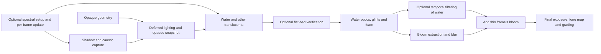

# AuroraShader

AuroraShader pairs azure days, coral sunsets and indigo nights with world-anchored water motion. Select **Shader Pack Settings → Water / Coastal (Medium)** to see currents, wakes, local foam and sun/moon glints. **Water → Water Body** offers freshwater, glacial turquoise, amber woodland streams, blue open sea and a smooth automatic camera-biome selection. Use **Water / Caustics (Ultra)** for illuminated beds, planar refraction, persistent foam and dual-cascade spectral normals on supported hardware.

[Four water bodies at three depths](docs/validation/WATER_MATERIALS_views.png) · [中文画质与水色指南](docs/WATER_MATERIALS_AND_PRESETS.zh-CN.md) · [水管线、缓冲与观察视角](docs/WATER_PIPELINE.zh-CN.md) · [夜光浪花](docs/WATER_NIGHT_SURF.zh-CN.md) · [双尺度频谱波](docs/WATER_M6_SPECTRAL_NORMALS.zh-CN.md) · [水面时域稳定](docs/WATER_K_TEMPORAL.zh-CN.md) · [Optical transport](docs/WATER_M1_OPTICS.md) · [Reflections](docs/WATER_M2_REFLECTION_STABILITY.md)

Open **Shader Pack Settings → Advanced → Debug View** for the water mask (7),
filtered view-space normal (8), and distance to the recorded background (9).
The depth display maps 0–16 modeled metres to black–white. Magenta marks a
water sample with no usable background. A metre corresponds to one world block.
In a pool with one visible bottom this view helps diagnose water path estimates.
[Three debug views on a synthetic pool](docs/validation/WATER_M0_views.png) ·
[Native GPU results, including window scaling](docs/validation/WATER_M0_GPU_final.json).

For repeated in-game comparisons, the [water test lab](tests/water_lab/README.md)
provides a separate dimension and fixed camera positions for Java 1.21.11.
Use its [中文场景说明](tests/water_lab/README.zh-CN.md) to compare the same pool,
waterfall and translucent edges at different depths, times and weather conditions.

[水体架构与实现顺序](docs/WATER_ARCHITECTURE.zh-CN.md) ·
[Water architecture and milestones](docs/WATER_ARCHITECTURE.md) ·
[中文路线图](docs/AURORA_ROADMAP.zh-CN.md) ·
[中文水体专项路线](docs/WATER_ROADMAP.zh-CN.md) ·
[波纹过滤原理](docs/WATER_02_FILTERED_WAVES.zh-CN.md) ·
[场景反射原理](docs/WATER_03_SCREEN_REFLECTIONS.zh-CN.md) ·
[English roadmap](docs/AURORA_ROADMAP.md)

## Current features

| System | Implemented scope |
|---|---|
| Lighting and shadows | Deferred directional light; ambient/block-light protection; hard, 3x3, 5x5 or eight-tap Poisson shadows; constant or angle-aware bias |
| Sky and light color | Continuous azure/coral/indigo palette; warm angular sun glow and cool phase-aware moon glow in the background |
| Scene color | Linear HDR scene storage, exposure once, highlight shoulder, sRGB display conversion and configurable grading |
| Fog and clouds | Height/distance atmosphere, compatible late-source fog and native-cloud color; original cloud geometry retained |
| Bloom | Four-pass half-resolution bright-pixel extraction, separable blur and recombination |
| Aurora | Bounded procedural teal/violet sky ribbons at night, with weather/vision fallbacks |
| Surface motion | World-anchored filtered waves, slope-driven flow and waterfall normals. Rain and recent player/vehicle contacts disturb the water. Optional compute simulates two spectral bands. Horizontal compression seeds crest foam, and unresolved slope energy widens distant glints. [Spectral foam details](docs/WATER_SPECTRAL_FOAM.zh-CN.md) |
| Optical transport | Per-metre absorption and scattering, optional camera-biome blending, verified planar refraction and visible underwater exit surfaces with Snell transmission or total internal reflection |
| Reflections and lighting | Sky fallback, bounded screen-space ray traversal, roughness-aware sun/moon glints and optional shadow-space focusing on directly lit beds |
| Foam and temporal stability | Shore and wave evidence, optional foam history, blue-green night surf and optional water-only history rejection before bloom |
| Foliage | Eleven vanilla leaf types, short grass and joined tall grass; shared terrain/shadow wind with fixed grass roots |
| Settings | English/Simplified Chinese, grouped pages, seven quality profiles and dedicated water diagnostics |

Use the Coastal preset for everyday water and the High preset for reflected visible banks. Confirmed screen hits can contribute in caves. A known roof blocks the sky fallback. Occluded and off-screen geometry limit what a screen ray can recover. The optical surface uses the Minecraft mesh as its geometric boundary, so the water depth and shoreline keep their block geometry.

Refraction checks the water layer and the opaque receiver along the displaced ray. Flat, continuously observed beds can use an analytic Snell intersection. Ambiguous edges use a conservative fallback. The spectral update, reflection, refraction and temporal passes have separate measurements on Intel Iris Xe. [Water pass layout and costs](docs/WATER_PIPELINE.zh-CN.md) · [Three-angle wave comparison](docs/validation/WATER_FFT_views.png) · [Off-screen visibility test](docs/validation/offscreen/OFFSCREEN_COVERAGE.md)

## Settings and quality profiles

Use Iris's Shader Pack Settings. Minecraft's Simplified Chinese language selects
`zh_cn.lang`; English remains available. Pages group sky/light, shadows, water,
clouds, aurora, bloom, fog, foliage, grading and advanced/debug controls.

In Shader Pack Settings, choose **Water / Coastal (Medium)** for moving water, rain and contact ripples, local foam and sun/moon glints. The first three profiles retain the historical rendering choices.

| Profile | Water appearance |
|---|---|
| Balanced / Light / Soft Shadows | Original balanced, lighter or softer-shadow rendering |
| Water / Low | Simpler world-anchored waves and sky reflections |
| Water / Coastal (Medium) | Absorption, scattering, currents, rain and wake normals, local foam and glints |
| Water / Reflections (High) | Coastal plus screen-space scene reflections and underwater Snell windows at observed exit surfaces |
| Water / Caustics (Ultra) | High plus shadow-space caustics, persistent foam, planar refraction and spectral waves on supported hardware |

Profiles leave water color, clarity, wave strength and grading available for art direction. Refraction can be selected separately under Water → Reflection and Refraction. Presets set the main optical features. The temporal filter and night surf remain independent choices. Optical profiles select the HDR beauty view. The default shader settings match Balanced.

The filters use 1/9/25 logical shadow comparisons respectively. The existing
2048 shadow map and 64-block shadow distance remain fixed. Bloom-off retains four
passes and half-resolution buffers. No FPS improvement or universal quality ranking
has been measured.

Advanced debug: 0 scene, 1 view normals, 2 block/sky levels, 3 directional term,
4 shadow depth, 5 filtered visibility, 6 receiver bias, 7 water mask, 8 water normal,
9 water-to-background distance. Debug bypasses artistic
post-processing; black can indicate an unrecorded surface.

## Color flow and buffers

The water features enter the frame in this order.



Sky, clouds and water retain their category-specific paths. Some geometry arrives
outside the main opaque/deferred sequence; stage notes record those limits.
Original baked face shading and lightmap influence remain in the source.

| Buffer | Format and purpose |
|---|---|
| `colortex0` | RGBA16F linear scene; RGBA8 in the explicit legacy pipeline |
| `colortex1` | Normalized RGBA16: encoded view normal and validity |
| `colortex2` | Normalized RG16: independent block/sky light levels |
| `colortex3`, `colortex4` | Half-resolution RGBA16F bloom intermediates |
| `colortex5` | Full-resolution RGBA16F: pre-camera-fog lit linear RGB, alpha as snapshot validity |
| `colortex6` | Full-resolution R32F: matching `depthtex1` value; invalid samples use 1 |
| `colortex7`, `colortex8` | Full-resolution water surface normal and raw depth, layer ownership, lighting and observed exit marker |
| `colortex9` | R16F direct-light share at the opaque receiver |
| `colortex10`, `colortex11` | Optional conservative reflection depths and flat-bed refraction bounds, each at one eighth width and height |
| `colortex12` | Optional full-resolution temporal RGB and signed raw depth, RGBA32F |
| `colortex13`, `colortex14` | Optional persistent foam and reprojection metadata |
| `colortex15` | Optional 16 × 2 contact history |
| `shadowcolor0` | Packed water-surface normal and source depth for shadow-space caustics |
| Iris depth snapshots | Existing reconstruction inputs; snapshot checks pre-hand `depthtex2` to reject nearer hand depth |

Opaque snapshots contain pre-fog radiance, matched depth and a direct-light share. Layer ownership keeps the optical solve from replacing ambiguous transparent mixtures. Current water effects operate in linear HDR. The final pass applies exposure and display encoding once. [Water data, dimensions and lifetime](docs/WATER_PIPELINE.zh-CN.md)

## Project location and Iris testing

Active worktree: **`D:/MinecraftShaders/MyShader-pcf-kernels`**.
Shared Git repository: `D:/MinecraftShaders/MyShader`. Historical projects and
branches are retained; automated development does not merge into main.

The existing `C:/Users/Wang/AppData/Roaming.minecraft/shaderpacks/MyShader` junction
still points to the separate original `D:/MinecraftShaders/MyShader` worktree.
It does not load this checkout. These milestones change no junction or Minecraft
profile. The proposed separate D: test instance has not been created.

An Iris pack exposes `shaders` at its root. Use this actual development pack in a
separate D: test profile for integration checks;
[test-profile notes](docs/MILESTONE_6_BENCHMARK.md) describe the setup.
Selecting the old `MyShader` entry does not test this branch.

The graphics programs use GLSL 3.30 compatibility. Optional spectral compute uses GLSL 4.30 with Iris custom images. Recent contracts were
inspected at Iris commit `99d855970316329f2e0e42ac2b79ef763cb77cc3`
(Iris 1.10.5 / Minecraft 1.21.11 source). Local vanilla 1.21.11 assets were read
to check leaf IDs and grass model roots. The installed Iris parser and native Intel driver were exercised independently. Runtime observations for this cumulative water branch are still pending. Other GPUs, mod versions, resource packs and dimensions need
their own integration observations.

## Validation and limits

Run from this D: checkout:

```powershell
python -B tools/validate.py --historical
python -B tools/compile_glsl.py --compiler C:/VulkanSDK/1.4.363.0/Bin/glslangValidator.exe
python -B tools/compile_glsl.py --profiles-only --compiler C:/VulkanSDK/1.4.363.0/Bin/glslangValidator.exe
python -B tools/validate_gpu.py --cxx C:/msys64/ucrt64/bin/g++.exe --suite screen-reflections
python -B tools/validate_gpu.py --cxx C:/msys64/ucrt64/bin/g++.exe --suite water-debug
python -B tools/validate_gpu.py --cxx C:/msys64/ucrt64/bin/g++.exe --suite water-transport
python -B tools/benchmark_water.py --cxx C:/msys64/ucrt64/bin/g++.exe
git diff --check
```

The first command compares the live rendering paths with the previous water release
and checks the current pass routing, menus and test world. Its optional historical
replay runs the original numerical suite on its pinned Git tree. The second
command compiles the actual checkout with an installed offline compiler. The optional Windows native tool
builds a hidden OpenGL harness with installed MinGW. It never downloads dependencies
or launches Minecraft. Generated inputs, binaries and compiler temporary files
stay on the project drive and are removed after the run.

To exercise the installed Iris GLSL and properties preprocessors without opening a
world, run `python -B tools/validate_iris_water.py --iris-jar PATH --slf4j-jar PATH`
with the local Iris 1.10.5 mod and SLF4J API jars and JDK 21 on PATH.

Run `python -B tools/validate_gpu.py --help` for the current suite list. Focused checks include `water-refraction`, `water-caustics`, `water-temporal`, `water-underwater`, `water-materials`, `water-surf-glow` and the capability-specific `water-fft`.
Use `--report docs/validation/NEW_NAME.json` to retain a new result; existing
reports are never overwritten. Synthetic rendering covers bloom, water normals,
final color, water-depth color, foliage math and celestial glow. Foliage wrappers exercise the
shared displacement and clip functions, without native chunk attributes or
geometry/shadow rasterization. Celestial checks also execute the actual sky pair
with synthetic stage identifiers; this checks source branching without Iris's
actual enum injection or sky meshes. Snapshot checks use simultaneous mixed-format
render targets and compare the actual deferred output against pinned M19 source.
They do not execute Iris's buffer flipping. Filtered-wave checks execute actual
screen derivatives across synthetic fields and compare original/off/zero actual
water-fragment output with W1. The tool does not run Iris's patcher or reproduce
Minecraft's resource binding, draw scheduling or world rendering.

User-confirmed Minecraft evidence is retained in [M3A](docs/MILESTONE_3A.md) and
[M3B](docs/MILESTONE_3B.md). Newer CPU/offline and native Intel Iris Xe results are
recorded in [M15](docs/MILESTONE_15.md) and [M16](docs/MILESTONE_16.md).
[M17](docs/MILESTONE_17.md) records settings checks;
[M18](docs/MILESTONE_18.md) records foliage evidence;
[M19](docs/MILESTONE_19.md) records celestial-glow evidence;
[W1](docs/WATER_01_SNAPSHOT.md) records water-snapshot evidence and limits. Synthetic GPU success
does not establish that the latest branch passed Minecraft testing. Tool duration
is not a GPU-performance benchmark.

## Learning notes and source map

| Topic | Notes |
|---|---|
| Historical deferred lighting | [M2 preserved README](docs/MILESTONE_2.md) |
| Shadow mapping and filtering | [M3A](docs/MILESTONE_3A.md), [M3B](docs/MILESTONE_3B.md), [M4](docs/MILESTONE_4.md), [M5](docs/MILESTONE_5.md) |
| Receiver bias | [M6](docs/MILESTONE_6.md) / [中文](docs/MILESTONE_6.zh-CN.md) |
| Fantasy palette | [M7](docs/MILESTONE_7.md) / [中文](docs/MILESTONE_7.zh-CN.md) |
| Linear light and HDR | [M8](docs/MILESTONE_8.md) / [中文](docs/MILESTONE_8.zh-CN.md) |
| Atmosphere | [M9](docs/MILESTONE_9.md) / [中文](docs/MILESTONE_9.zh-CN.md) |
| Bloom | [M10](docs/MILESTONE_10.md) / [中文](docs/MILESTONE_10.zh-CN.md) |
| Aurora | [M11](docs/MILESTONE_11.md) / [中文](docs/MILESTONE_11.zh-CN.md) |
| Native clouds | [M12](docs/MILESTONE_12.md) / [中文](docs/MILESTONE_12.zh-CN.md) |
| Water color and reflection | [M13](docs/MILESTONE_13.md) / [中文](docs/MILESTONE_13.zh-CN.md) |
| Wave normals | [M14](docs/MILESTONE_14.md) / [中文](docs/MILESTONE_14.zh-CN.md) |
| Native GPU checks | [M15](docs/MILESTONE_15.md) / [中文](docs/MILESTONE_15.zh-CN.md) |
| Water depth color | [M16](docs/MILESTONE_16.md) / [中文](docs/MILESTONE_16.zh-CN.md) |
| Settings and profiles | [M17](docs/MILESTONE_17.md) / [中文](docs/MILESTONE_17.zh-CN.md) |
| Foliage and shared shadow motion | [M18](docs/MILESTONE_18.md) / [中文](docs/MILESTONE_18.zh-CN.md) |
| Angular sun/moon glow | [M19](docs/MILESTONE_19.md) / [中文](docs/MILESTONE_19.zh-CN.md) |
| Water specialization and all-view criteria | [Water roadmap](docs/WATER_ROADMAP.md) / [中文](docs/WATER_ROADMAP.zh-CN.md) |
| Optical water transport | [M1 optics](docs/WATER_M1_OPTICS.md) / [中文](docs/WATER_M1_OPTICS.zh-CN.md) |
| Matched scene/depth capture | [W1](docs/WATER_01_SNAPSHOT.md) / [中文](docs/WATER_01_SNAPSHOT.zh-CN.md) |

`shaders/` contains 25 program pairs and configuration. Shared code/settings live
in `shaders/lib/`, native geometry helpers in `shaders/lib/geometry/`, translations
in `shaders/lang/`, optional validation tools in `tools/`, and learning notes and
retained evidence in `docs/`.

Base-330 by Balint supplied the original geometry foundation:
[upstream Base-330](https://github.com/shaderLABS/Base-330).
Its [Unlicense](LICENSE) is retained. Iris references accompany the relevant
equations and interface contracts in the learning notes.

[Validated planar refraction](docs/WATER_M3_PLANAR.md) · [水面折射与三视角对照](docs/WATER_M3_PLANAR.zh-CN.md)

[Animated currents and water contact](docs/WATER_CURRENTS.md) · [河流、瀑布和涉水涟漪](docs/WATER_CURRENTS.zh-CN.md)

[Foam, sun and moon glints](docs/WATER_M5_FOAM.md) · [岸边泡沫与日月高光](docs/WATER_M5_FOAM.zh-CN.md)

[Water-bed caustics, settings and optical model](docs/WATER_M4_CAUSTICS.md) · [中文水底焦散图解](docs/WATER_M4_CAUSTICS.zh-CN.md) · [Driver comparison](docs/validation/WATER_CAUSTIC_WAVES_views.png)

[Underwater transmission and total internal reflection](docs/WATER_M3B_UNDERWATER.md) · [水下斯涅尔视窗与出水边界](docs/WATER_M3B_UNDERWATER.zh-CN.md)
