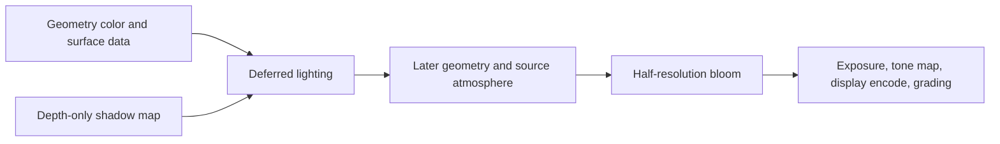

# AuroraShader

AuroraShader is an Iris shader pack developing a rich fantasy style: azure days,
coral/gold sunsets, indigo nights and teal/violet aurora. It combines Minecraft's
textures and lightmaps with directional lighting, shadows, atmosphere and gentle
water effects. The aim is a coherent, playable pack with its own identity.

**Current development: M17 — Chinese settings and quality profiles**
on `codex/milestone-17-settings-profiles`, based on M16 commit `581ffa8`.
M17 organizes all 51 options, adds Simplified Chinese labels and offers three
quality presets. GLSL source and shader defaults are unchanged from M16.

[中文路线图](docs/AURORA_ROADMAP.zh-CN.md) ·
[中文设置与预设说明](docs/MILESTONE_17.zh-CN.md) ·
[English roadmap](docs/AURORA_ROADMAP.md)

## Current features

| System | Implemented scope |
|---|---|
| Lighting and shadows | Deferred directional light; ambient/block-light protection; hard, 3x3, 5x5 or eight-tap Poisson shadows; constant or angle-aware bias |
| Sky and light color | Continuous azure/coral/indigo palette with sun direction, time, weather and environment gates |
| Scene color | Linear HDR scene storage, exposure once, highlight shoulder, sRGB display conversion and configurable grading |
| Fog and clouds | Height/distance atmosphere, compatible late-source fog and native-cloud color; original cloud geometry retained |
| Bloom | Four-pass half-resolution bright-pixel extraction, separable blur and recombination |
| Aurora | Bounded procedural teal/violet sky ribbons at night, with weather/vision fallbacks |
| Water | Fluid classification, gentle tint, analytic sky-color reflection, world-anchored wave normals and luminance-preserving background-depth color |
| Settings | English/Simplified Chinese, grouped pages, three quality profiles and seven debug views |

Water reflection uses an analytic sky palette. Waves change reflection normals;
they do not move the mesh or shoreline. Depth color uses a background height gap,
not measured water-volume thickness. Native water alpha is retained.
There is no SSR, physical water transmission/refraction, PBR, SSAO, volumetric
lighting or custom volumetric cloud geometry in this stage.

## Settings and quality profiles

Use Iris's Shader Pack Settings. Minecraft's Simplified Chinese language selects
`zh_cn.lang`; English remains available. Pages group sky/light, shadows, water,
clouds, aurora, bloom, fog, grading and advanced/debug controls.

| Profile | Shadows | Bloom / aurora / water waves / depth color |
|---|---|---|
| Balanced / 均衡（默认） | 3x3 PCF | Enabled |
| Light / 轻量 | Hard | Disabled |
| Soft Shadows / 柔和阴影 | 5x5 PCF | Enabled |

Profiles change exactly six settings: shadow enable/filter and the four feature
switches above. All three enable shadows. Exposure, grading, artistic strengths,
fog, debug and pipeline choices remain as you set them. Adding profiles does not
overwrite saved settings; the six source defaults match Balanced.
Iris matches only the listed controls. A manual edit can match another profile or
Custom. Legacy/debug/environment gates can independently hide an effect.

The filters use 1/9/25 logical shadow comparisons respectively. The existing
2048 shadow map and 64-block shadow distance remain fixed. Bloom-off retains four
passes and half-resolution buffers. No FPS improvement or universal quality ranking
has been measured.

Advanced debug: 0 scene, 1 view normals, 2 block/sky levels, 3 directional term,
4 shadow depth, 5 filtered visibility, 6 receiver bias. Debug bypasses artistic
post-processing; black can indicate an unrecorded surface.

## Color flow and buffers

This is a color-flow sketch, not Iris's complete draw schedule:



Sky, clouds and water retain their category-specific paths. Some geometry arrives
outside the main opaque/deferred sequence; stage notes record those limits.
Original baked face shading and lightmap influence remain in the source.

| Buffer | Format and purpose |
|---|---|
| `colortex0` | RGBA16F linear scene; RGBA8 in the explicit legacy pipeline |
| `colortex1` | Normalized RGBA16: encoded view normal and validity |
| `colortex2` | Normalized RG16: independent block/sky light levels |
| `colortex3`, `colortex4` | Half-resolution RGBA16F bloom intermediates |
| Iris depth snapshots | Existing reconstruction inputs; water color uses pre-hand `depthtex2` |

Exposure and display encoding run once in normal final output. Data buffers are
not gamma-converted. Water effects preserve alpha, geometry and foreground-fog
composition; see the notes for exact fallback contracts.

## Project location and Iris testing

Active worktree: **`D:/MinecraftShaders/MyShader-pcf-kernels`**.
Shared Git repository: `D:/MinecraftShaders/MyShader`. Historical projects and
branches are retained; automated development does not merge into main.

The existing `C:/Users/Wang/AppData/Roaming.minecraft/shaderpacks/MyShader` junction
still points to the separate original `D:/MinecraftShaders/MyShader` worktree.
It does not load this checkout. These milestones change no junction or Minecraft
profile. The proposed separate D: test instance has not been created.

An Iris pack exposes `shaders` at its root. Use this actual development pack in a
separate D: test profile for integration checks;
[test-profile notes](docs/MILESTONE_6_BENCHMARK.md) describe the setup.
Selecting the old `MyShader` entry does not test this branch.

The pack supplies GLSL 3.30 compatibility input to Iris. Recent contracts were
inspected at Iris commit `99d855970316329f2e0e42ac2b79ef763cb77cc3`
(Iris 1.10.5 / Minecraft 1.21.11 source); the installed game version has not been
freshly verified. Other GPUs, mod versions, resource packs and dimensions need
their own integration observations.

## Validation and limits

Run from this D: checkout:

```powershell
python -B tools/validate.py
python -B tools/compile_glsl.py --compiler C:/VulkanSDK/1.4.363.0/Bin/glslangValidator.exe
python -B tools/compile_glsl.py --profiles-only --compiler C:/VulkanSDK/1.4.363.0/Bin/glslangValidator.exe
python -B tools/validate_gpu.py --cxx C:/msys64/ucrt64/bin/g++.exe --suite profiles
git diff --check
```

The first tool checks source contracts and independent numerical invariants;
the second uses an installed offline compiler. The optional Windows native tool
builds a hidden OpenGL harness with installed MinGW. It never downloads dependencies
or launches Minecraft. Generated inputs, binaries and compiler temporary files
stay on the project drive and are removed after the run.

Native suites: `probe`, `compile`, `profiles`, `render`, `depth`, or default `all`.
Use `--report docs/validation/NEW_NAME.json` to retain a new result; existing
reports are never overwritten. Synthetic rendering covers bloom, water normals,
final color and water-depth color. It does not run Iris's patcher or reproduce
Minecraft's resource binding, draw scheduling or world rendering.

User-confirmed Minecraft evidence is retained in [M3A](docs/MILESTONE_3A.md) and
[M3B](docs/MILESTONE_3B.md). Newer CPU/offline and native Intel Iris Xe results are
recorded in [M15](docs/MILESTONE_15.md) and [M16](docs/MILESTONE_16.md).
[M17](docs/MILESTONE_17.md) records this stage's checks. Synthetic GPU success
does not establish that the latest branch passed Minecraft testing. Tool duration
is not a GPU-performance benchmark.

## Learning notes and source map

| Topic | Notes |
|---|---|
| Historical deferred lighting | [M2 preserved README](docs/MILESTONE_2.md) |
| Shadow mapping and filtering | [M3A](docs/MILESTONE_3A.md), [M3B](docs/MILESTONE_3B.md), [M4](docs/MILESTONE_4.md), [M5](docs/MILESTONE_5.md) |
| Receiver bias | [M6](docs/MILESTONE_6.md) / [中文](docs/MILESTONE_6.zh-CN.md) |
| Fantasy palette | [M7](docs/MILESTONE_7.md) / [中文](docs/MILESTONE_7.zh-CN.md) |
| Linear light and HDR | [M8](docs/MILESTONE_8.md) / [中文](docs/MILESTONE_8.zh-CN.md) |
| Atmosphere | [M9](docs/MILESTONE_9.md) / [中文](docs/MILESTONE_9.zh-CN.md) |
| Bloom | [M10](docs/MILESTONE_10.md) / [中文](docs/MILESTONE_10.zh-CN.md) |
| Aurora | [M11](docs/MILESTONE_11.md) / [中文](docs/MILESTONE_11.zh-CN.md) |
| Native clouds | [M12](docs/MILESTONE_12.md) / [中文](docs/MILESTONE_12.zh-CN.md) |
| Water color and reflection | [M13](docs/MILESTONE_13.md) / [中文](docs/MILESTONE_13.zh-CN.md) |
| Wave normals | [M14](docs/MILESTONE_14.md) / [中文](docs/MILESTONE_14.zh-CN.md) |
| Native GPU checks | [M15](docs/MILESTONE_15.md) / [中文](docs/MILESTONE_15.zh-CN.md) |
| Water depth color | [M16](docs/MILESTONE_16.md) / [中文](docs/MILESTONE_16.zh-CN.md) |
| Settings and profiles | [M17](docs/MILESTONE_17.md) / [中文](docs/MILESTONE_17.zh-CN.md) |

`shaders/` contains 24 program pairs and configuration. Shared code/settings live
in `shaders/lib/`, native geometry helpers in `shaders/lib/geometry/`, translations
in `shaders/lang/`, optional validation tools in `tools/`, and learning notes and
retained evidence in `docs/`.

Base-330 by Balint supplied the original geometry foundation:
[upstream Base-330](https://github.com/shaderLABS/Base-330).
Its [Unlicense](LICENSE) is retained. Iris references accompany the relevant
equations and interface contracts in the learning notes.
