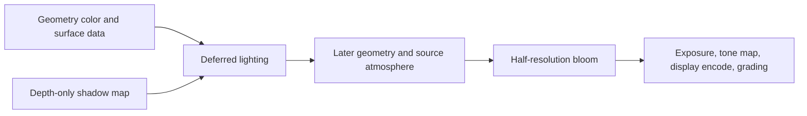

# AuroraShader

AuroraShader is an Iris shader pack developing a rich fantasy style: azure days,
coral/gold sunsets, indigo nights and teal/violet aurora. It combines Minecraft's
textures and lightmaps with directional lighting, shadows, atmosphere and gentle
water effects. The aim is a coherent, playable pack with its own identity.

**Current priority: convincing, beautiful water from every view.**
Open **Shader Pack Settings → Water → Water Optical Transport** to enable depth-dependent
absorption and scattering. **Water Clarity** adjusts how far the bottom remains visible.
This optional HDR pass operates above a single water surface with a known solid bed.
It uses separate light-to-bed and bed-to-eye travel distances, attenuates reflected
air paths, and preserves scene alpha. Its confidence checks keep the existing
appearance around overlapping translucent geometry. Default **Off** retains the W3 water.
[Water optics and validation](docs/WATER_M1_OPTICS.md) · [中文原理与证据](docs/WATER_M1_OPTICS.zh-CN.md).

Water M0 on `codex/water-04a-optics-foundation` builds on the
[W3 scene reflection](https://github.com/GloryKazimierz/AuroraShader/commit/df94fe404146c1364920f709569898359c84c8ed).
Open **Shader Pack Settings → Advanced → Debug View** for the water mask (7),
filtered view-space normal (8), and distance to the recorded background (9).
The depth display maps 0–16 modeled metres to black–white. Magenta marks a
water sample with no usable background. A metre corresponds to one world block.
In a pool with one visible bottom this view helps diagnose water path estimates.
[Three debug views on a synthetic pool](docs/validation/WATER_M0_views.png) ·
[Native GPU results, including window scaling](docs/validation/WATER_M0_GPU_final.json).

For repeated in-game comparisons, the [water test lab](tests/water_lab/README.md)
provides a separate dimension and fixed camera positions for Java 1.21.11.
Use its [中文场景说明](tests/water_lab/README.zh-CN.md) to compare the same pool,
waterfall and translucent edges at different depths, times and weather conditions.

[水体架构与实现顺序](docs/WATER_ARCHITECTURE.zh-CN.md) ·
[Water architecture and milestones](docs/WATER_ARCHITECTURE.md) ·
[中文路线图](docs/AURORA_ROADMAP.zh-CN.md) ·
[中文水体专项路线](docs/WATER_ROADMAP.zh-CN.md) ·
[波纹过滤原理](docs/WATER_02_FILTERED_WAVES.zh-CN.md) ·
[场景反射原理](docs/WATER_03_SCREEN_REFLECTIONS.zh-CN.md) ·
[English roadmap](docs/AURORA_ROADMAP.md)

## Current features

| System | Implemented scope |
|---|---|
| Lighting and shadows | Deferred directional light; ambient/block-light protection; hard, 3x3, 5x5 or eight-tap Poisson shadows; constant or angle-aware bias |
| Sky and light color | Continuous azure/coral/indigo palette; warm angular sun glow and cool phase-aware moon glow in the background |
| Scene color | Linear HDR scene storage, exposure once, highlight shoulder, sRGB display conversion and configurable grading |
| Fog and clouds | Height/distance atmosphere, compatible late-source fog and native-cloud color; original cloud geometry retained |
| Bloom | Four-pass half-resolution bright-pixel extraction, separable blur and recombination |
| Aurora | Bounded procedural teal/violet sky ribbons at night, with weather/vision fallbacks |
| Water | Fluid classification, gentle tint, analytic sky-color reflection, world-anchored, pixel-filtered multiscale wave normals and luminance-preserving background-depth color |
| Water optical transport | Optional in linear HDR. Two water travel segments, source-limited scattering, three clarity settings and validated transparent-layer ownership |
| Water scene reflection | Matched eligible opaque color/depth snapshot, bounded 64/128-cell screen traversal, unknown-occluder guard and confidence-weighted fallback |
| Foliage | Eleven vanilla leaf types, short grass and joined tall grass; shared terrain/shadow wind with fixed grass roots |
| Settings | English/Simplified Chinese, grouped pages, three quality profiles and ten view selections (scene plus nine diagnostics) |

The default W3 water reflection can replace its analytic sky fallback with a valid recorded scene
hit. Local scene reflection works independently of sky-style/blend and local sky
light; the existing dimension, fluid and upward-face scope remains. Waves change
reflection normals; they do not move the mesh or shoreline. Water Surface Detail 1 (default) uses six
filtered waves; 0 restores the original three-wave normal path exactly. Filtering
does not yet convert unresolved waves into reflection roughness or eliminate
nonlinear highlight aliasing. Depth color uses a background height gap, not measured
water-volume thickness. Native water alpha is retained.
Sun/moon glow adds bounded light to the sky background. It fades with horizon,
weather and vision conditions; it is not physical scattering or terrain illumination.
Screen-space tracing has no hidden or off-screen geometry. Its finite depth
tolerance is an approximation; it is not hardware RTX or path tracing. Reflected
water-to-hit atmospheric attenuation is added by the optional M1 optical pass; in W3, existing camera-to-water
fog is applied once. The analytic fallback still omits actual aurora, discs and
cloud shapes. Stepped refraction, PBR, SSAO, volumetric lighting
and custom volumetric cloud geometry remain planned.

## Settings and quality profiles

Use Iris's Shader Pack Settings. Minecraft's Simplified Chinese language selects
`zh_cn.lang`; English remains available. Pages group sky/light, shadows, water,
clouds, aurora, bloom, fog, foliage, grading and advanced/debug controls.

| Profile | Shadows | Bloom / aurora / water waves / depth color / foliage wind |
|---|---|---|
| Balanced / 均衡（默认） | 3x3 PCF | Enabled |
| Light / 轻量 | Hard | Disabled |
| Soft Shadows / 柔和阴影 | 5x5 PCF | Enabled |

Profiles change exactly seven settings: shadow enable/filter and the five feature
switches above. All three enable shadows. Exposure, grading, artistic strengths,
fog, celestial-glow controls, water scene-reflection controls, debug and pipeline
choices remain as you set them. Light does not automatically disable the new SSR
control; performance tiers for tracing require measurements.
Adding profiles does not
overwrite saved settings; the seven source defaults match Balanced.
Iris matches only the listed controls. A manual edit can match another profile or
Custom. Legacy/debug/environment gates can independently hide an effect.

The filters use 1/9/25 logical shadow comparisons respectively. The existing
2048 shadow map and 64-block shadow distance remain fixed. Bloom-off retains four
passes and half-resolution buffers. No FPS improvement or universal quality ranking
has been measured.

Advanced debug: 0 scene, 1 view normals, 2 block/sky levels, 3 directional term,
4 shadow depth, 5 filtered visibility, 6 receiver bias, 7 water mask, 8 water normal,
9 water-to-background distance. Debug bypasses artistic
post-processing; black can indicate an unrecorded surface.

## Color flow and buffers

This is a color-flow sketch, not Iris's complete draw schedule:



Sky, clouds and water retain their category-specific paths. Some geometry arrives
outside the main opaque/deferred sequence; stage notes record those limits.
Original baked face shading and lightmap influence remain in the source.

| Buffer | Format and purpose |
|---|---|
| `colortex0` | RGBA16F linear scene; RGBA8 in the explicit legacy pipeline |
| `colortex1` | Normalized RGBA16: encoded view normal and validity |
| `colortex2` | Normalized RG16: independent block/sky light levels |
| `colortex3`, `colortex4` | Half-resolution RGBA16F bloom intermediates |
| `colortex5` | Full-resolution RGBA16F: pre-camera-fog lit linear RGB, alpha as snapshot validity |
| `colortex6` | Full-resolution R32F: matching `depthtex1` value; invalid samples use 1 |
| Iris depth snapshots | Existing reconstruction inputs; snapshot checks pre-hand `depthtex2` to reject nearer hand depth |

The new snapshot is written with deferred lighting and remains unchanged during
later geometry. Sky, unqualified data, hand-nearer pixels and invalid values become
explicit misses; it contains neither all transparent layers nor hidden/off-screen
geometry. The water consumer reads only buffers 5/6 for hits; raw pre-translucent
depth is an additional occlusion guard for unrecorded foreground surfaces. The two new double-buffered attachments have a nominal cost of about
47.46 MiB at 1920x1080; this is an allocation estimate, not measured frame time.

Exposure and display encoding run once in normal final output. Data buffers are
not gamma-converted. Water effects preserve alpha, geometry and foreground-fog
composition; see the notes for exact fallback contracts.

## Project location and Iris testing

Active worktree: **`D:/MinecraftShaders/MyShader-pcf-kernels`**.
Shared Git repository: `D:/MinecraftShaders/MyShader`. Historical projects and
branches are retained; automated development does not merge into main.

The existing `C:/Users/Wang/AppData/Roaming.minecraft/shaderpacks/MyShader` junction
still points to the separate original `D:/MinecraftShaders/MyShader` worktree.
It does not load this checkout. These milestones change no junction or Minecraft
profile. The proposed separate D: test instance has not been created.

An Iris pack exposes `shaders` at its root. Use this actual development pack in a
separate D: test profile for integration checks;
[test-profile notes](docs/MILESTONE_6_BENCHMARK.md) describe the setup.
Selecting the old `MyShader` entry does not test this branch.

The pack supplies GLSL 3.30 compatibility input to Iris. Recent contracts were
inspected at Iris commit `99d855970316329f2e0e42ac2b79ef763cb77cc3`
(Iris 1.10.5 / Minecraft 1.21.11 source). Local vanilla 1.21.11 assets were read
to check leaf IDs and grass model roots; the active game/Iris installation has
not been run or verified. Other GPUs, mod versions, resource packs and dimensions need
their own integration observations.

## Validation and limits

Run from this D: checkout:

```powershell
python -B tools/validate.py --historical
python -B tools/compile_glsl.py --compiler C:/VulkanSDK/1.4.363.0/Bin/glslangValidator.exe
python -B tools/compile_glsl.py --profiles-only --compiler C:/VulkanSDK/1.4.363.0/Bin/glslangValidator.exe
python -B tools/validate_gpu.py --cxx C:/msys64/ucrt64/bin/g++.exe --suite screen-reflections
python -B tools/validate_gpu.py --cxx C:/msys64/ucrt64/bin/g++.exe --suite water-debug
python -B tools/validate_gpu.py --cxx C:/msys64/ucrt64/bin/g++.exe --suite water-transport
python -B tools/benchmark_water.py --cxx C:/msys64/ucrt64/bin/g++.exe
git diff --check
```

The first command compares the live rendering paths with the previous water release
and checks the current pass routing, menus and test world. Its optional historical
replay runs the original numerical suite on its pinned Git tree. The second
command compiles the actual checkout with an installed offline compiler. The optional Windows native tool
builds a hidden OpenGL harness with installed MinGW. It never downloads dependencies
or launches Minecraft. Generated inputs, binaries and compiler temporary files
stay on the project drive and are removed after the run.

To exercise the installed Iris GLSL and properties preprocessors without opening a
world, run `python -B tools/validate_iris_water.py --iris-jar PATH --slf4j-jar PATH`
with the local Iris 1.10.5 mod and SLF4J API jars and JDK 21 on PATH.

Native suites: `probe`, `compile`, `profiles`, `render`, `depth`, `foliage`,
`celestial`, `snapshot`, `filtered-waves`, `screen-reflections`, `water-debug`, `water-transport`, or default `all`.
Use `--report docs/validation/NEW_NAME.json` to retain a new result; existing
reports are never overwritten. Synthetic rendering covers bloom, water normals,
final color, water-depth color, foliage math and celestial glow. Foliage wrappers exercise the
shared displacement and clip functions, without native chunk attributes or
geometry/shadow rasterization. Celestial checks also execute the actual sky pair
with synthetic stage identifiers; this checks source branching without Iris's
actual enum injection or sky meshes. Snapshot checks use simultaneous mixed-format
render targets and compare the actual deferred output against pinned M19 source.
They do not execute Iris's buffer flipping. Filtered-wave checks execute actual
screen derivatives across synthetic fields and compare original/off/zero actual
water-fragment output with W1. The tool does not run Iris's patcher or reproduce
Minecraft's resource binding, draw scheduling or world rendering.

User-confirmed Minecraft evidence is retained in [M3A](docs/MILESTONE_3A.md) and
[M3B](docs/MILESTONE_3B.md). Newer CPU/offline and native Intel Iris Xe results are
recorded in [M15](docs/MILESTONE_15.md) and [M16](docs/MILESTONE_16.md).
[M17](docs/MILESTONE_17.md) records settings checks;
[M18](docs/MILESTONE_18.md) records foliage evidence;
[M19](docs/MILESTONE_19.md) records celestial-glow evidence;
[W1](docs/WATER_01_SNAPSHOT.md) records water-snapshot evidence and limits. Synthetic GPU success
does not establish that the latest branch passed Minecraft testing. Tool duration
is not a GPU-performance benchmark.

## Learning notes and source map

| Topic | Notes |
|---|---|
| Historical deferred lighting | [M2 preserved README](docs/MILESTONE_2.md) |
| Shadow mapping and filtering | [M3A](docs/MILESTONE_3A.md), [M3B](docs/MILESTONE_3B.md), [M4](docs/MILESTONE_4.md), [M5](docs/MILESTONE_5.md) |
| Receiver bias | [M6](docs/MILESTONE_6.md) / [中文](docs/MILESTONE_6.zh-CN.md) |
| Fantasy palette | [M7](docs/MILESTONE_7.md) / [中文](docs/MILESTONE_7.zh-CN.md) |
| Linear light and HDR | [M8](docs/MILESTONE_8.md) / [中文](docs/MILESTONE_8.zh-CN.md) |
| Atmosphere | [M9](docs/MILESTONE_9.md) / [中文](docs/MILESTONE_9.zh-CN.md) |
| Bloom | [M10](docs/MILESTONE_10.md) / [中文](docs/MILESTONE_10.zh-CN.md) |
| Aurora | [M11](docs/MILESTONE_11.md) / [中文](docs/MILESTONE_11.zh-CN.md) |
| Native clouds | [M12](docs/MILESTONE_12.md) / [中文](docs/MILESTONE_12.zh-CN.md) |
| Water color and reflection | [M13](docs/MILESTONE_13.md) / [中文](docs/MILESTONE_13.zh-CN.md) |
| Wave normals | [M14](docs/MILESTONE_14.md) / [中文](docs/MILESTONE_14.zh-CN.md) |
| Native GPU checks | [M15](docs/MILESTONE_15.md) / [中文](docs/MILESTONE_15.zh-CN.md) |
| Water depth color | [M16](docs/MILESTONE_16.md) / [中文](docs/MILESTONE_16.zh-CN.md) |
| Settings and profiles | [M17](docs/MILESTONE_17.md) / [中文](docs/MILESTONE_17.zh-CN.md) |
| Foliage and shared shadow motion | [M18](docs/MILESTONE_18.md) / [中文](docs/MILESTONE_18.zh-CN.md) |
| Angular sun/moon glow | [M19](docs/MILESTONE_19.md) / [中文](docs/MILESTONE_19.zh-CN.md) |
| Water specialization and all-view criteria | [Water roadmap](docs/WATER_ROADMAP.md) / [中文](docs/WATER_ROADMAP.zh-CN.md) |
| Optical water transport | [M1 optics](docs/WATER_M1_OPTICS.md) / [中文](docs/WATER_M1_OPTICS.zh-CN.md) |
| Matched scene/depth capture | [W1](docs/WATER_01_SNAPSHOT.md) / [中文](docs/WATER_01_SNAPSHOT.zh-CN.md) |

`shaders/` contains 25 program pairs and configuration. Shared code/settings live
in `shaders/lib/`, native geometry helpers in `shaders/lib/geometry/`, translations
in `shaders/lang/`, optional validation tools in `tools/`, and learning notes and
retained evidence in `docs/`.

Base-330 by Balint supplied the original geometry foundation:
[upstream Base-330](https://github.com/shaderLABS/Base-330).
Its [Unlicense](LICENSE) is retained. Iris references accompany the relevant
equations and interface contracts in the learning notes.
