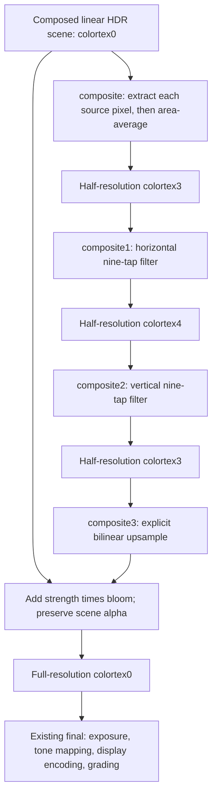

# Milestone 10: Controlled HDR bloom

Date: 2026-11-13. Branch: `codex/milestone-10-bloom`.
Base: M9 commit `3c5a2ab0cd90aff32d5145dce7ea461917d886af`.
[中文学习版](MILESTONE_10.zh-CN.md).

Minecraft/Iris appearance and GPU timing remain **unmeasured**. The defaults are
an initial artistic choice, not a runtime-tuned preset. Record executed checks
separately; the empty observation table below is not a claim of success or a gate
that stops the continuing development goal.

## 1. Visual purpose and limits

M10 spreads a small amount of bright scene color into nearby screen pixels. The
goal is a restrained glow around bright accents that complements Aurora's fantasy
palette without washing out building detail. This builds on M8's linear HDR
storage and runs after M9's scene composition.

The source is **bright pixels**, selected by the largest RGB channel. It is not a
material emission mask: sky, clouds, particles and held items can contribute when
their composed color qualifies. Conversely, an emissive-looking block need not
pass the threshold. There is no new material classification or light emission.

This is an image-space post-process, not physically simulated eye/lens scattering,
world-space illumination or volumetric light. It does not illuminate nearby blocks
or respect depth boundaries while spreading color. Bloom also cannot reconstruct
bright objects that never appear in the rendered scene.

## 2. Four passes before the existing final output



| Program | Reads | Writes | Operation |
|---|---|---|---|
| `composite` | `colortex0`; size of `colortex3` | `colortex3` | Bright extraction and area downsample |
| `composite1` | `colortex3` | `colortex4` | Horizontal blur |
| `composite2` | `colortex4` | `colortex3` | Vertical blur |
| `composite3` | `colortex0`, `colortex3` | `colortex0` | Upsample and add |

Iris runs composite programs after the gbuffers programs. The configured
`size.buffer.colortex3/4 = 0.5 0.5` changes the attachments' actual dimensions;
the first three passes cover those output dimensions. The pack retains Iris's
default buffer flips so later passes read the most recent output, including the
original-scene read and new-scene write in `composite3`.
[Iris composite](https://shaders.properties/current/reference/programs/composite/),
[buffer sizing and flipping](https://shaders.properties/current/reference/shadersproperties/rendering/).

The two scratch attachments are `RGBA16F`; their alpha is always zero. The final
combine preserves the original scene alpha. Exposure, tone mapping, sRGB encoding
and grading remain in the existing `final` program. Bloom is added in linear light
before those operations; it is not added to the already tone-mapped image.

## 3. A soft threshold that preserves RGB ratios

For safe nonnegative scene color `C`, define:

```text
p = max(C.r, C.g, C.b)
t = max(BLOOM_THRESHOLD, 0)
k = t * clamp(BLOOM_SOFT_KNEE, 0, 1)
q = clamp(p - t + k, 0, 2*k)
soft = q*q / (4*k) if k > 0, otherwise 0
amount = max(p-t, 0, soft)
E(C) = C * amount / max(p, 0.000001)
```

One shared scale retains the ratios of finite positive RGB channels. Using the
maximum channel favors vivid saturated highlights compared with a perceptual
luminance test; this is an explicit artistic decision. Black remains black.

The knee is a fraction of the threshold, not an independent brightness value.
With the defaults `t=1` and `k=0.5`, the transition begins at peak 0.5 and joins
the hard-threshold rule at 1.5. A peak of 1 already contributes 0.125, so
“threshold 1” does not mean that every value at/below 1 is excluded. A zero knee
uses the hard rule `max(p-t,0)` without dividing by zero.

The threshold is evaluated before final exposure. Changing exposure changes how
the composed scene is displayed, but does not change which source pixels were
selected for bloom. Threshold and strength therefore control different things:
selection versus how much of the filtered result is added.

## 4. Extract before downsampling

A small bright source can disappear if its neighborhood is averaged first and
that average then falls below the threshold. M10 applies `E(C)` to each source
pixel before averaging it into the half-resolution image.

For example, with a hard threshold of 1, one gray source of value 4 among three
black pixels gives an extracted average of `(3+0+0+0)/4 = 0.75`. Averaging first
would give 1 and then extract zero. This explains the operation order; it is not
a measured Minecraft scene.

Each output pixel maps to a rectangle in the source image:

```text
ratio = sourceSize / outputSize
first = outputPixel * ratio
last = min((outputPixel + 1) * ratio, sourceSize)
area_i = overlapWidth_i * overlapHeight_i
downsampled = sum(E(source_i) * area_i) / rectangleArea
```

The sizes come from the actual textures. At the intended half scale, a footprint
intersects at most three source pixels per axis. Up to 3x3 candidates allow the
last row/column and fractional overlaps to participate on odd sizes; this is not
a fixed 2x2 read that silently drops an edge.

This is area averaging of a piecewise-constant extracted image, not temporal
antialiasing or a guarantee against flicker. Very small or moving highlights still
need observation. Both full-resolution dimensions must be at least two pixels. In the inspected
Iris 1.21.1 branch, relative dimensions are truncated to integers and zero-sized
attachments are rejected: a one-pixel source dimension cannot allocate this
half-size target. Shader arithmetic cannot repair a failure that happens before
the shader runs. A 1x1 scratch image from a 2x2 or 3x3 source is a different,
valid numerical case. Normal game-window sizes are unaffected by this limit.
[Iris size calculation](https://raw.githubusercontent.com/IrisShaders/Iris/1.21.1/common/src/main/java/net/irisshaders/iris/gl/texture/TextureScaleOverride.java),
[render-target allocation](https://raw.githubusercontent.com/IrisShaders/Iris/1.21.1/common/src/main/java/net/irisshaders/iris/targets/RenderTarget.java).

## 5. Separable filtering and reconstruction

Both blur passes use this fixed binomial kernel:

```text
w = [1, 8, 28, 56, 70, 56, 28, 8, 1] / 256
H(x,y) = sum(w[i] * D(x+i-4,y), i=0..8)
B(x,y) = sum(w[j] * H(x,y+j-4), j=0..8)
```

The weights are nonnegative and sum to one, so a constant field remains constant.
Their outer product defines a separable 9x9 filter: two one-dimensional passes
need 18 sample reads per half-resolution pixel instead of 81 for direct evaluation
of that kernel. This comparison covers the blur alone, not the full bloom pipeline
or measured frame time. The binomial filter approximates a Gaussian-like profile;
it is not an exact sampled Gaussian.
[Filtering background](https://developer.nvidia.com/gpugems/gpugems2/part-iii-high-quality-rendering/chapter-27-advanced-high-quality-filtering).

Integer fetch coordinates clamp to the image edge. The implementation does not
wrap to the opposite screen edge or rely on a sampler's filtering mode. Upsampling
uses four clamped samples and explicit bilinear interpolation:

```text
position = uv * bloomSize - 0.5
base = floor(position)
f = fract(position)
upsampled = mix(mix(B00,B10,f.x), mix(B01,B11,f.x), f.y)
combinedRGB = safe(safe(sceneRGB) + max(BLOOM_STRENGTH,0) * upsampled)
combinedAlpha = sceneAlpha
```

There is one resolution level and one fixed radius of four half-resolution texels
per axis, plus the downsample/upsample footprints. The apparent width changes with
render resolution. No mip pyramid, adjustable radius, temporal history or
depth-aware filter is implemented. Normalizing the blur preserves a constant field;
adding bloom to the original scene still increases its energy.

## 6. Safety, bypasses and settings

The new active path maps NaN components to zero and clamps RGB into `[0,65504]`,
including the final addition. This protects half-float storage from invalid or
overflowing values; it is not the artistic display transform. Negative RGB is not
part of the bloom contribution. Very large colors can saturate this storage guard.

`BLOOM_ENABLED=0`, `BLOOM_STRENGTH=0`, `SCENE_COLOR_MODE=0`, or
`DEBUG_VIEW!=0` bypasses bloom. The scratch passes return black and
`composite3` copies the complete source value, including alpha, without calling
the sanitizer. This is an exact shader-level source-copy path, not a claim of
cross-driver screenshot identity or zero runtime cost.

Open **Controlled Bloom** (`BLOOM`).

| Setting | Default | Choices | Meaning |
|---|---:|---|---|
| `BLOOM_ENABLED` | 1 | 0, 1 | Enable the effect in linear scene mode and normal view |
| `BLOOM_STRENGTH` | .08 | 0, .04, .08, .12, .2 | Multiplier of the filtered color added to the scene |
| `BLOOM_THRESHOLD` | 1 | .5, 1, 1.5, 2 | Peak RGB threshold before exposure |
| `BLOOM_SOFT_KNEE` | .5 | 0, .25, .5, 1 | Transition half-width as a fraction of threshold |

Bloom has no new dimension, cave or fluid-camera gate. It operates on the composed
scene in supported linear mode, including scenes where M9 fog is disabled by its
own environment rules. M9's geometric coverage limits are not fixed by bloom.

## 7. Files and expected costs

- `lib/bloom_settings.glsl`: four options.
- `lib/bloom.glsl`: activity guard, safety clamp, extraction, blur and upsample.
- `composite.fsh` through `composite3.fsh`: the four ordered operations.
- Their four vertex wrappers share `lib/fullscreen_vertex.glsl`.
- `shaders.properties`: two half-size attachments and the settings screen;
  `lang/en_us.lang`: menu labels and explanations.

This adds four program pairs, bringing the pack to 24. Earlier shader programs,
including `final`, remain unchanged. A half-width, half-height texture has about
one quarter of the full-resolution pixel count, not half.

The implementation adds four draws, scratch storage, extraction and reconstruction
costs. No program-enable properties remove the passes when bloom is off; the
draws and allocation remain even when their shader work is bypassed.

A planning estimate for two RGBA16F attachments, with two images per attachment
for Iris flipping, is:

```text
2 attachments * 2 images * 8 bytes * (W/2)*(H/2) ~= 8*W*H bytes
1920*1080 -> approximately 15.8 MiB
```

This is conditional on that allocation model and excludes other buffers, driver
overhead and odd-size rounding. It is not measured VRAM use. No FPS improvement or
performance tier is claimed. Reduced-resolution separable glow is an established
technique, but its actual cost depends on the full renderer and GPU.
[Glow/filtering background](https://developer.nvidia.com/gpugems/gpugems/part-iv-image-processing/chapter-21-real-time-glow),
[Iris color attachments](https://shaders.properties/current/reference/buffers/colortex/).

## 8. Checks and pending runtime observations

Run the existing `python -B tools/validate.py`, available standalone GLSL
compilation through `python -B tools/compile_glsl.py`, and whitespace review.
Record their executed results separately. These checks do not execute Iris's
patcher, framebuffer allocation, GPU rendering or a Minecraft frame.

Keep the same viewpoint, exposure and grading during A/B comparisons. Record
Minecraft/Iris/Sodium, GPU/driver, render resolution and option values.

| Comparison | Observation needed | Actual result |
|---|---|---|
| Off / zero strength / legacy mode | Original source path and alpha retained | |
| Debug views 1-6 | Numerical views unaffected by bloom | |
| Dark cave versus lamps and bright blocks | Selective accents, readable dark areas; not all materials emit | |
| Sky, sun, clouds and held items | Document intentional bright-pixel contribution and unwanted halos | |
| Day, sunset, night, rain | Defaults remain restrained across the existing palette/fog | |
| Water/glass/particles over fogged terrain | No new alpha change; inspect composed highlight spread | |
| Threshold and knee transitions | Smooth onset; hard knee remains useful for comparison | |
| Fixed threshold with exposure changes | Selection remains upstream of exposure | |
| Thin moving highlights, camera rotation | Shimmer/aliasing and resolution dependence | |
| Window resize, odd sizes and smallest supported size | Last rows/columns, allocation and stable sampling | |
| Corners and screen edges | No opposite-edge wrap; inspect clamp-edge glow | |
| Nether/End, underwater and vision effects | Existing scene remains readable without a new bloom environment gate | |
| Bright extremes and reloads | No invalid-color propagation, stale scratch image or clipping surprise | |
| Same scene with bloom on/off | Measure GPU/frame time and memory; off is not a zero-pass mode | |

Unobserved results stay blank. The next proposed step is a bounded, sky-only
teal/violet aurora for a distinctive night identity; its architecture remains
under review and it is not part of M10. Clouds, material emission selection and
bloom-scale refinements remain later work with their own composition and
performance evidence.

## 9. Interview-sized explanations

1. **Why bloom before tone mapping?** Highlight relationships still exist in linear
   HDR color; a compressed display image has already discarded part of that range.
2. **Does bloom make a material emissive?** No. This stage detects bright rendered
   pixels; material identity and illumination are separate systems.
3. **Why extract before downsampling?** Thresholding is nonlinear, so averaging can
   hide a small bright source that should contribute.
4. **What does a soft knee do?** It replaces abrupt highlight selection with a
   smooth transition around the threshold; it does not change the blur radius.
5. **Why use max RGB?** It keeps saturated highlights eligible and allows one
   RGB-ratio-preserving scale, with a different artistic response from luminance.
6. **Why two blur passes?** A separable 2D kernel is the outer product of two 1D
   kernels, reducing the blur's sample count from 81 to 18 here.
7. **Why do the weights sum to one?** Constant inputs should remain constant
   through the blur; overall bloom strength is controlled separately.
8. **Why manually upsample?** Four explicit clamped fetches define interpolation
   independently of the sampler state.
9. **Does turning bloom off remove its cost?** Not yet. It bypasses computation
   and copies the source, but keeps the pass schedule and scratch allocation.
10. **What would a larger production bloom need?** Evidence-driven choices such
    as a multiscale pyramid, emission data, temporal stability and measured quality
    tiers; M10 deliberately contains none of these yet.

## Primary references

- [Iris composite programs](https://shaders.properties/current/reference/programs/composite/)
- [Iris buffer sizing and flipping](https://shaders.properties/current/reference/shadersproperties/rendering/)
- [Iris colortex buffers](https://shaders.properties/current/reference/buffers/colortex/)
- [Iris image formats](https://shaders.properties/current/reference/buffers/image_format/)
- [NVIDIA GPU Gems: Real-Time Glow](https://developer.nvidia.com/gpugems/gpugems/part-iv-image-processing/chapter-21-real-time-glow)
- [NVIDIA GPU Gems 2: Advanced High-Quality Filtering](https://developer.nvidia.com/gpugems/gpugems2/part-iii-high-quality-rendering/chapter-27-advanced-high-quality-filtering)
- [M8 linear HDR foundation](MILESTONE_8.md), [M9 fog](MILESTONE_9.md)
- [Continuing roadmap](AURORA_ROADMAP.md)

## Recorded offline verification (2026-11-13)

- Full `tools/validate.py` passed all prior regressions and M10 checks: 69 unchanged M9 shader files, 576 extraction cases and 64 even/odd image sizes, plus blur, upsample, buffer-routing, finite-storage and bypass contracts.
- All 854 standalone GLSL compile/link configurations passed.
- Full code, tool and documentation diff review and whitespace checks passed.
- These results do not establish Minecraft/Iris runtime appearance or GPU performance.
