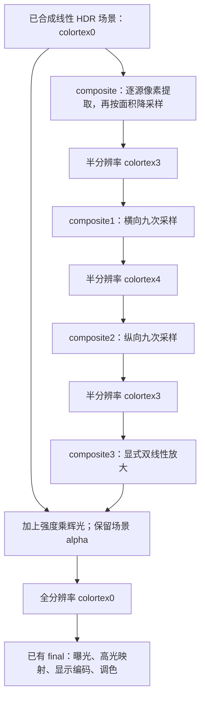

# Milestone 10：受控 HDR 辉光

日期：2026-11-13。分支：`codex/milestone-10-bloom`。
基于 M9 提交 `3c5a2ab0cd90aff32d5145dce7ea461917d886af`。
[English](MILESTONE_10.md)。

**尚未测量 Minecraft／Iris 实际画面与 GPU 耗时。** 默认值是初始艺术选择，
不是经过游戏实测调好的预设。已执行检查应单独记录；下方空白观察表不代表通过，
也不成为持续开发的人工验收门槛。

## 1. 画面目标与边界

M10 把一小部分明亮场景颜色扩散到附近的屏幕像素，让灯光等亮色细节带有克制的光晕，
配合 Aurora 的奇幻风格，同时尽量保持建筑细节。它建立在 M8 线性 HDR 存储之上，
位于 M9 场景合成之后。

来源是按 RGB 最大分量选择的**明亮像素**，不是材质自发光遮罩。天空、云、粒子、
手持物只要合成后的颜色符合条件，也能参与；看起来像发光块的物体则未必超过阈值。
这里没有增加材质识别或新的光源。

这是屏幕图像后处理，不是物理眼球／镜头散射、世界空间照明或体积光。
它不会照亮附近方块，扩散时也不遵守深度边界。原图没有显示出的亮物体，辉光无法还原。

## 2. 在已有 final 之前加入四个阶段



| 程序 | 读取 | 写入 | 职责 |
|---|---|---|---|
| `composite` | `colortex0`；`colortex3` 尺寸 | `colortex3` | 提取亮色并按面积降采样 |
| `composite1` | `colortex3` | `colortex4` | 横向模糊 |
| `composite2` | `colortex4` | `colortex3` | 纵向模糊 |
| `composite3` | `colortex0`、`colortex3` | `colortex0` | 放大并加回原图 |

Iris 的 composite 位于 gbuffers 程序之后。`size.buffer.colortex3/4 = 0.5 0.5`
改变的是附件实际宽高，前三个阶段按输出附件尺寸绘制。项目保留 Iris 默认翻转，
让后续程序读到最新结果；`composite3` 也因此能读取原场景并写出新的场景。
[Iris composite](https://shaders.properties/current/reference/programs/composite/)、
[缓冲尺寸与翻转](https://shaders.properties/current/reference/shadersproperties/rendering/)。

两个临时附件均为 `RGBA16F`，其 alpha 固定写零；最终合成保留原场景 alpha。
曝光、高光映射、sRGB 编码与调色仍由已有 `final` 负责。辉光在线性光空间中相加，
发生在这些操作之前，没有往已经压缩到显示范围的图像上添加辉光。

## 3. 用软阈值提取，并保留 RGB 比例

对于经过保护的非负场景颜色 `C`：

```text
p = max(C.r, C.g, C.b)
t = max(BLOOM_THRESHOLD, 0)
k = t * clamp(BLOOM_SOFT_KNEE, 0, 1)
q = clamp(p - t + k, 0, 2*k)
soft = q*q / (4*k) if k > 0, otherwise 0
amount = max(p-t, 0, soft)
E(C) = C * amount / max(p, 0.000001)
```

三个分量共用一个缩放系数，因此有限、正值 RGB 的比例得到保留。使用最大分量，
会比按感知亮度筛选更愿意保留鲜艳的饱和亮色，这是明确的艺术取舍。黑色仍为黑色。

软过渡宽度是阈值的比例。默认 `t=1`、`k=0.5` 时，峰值 0.5 开始进入过渡，
到 1.5 接上硬阈值规则。峰值恰好为 1 时，已经有 0.125 的贡献，因此“阈值为 1”
不表示所有小于等于 1 的颜色都被排除。过渡比例为零时直接使用
`max(p-t,0)`，不会执行除以零。

筛选发生在最终曝光之前。修改曝光会改变合成结果如何显示，但不会改变哪些原始
像素被选中。因此阈值控制“选谁”，强度控制“加入多少”，两者作用不同。

## 4. 先提取，再缩小

如果先把一个小亮点与周围暗像素平均，再判断阈值，它可能因平均后变暗而完全消失。
M10 对每个原始像素先执行 `E(C)`，然后才平均到半分辨率图像。

例如硬阈值为 1，四个灰度像素为 4、0、0、0：先提取再平均，得到
`(3+0+0+0)/4 = 0.75`；先平均得到 1，再提取却为零。这是说明顺序的数值例子，
不是 Minecraft 实测画面。

每个输出像素对应源图像中的一个矩形：

```text
ratio = sourceSize / outputSize
first = outputPixel * ratio
last = min((outputPixel + 1) * ratio, sourceSize)
area_i = overlapWidth_i * overlapHeight_i
downsampled = sum(E(source_i) * area_i) / rectangleArea
```

尺寸读取自实际纹理。在预期半分辨率关系下，一个矩形每轴最多跨三个源像素。
检查最多 3x3 个候选并按相交面积加权，使奇数尺寸的最后一行／列也参与；
它不是简单固定取 2x2 后遗漏边缘。

这是对提取图像的分段常量面积平均，不是时间抗锯齿，也不能保证运动中绝无闪烁。
小亮点与相机运动仍需观察。

全分辨率宽、高都必须至少为 2。已检查的 Iris 1.21.1 分支会把相对尺寸截断为整数，
并拒绝零尺寸附件；源图某一维只有 1 像素时，无法分配这个半尺寸附件。错误发生在
着色器运行前，不能靠 GLSL 中的保护修复。2x2 或 3x3 源图得到 1x1 临时图像，
则是另一种有效的数值情况。普通游戏窗口尺寸不受这个限制影响。
[Iris 尺寸计算](https://raw.githubusercontent.com/IrisShaders/Iris/1.21.1/common/src/main/java/net/irisshaders/iris/gl/texture/TextureScaleOverride.java)、
[渲染目标分配](https://raw.githubusercontent.com/IrisShaders/Iris/1.21.1/common/src/main/java/net/irisshaders/iris/targets/RenderTarget.java)。

## 5. 可分离过滤与放大

横向、纵向都使用固定二项式核：

```text
w = [1, 8, 28, 56, 70, 56, 28, 8, 1] / 256
H(x,y) = sum(w[i] * D(x+i-4,y), i=0..8)
B(x,y) = sum(w[j] * H(x,y+j-4), j=0..8)
```

权重非负且总和为 1，常量颜色经过模糊后仍保持常量。两组一维核的外积构成
可分离的 9x9 过滤：每个半分辨率像素两次各取九样本，共 18 次；直接计算对应
二维核则为 81 次。这只比较模糊部分，不包括完整管线开销，更不是实际帧时数据。
二项式核近似高斯形状，但不等于精确采样的高斯函数。
[过滤原理背景](https://developer.nvidia.com/gpugems/gpugems2/part-iii-high-quality-rendering/chapter-27-advanced-high-quality-filtering)。

整数取样坐标限制在图像边缘，不会绕到屏幕另一侧，也不依赖采样器过滤模式。
放大时读取四个经过边缘限制的像素，显式执行双线性插值：

```text
position = uv * bloomSize - 0.5
base = floor(position)
f = fract(position)
upsampled = mix(mix(B00,B10,f.x), mix(B01,B11,f.x), f.y)
combinedRGB = safe(safe(sceneRGB) + max(BLOOM_STRENGTH,0) * upsampled)
combinedAlpha = sceneAlpha
```

当前只有一个分辨率层级，每轴过滤半径固定为四个半分辨率纹素，再叠加降采样／
放大的覆盖范围。因此屏幕观感宽度会随渲染分辨率变化。没有多级金字塔、半径选项、
时间历史或深度过滤。权重归一化保证模糊不改变常量场，但把辉光加回原图仍会增加能量。

## 6. 数值保护、回退与设置

新增的启用路径会把 NaN 分量变为零，把 RGB 限制在 `[0,65504]`，最终加法也受保护。
目的是避免半精度浮点存储出现无效值或溢出，不是艺术上的显示映射。负颜色不会成为
辉光来源；特别大的颜色仍可能碰到这一存储上限。

`BLOOM_ENABLED=0`、`BLOOM_STRENGTH=0`、`SCENE_COLOR_MODE=0` 或
`DEBUG_VIEW!=0` 时绕过辉光。临时阶段输出黑色，`composite3` 直接复制完整源值，
包括 alpha，也不调用数值修整函数。这是着色器层面的精确源值复制，不等于已证明
跨驱动截图逐位一致，也不等于无运行成本。

设置页为 **Controlled Bloom**，内部名称 `BLOOM`。

| 设置 | 默认值 | 可选值 | 含义 |
|---|---:|---|---|
| `BLOOM_ENABLED` | 1 | 0、1 | 在线性场景与普通视图中启用 |
| `BLOOM_STRENGTH` | .08 | 0、.04、.08、.12、.2 | 加回场景的过滤颜色倍数 |
| `BLOOM_THRESHOLD` | 1 | .5、1、1.5、2 | 曝光前 RGB 峰值阈值 |
| `BLOOM_SOFT_KNEE` | .5 | 0、.25、.5、1 | 过渡半宽占阈值的比例 |

辉光没有新增维度、洞穴或流体镜头开关。在线性模式下，它处理已经合成的场景，
包括 M9 雾因自身环境条件而关闭的场景。M9 的几何体覆盖限制也不会因辉光而自动消失。

## 7. 文件职责与成本预期

- `lib/bloom_settings.glsl`：四个选项。
- `lib/bloom.glsl`：启用判断、数值保护、提取、模糊、放大。
- `composite.fsh` 至 `composite3.fsh`：四个有序阶段。
- 四个顶点包装文件共用 `lib/fullscreen_vertex.glsl`。
- `shaders.properties`：两个半尺寸附件及设置页；
  `lang/en_us.lang`：菜单名称与说明。

新增四个程序对，总数变为 24。已有着色器程序（包括 `final`）保持不变。
宽、高各减半意味着约四分之一像素数，不是一半。

新增开销包括四次绘制、临时存储、提取与重建。目前没有通过程序启用属性移除
关闭状态的阶段，因此关闭辉光后仍有绘制与分配开销，只是绕过对应着色计算。

如果按 Iris 每个附件分配两张图用于翻转来估算，两个 RGBA16F 半尺寸附件需要：

```text
2 attachments * 2 images * 8 bytes * (W/2)*(H/2) ~= 8*W*H bytes
1920*1080 -> approximately 15.8 MiB
```

这取决于该分配方式，不包含其他缓冲、驱动额外开销或奇数尺寸取整，不是实测显存。
没有据此宣称 FPS 提升或已经建立性能档位。低分辨率可分离辉光是已有技术路线，
具体成本仍取决于完整渲染器与显卡。
[辉光与过滤背景](https://developer.nvidia.com/gpugems/gpugems/part-iv-image-processing/chapter-21-real-time-glow)、
[Iris 颜色附件](https://shaders.properties/current/reference/buffers/colortex/)。

## 8. 检查与待观察项目

使用已有 `python -B tools/validate.py`、可用编译器对应的
`python -B tools/compile_glsl.py`，以及空白检查。已执行结果单独记录。
这些检查不执行 Iris patcher、帧缓冲分配、GPU 绘制或 Minecraft 帧。

对照时保持机位、曝光与调色一致。记录 Minecraft／Iris／Sodium、显卡／驱动、
渲染分辨率和设置值。

| 对照项目 | 需要观察的内容 | 实际结果 |
|---|---|---|
| 关闭／强度零／旧场景模式 | 原源值路径与 alpha 保留 | |
| Debug 1–6 | 数值视图不受辉光影响 | |
| 暗洞穴、灯光与明亮方块 | 亮色有选择地突出；暗处可读，不是所有材质都会发光 | |
| 天空、太阳、云与手持物 | 记录亮像素贡献及不希望出现的光晕 | |
| 白天、日落、夜晚、雨天 | 配合现有配色与雾时保持克制 | |
| 雾化地形前的水／玻璃／粒子 | alpha 无新增变化；观察合成后亮色扩散 | |
| 阈值与过渡调整 | 平滑起效；硬阈值对照可用 | |
| 固定阈值后调整曝光 | 筛选仍发生在曝光之前 | |
| 细小亮点运动与相机转动 | 闪烁、走样和分辨率依赖 | |
| 改窗口、奇数尺寸、最小支持尺寸 | 最后一行／列、分配与取样稳定性 | |
| 屏幕边角 | 不从对侧绕回；观察边缘限制的光晕 | |
| 下界／末地、水下与视觉状态 | 没有新增环境门控时，已有场景仍可读 | |
| 极亮值与重载 | 没有无效颜色扩散、旧临时图像或意外截断 | |
| 相同场景开关辉光 | 测量 GPU／帧时与显存；关闭并非零阶段模式 | |

没有观察过的结果保留空白。下一候选是范围受限、仅作用于天空的青绿／紫色极光，
用来建立夜景辨识度；架构仍在审查，不属于 M10 已实现功能。云、材质发光选择与
辉光尺度改进留在后续独立阶段，并分别补充合成与性能证据。

## 9. 面试时如何解释

1. **为什么在高光映射前做辉光？** 线性 HDR 中仍有高亮强弱关系，显示压缩后的
   图像已经丢失一部分范围。
2. **辉光会让材质真正自发光吗？** 不会。这里检测明亮像素；材质身份和照明是独立系统。
3. **为什么先提取再降采样？** 阈值操作非线性，先平均可能隐藏本应产生贡献的小亮点。
4. **软阈值解决什么？** 它让筛选在阈值附近平滑过渡，不负责改变模糊半径。
5. **为什么用最大 RGB？** 更容易保留饱和亮色，并可共用一个保色比例；艺术反应不同于亮度筛选。
6. **为什么分两次模糊？** 可分离二维核是一维核的外积，这里把模糊采样从 81 次变为 18 次。
7. **权重为什么加起来为 1？** 常量输入通过模糊后应保持常量，整体强度另用参数控制。
8. **为什么手动双线性放大？** 用四次明确的边缘限制取样定义插值，避免依赖采样器状态。
9. **关闭辉光是否没有成本？** 目前不是。计算被绕过且复制源值，但阶段调度和临时附件仍保留。
10. **更完整的辉光还需要什么？** 根据证据选择多级金字塔、自发光数据、时间稳定性、
    实测质量档位等；M10 尚未实现这些内容。

## 原始资料

- [Iris composite 程序](https://shaders.properties/current/reference/programs/composite/)
- [Iris 缓冲尺寸与翻转](https://shaders.properties/current/reference/shadersproperties/rendering/)
- [Iris colortex 缓冲](https://shaders.properties/current/reference/buffers/colortex/)
- [Iris 图像格式](https://shaders.properties/current/reference/buffers/image_format/)
- [NVIDIA GPU Gems：Real-Time Glow](https://developer.nvidia.com/gpugems/gpugems/part-iv-image-processing/chapter-21-real-time-glow)
- [NVIDIA GPU Gems 2：Advanced High-Quality Filtering](https://developer.nvidia.com/gpugems/gpugems2/part-iii-high-quality-rendering/chapter-27-advanced-high-quality-filtering)
- [M8 线性 HDR 基础](MILESTONE_8.zh-CN.md)、[M9 雾](MILESTONE_9.zh-CN.md)
- [持续开发路线](AURORA_ROADMAP.zh-CN.md)

## 已执行的离线验证（2026-11-13）

- 完整 `tools/validate.py` 通过所有历史回归和 M10 检查：69 个 M9 着色器文件保持不变，576 组亮色提取输入、64 组奇偶尺寸，以及模糊、放大、缓冲路由、有限存储和回退约定。
- 854 组独立 GLSL 编译／链接配置全部通过。
- 完整代码、验证工具与文档差异复核，以及空白检查通过。
- 这些结果不代表已经验证 Minecraft／Iris 的实际画面或 GPU 性能。
