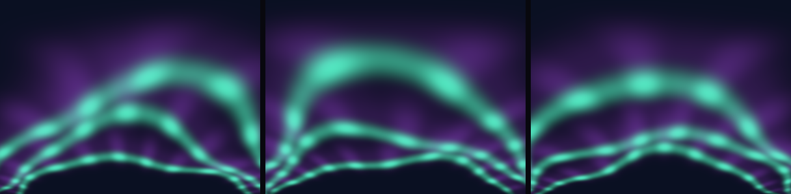
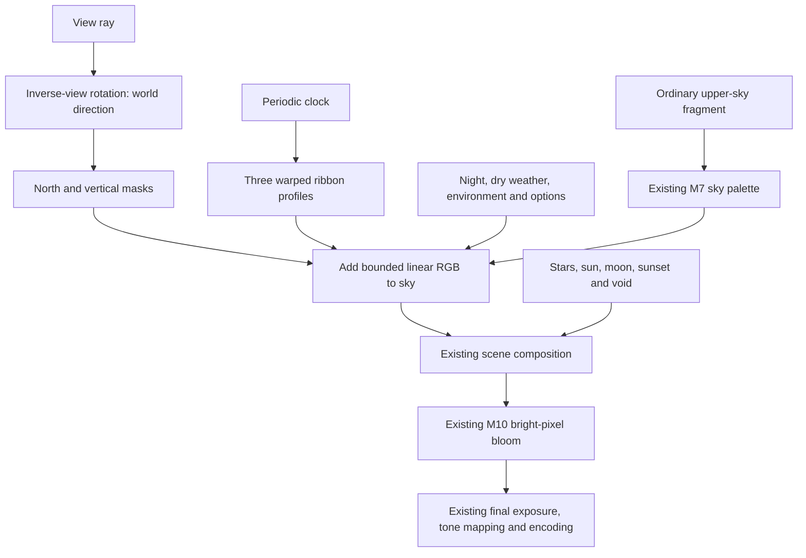

# Milestone 11: Aurora night ribbons

Date: 2026-11-13. Branch: `codex/milestone-11-aurora`.
Base: M10 commit `9e9bbc06d7f115783a9fa0f52c940325dc7e3f38`.
[中文学习版](MILESTONE_11.zh-CN.md).

Minecraft/Iris appearance, motion stability and GPU timing remain **unmeasured**.
This is an implemented artistic model, not a runtime-approved preset. Executed
offline checks belong in a separate record. Empty observations below remain open
without stopping the continuing development goal.

## 1. A first signature night effect

M11 adds three moving teal/violet light ribbons to the northern upper sky on clear
nights. They provide an Aurora identity beyond general saturation or a uniform
night tint. Their brightness, location and motion are bounded and configurable.

This is a procedural sky image. It does not simulate charged particles, magnetic
fields, polar latitude, seasons, atmospheric volume or physically scattered light.
It adds no world-space light, material emission, terrain illumination or reflection
system. The pattern has no position-dependent parallax.

## Mathematical preview



Left to right: 0, 50 and 100 seconds at normal speed and intensity 0.6, facing
north over azimuth -65 to +65 degrees and elevation 5 to 75 degrees. This is a
**CPU mathematical reference, not Minecraft, Iris or GPU output**. It uses a fixed
linear background `(0.003,0.005,0.016)`, full clear-night weight, M8's default
highlight shoulder and display encoding at exposure zero. It includes no bloom,
stars, geometry or fog. It shows the projected profiles and motion samples, not
engine integration or the expected complete game scene.

Regenerate from the checkout with `python -B tools/preview_aurora.py`. The tool
uses the independent validation reference and Python's standard library.

## 2. Exact draw scope matters

The new call is made only when `renderStage == MC_RENDER_STAGE_SKY` inside the
existing shared sky fragment shader. It does not use a broad “anything except
stars” rule. Iris identifies this stage as the upper sky, separately from sunset,
void, custom sky, stars, sun and moon stages.
[Iris render stages](https://shaders.properties/current/reference/macros/render_stages/).



The existing star branch and textured sun/moon programs are unchanged. The aurora
helper is not added to `sky_palette.glsl`: M9 fog still reuses the plain palette
without inheriting ribbon shapes. No aurora is inserted into deferred lighting,
transparent-source fog or final output.

This preserves source-path separation, not every visible pixel in the final
image: existing bloom can spread the already rendered aurora near other objects.
Cloud/celestial overlap and custom-sky mod routing still need runtime observation.
M11 has no custom cloud occlusion or light transport.

## 3. World orientation without camera translation

The sky shader reconstructs a view ray from the pixel using its existing inverse
projection. For valid, nonzero rays, the new helper effectively computes:

```text
worldDirection = unit(mat3(gbufferModelViewInverse) * unit(rayView))
```

The 3x3 matrix portion rotates directions out of view space and omits translation.
As the camera turns, looking back toward the same world direction samples the
same part of the pattern at a fixed time. Translating the camera alone produces
no parallax; this deliberately treats the sky as infinitely distant.

Adding camera position would make an infinite sky depend on local movement.
This differs from M9 fog, whose finite path heights require a world-position
anchor. Direction and position are different data contracts.
[Iris matrix uniforms](https://shaders.properties/current/reference/uniforms/matrices/),
[coordinate spaces](https://shaders.properties/current/how-to/coordinate_spaces/).

The implementation uses robust unit-vector helpers and rejects non-finite rays,
non-finite transformed directions, and very small input rays. Invalid effect
inputs leave the supplied scene unchanged; this is not a replacement for the
existing sky shader's position reconstruction.

## 4. Where and when the ribbons are visible

For unit world direction `d`, the orientation masks are:

```text
vertical = smoothstep(0.04,0.18,d.y) * (1-smoothstep(0.82,0.98,d.y))
north = smoothstep(0,0.45,-d.z)
```

North is the fixed world `-Z` direction. The effect fades away near the horizon
and zenith instead of filling the whole dome. This is a chosen composition, not
a model of real auroral geography.

The temporal/environment weight is:

```text
elevation = clamp(dot(unit(sunPosition),unit(upPosition)),-1,1)
night = 1-smoothstep(-0.20,-0.05,elevation)
dry = 1-clamp(rainStrength,0,1)
weight = clamp(AURORA_INTENSITY,0,1) * clamp(SKY_BLEND,0,1)
         * celestialEnvironmentWeight() * night * dry*dry * vertical * north
```

Solar elevation drives a continuous day/night fade instead of a hard clock-hour
switch. The effect reaches full night weight at elevation -0.20 or below and is
off at -0.05 or above. Squared dryness suppresses it progressively during rain:
half rain leaves one quarter of the dry-weather weight.

The shared environment guard requires an open skylit dimension, excludes
water/lava/powdered-snow camera states, and fades with blindness/darkness. Open
skylit modded dimensions may qualify; this is not an Overworld name check.
There is no added cave sky-light gate: this is sky geometry, and ordinary scene
occlusion determines where that geometry is visible.

The new RGB addition is bypassed for disabled aurora, zero intensity, legacy
scene mode, base sky style or a debug view. Sky Blend zero, full rain, disallowed
environments and zero spatial/night masks also produce no addition. These paths
return the supplied scene value; alpha is never modified.

## 5. Three projected ribbons

Use a bounded direction-plane projection:

```text
uv = d.xz / (max(d.y,0) + 0.18)
```

The positive denominator prevents a horizon singularity. Avoiding an azimuth
angle also avoids an angle-wrap seam. The mapping still distorts direction space;
the horizon/zenith fades are deliberate artistic limits, not proof of a uniform
physical projection.

For ribbon index `i = 0,1,2` and phase `p`:

```text
center = -0.8 - 0.55*i
         + 0.18*sin(1.6*uv.x + p + 2*i)
         + 0.09*sin(3.1*uv.x - 2*p + i)
distance = uv.y-center
core = exp(-(distance/0.10)^2)
tail = exp(-((distance-0.22)/0.30)^2)
fold = 0.5 + 0.5*sin(11*uv.x + sin(2.3*uv.x-2*p) + 3*p + 2*i)
striation = 0.35 + 0.65*fold*fold
ribbon = striation * ((0.08,1.35,0.75)*core
                    + (0.25,0.05,0.55)*(0.45*tail))
light = clamp(sum(ribbon),0,2)
outputRGB = sceneRGB + light*weight
```

Two slow sine warps bend each centerline. A narrow exponential profile forms the
teal core; a broader offset profile forms the softer violet trail. Nested waves
modulate brightness along the ribbon. These are three analytic bands, not sampled
3D curtains, noise textures or a ray-marched volume.

The source squares signed scaled distances with multiplication. The symmetric
profile responds to the distance from a centerline, regardless of its sign.

Color coefficients are linear HDR values. The component-wise cap of 2 bounds the
added source before the final weight; since weight is in [0,1], no component adds
more than 2. This cap may alter color ratios where channels reach it. It is a
numerical/artistic bound, not radiometric conservation or a claim that the total
scene is limited to 2.

## 6. A loop designed around the engine clock

```text
p = 2*pi*fract(max(frameTimeCounter,0) * AURORA_SPEED / 200)
```

All temporal terms use integer harmonics of `p`. Adding a full turn therefore
returns each sine, including nested modulation, to the same state. At speed 1,
the pattern repeats every 200 seconds; speed 2 repeats every 100 seconds.

Iris documents a 3600-second reset of `frameTimeCounter`, and that it continues
during the pause screen. Because 3600 contains 18 normal-speed periods or 36
double-speed periods, the ideal phase boundary is continuous at that reset.
Actual floating-point behavior and frame scheduling still need observation.
[Iris system clock](https://shaders.properties/current/reference/uniforms/system/#frametimecounter).

Speed zero means **fixed phase zero**, not freezing the currently visible frame.
Changing the speed option can therefore change the pattern immediately. Non-finite
clock input falls back to zero phase. There is no saved animation history, world
seed or synchronized time-of-day motion: solar elevation controls visibility,
while elapsed seconds control the ribbon animation. Reload behavior is not a
promised continuous timeline.

## 7. Settings, files and cost

Open **Aurora Night Ribbons** (`AURORA`).

| Option | Default | Choices | Meaning |
|---|---:|---|---|
| `AURORA_ENABLED` | 1 | 0, 1 | Enable the sky-only effect |
| `AURORA_INTENSITY` | .6 | 0, .3, .6, 1 | Linear RGB addition scale before other masks |
| `AURORA_SPEED` | 1 | 0, 1, 2 | Fixed zero phase, normal or double speed |

The effect also requires Aurora Sky (`SKY_STYLE=1`), linear scene mode and normal
view. Intensity is distinct from `NIGHT_BRIGHTNESS`: M7's control adjusts the
night palette, whereas this new control scales only the ribbon addition.
`SKY_BLEND` affects both systems.

- `lib/aurora_settings.glsl`: three user options.
- `lib/aurora.glsl`: phase, ribbon profiles, masks and bounded addition.
- `lib/geometry/sky_fragment.glsl`: one include and the exact upper-sky call site.
- `shaders.properties` and `lang/en_us.lang`: menu wiring and explanations.

There are no new passes, attachments, textures or history buffers; the pack still
has 24 program pairs. Work is added to eligible sky fragments: three fixed ribbon
iterations with sine/exponential calculations. Existing gates avoid that ribbon
work when its weight is zero. No additional passes does not mean no GPU cost;
timing has not been measured.

M10 may bloom sufficiently bright rendered ribbons before the unchanged final
display transform. It does not make the aurora a new terrain light source, and
M11 does not retune bloom or exposure.

## 8. Checks and runtime observations

Run the existing validator, available standalone GLSL compilation and whitespace
checks, then record actual results separately. Offline structure/math/compiler
checks cannot establish the Iris stage mapping, GPU appearance, cloud overlap or
temporal stability in Minecraft.

Use clear nighttime sky toward north, then compare the same view with speed zero,
bloom off and ordinary exposure before judging the animated combination. Record
Minecraft/Iris/Sodium, GPU/driver, resource packs, dimensions and settings.

| Comparison | Observation needed | Actual result |
|---|---|---|
| Enabled off / intensity zero | Existing M10 sky source path remains available | |
| Base sky / legacy mode / Debug 1-6 | No new ribbon addition | |
| North, east/west, south | Intended fixed world orientation and smooth directional mask | |
| Horizon to zenith | No seam, pole streak, hard cutoff or unwanted full-dome wash | |
| Camera rotation, movement, view bobbing | World orientation; no translation-driven parallax | |
| Sunset, deep night, sunrise, day | Continuous visibility tied to solar elevation | |
| Clear, rain and weather transitions | Dry-squared suppression without an abrupt pop | |
| Underwater, lava, powdered snow, vision effects | Existing environment gate suppresses the addition | |
| Nether/End and open skylit modded dimensions | Dimension-property behavior and native sky routing | |
| Stars, sun/moon, sunset and void | No direct ribbon call in those source paths | |
| Terrain, cave opening, clouds, glass and fog | Actual occlusion/composition; fog contains no ribbon-shaped source | |
| Bloom off/on and exposure changes | Distinguish ribbon source from later highlight spread | |
| Normal/double/frozen speed | 200/100-second loops; frozen selects phase zero | |
| Loop boundaries, 3600-second reset, pause and reload | Continuity limits and engine clock behavior | |
| Resource-pack/custom-sky mods | Record draw routing and compatibility gaps | |
| Same view on/off | Actual frame/GPU cost and nighttime readability | |

Leave unobserved results blank. The next stage is cloud composition: establish
how clouds, celestial bodies and the new sky effect overlap before extending cloud
appearance. Physical aurora, volumetrics and terrain light remain outside M11.

## 9. Interview-sized explanations

1. **Why use a world-oriented direction?** The sky should keep its compass direction
   when the camera turns; a view-space pattern would stick to the camera.
2. **Why omit translation?** Infinite sky has no positional parallax, unlike nearby
   surfaces or finite-height fog paths.
3. **Why check the exact sky render stage?** A shared sky program can draw several
   categories; only the ordinary upper background should receive the addition.
4. **Why not put ribbons in the shared sky palette?** Geometry fog uses that palette;
   adding spatial ribbons there would put the sky pattern into fog color.
5. **Why solar elevation instead of fixed world-time intervals?** A dot product
   measures the sun's geometric height and supplies continuous transition weights.
6. **Why avoid an azimuth angle?** A direction-plane mapping avoids the angle-wrap
   seam, while positive denominator and masks bound the selected region.
7. **Why integer temporal harmonics?** Every wave returns to the same state when
   the base phase wraps, including at the designed engine-clock boundary.
8. **What does Frozen do?** It selects a reproducible zero phase, without storing
   or pausing the currently displayed animation.
9. **Does bloom turn the aurora into illumination?** No. It spreads rendered bright
   image pixels; blocks receive no new world-space light.
10. **Why call this artistic rather than physical?** Its fixed projected bands,
    RGB profiles and gates target a style, without atmospheric or magnetic simulation.

## Primary references

- [Iris render stages](https://shaders.properties/current/reference/macros/render_stages/)
- [Iris matrix uniforms](https://shaders.properties/current/reference/uniforms/matrices/)
- [Iris coordinate spaces](https://shaders.properties/current/how-to/coordinate_spaces/)
- [Iris system uniforms and frameTimeCounter](https://shaders.properties/current/reference/uniforms/system/)
- [M7 sky palette](MILESTONE_7.md), [M9 geometry fog](MILESTONE_9.md)
- [M10 controlled bloom](MILESTONE_10.md), [continuing roadmap](AURORA_ROADMAP.md)

## Recorded offline verification (2026-11-13)

- Full `tools/validate.py` passed all historical checks plus 81 M10 shader/property pins and 5,166 bounded ribbon cases. Direction/translation invariance, stage exclusions, masks and exact bypasses passed.
- All 934 standalone GLSL compile/link configurations passed.
- Float32 clock arithmetic with the CPU ribbon reference produced a largest sampled RGB difference of 0.000316928 across the tested 200/3600-second boundaries; this is not a GPU measurement.
- The CPU reference preview was generated and visually inspected. Full code/tool/document diff review and whitespace checks passed.
- Minecraft/Iris appearance, motion and performance remain unmeasured.
