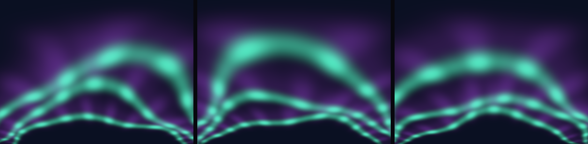
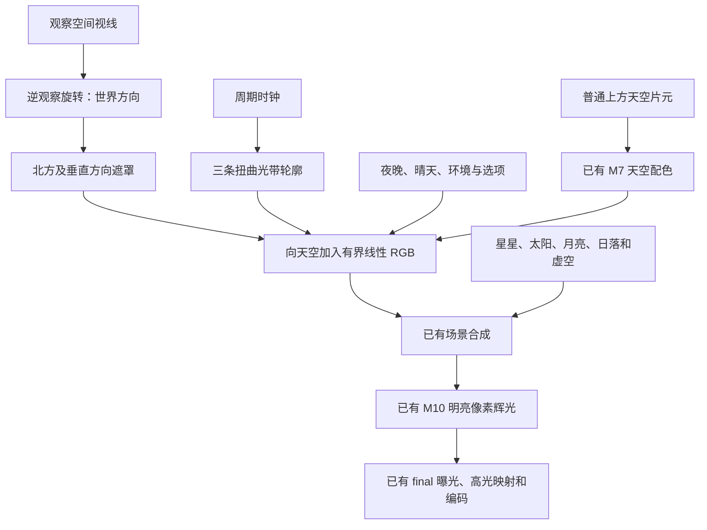

# Milestone 11：极光夜间光带

日期：2026-11-13。分支：`codex/milestone-11-aurora`。
基于 M10 提交 `9e9bbc06d7f115783a9fa0f52c940325dc7e3f38`。
[English](MILESTONE_11.md)。

**尚未测量 Minecraft／Iris 实际画面、运动稳定性与 GPU 耗时。**
这里完成的是一个艺术模型，不是经过游戏验收的预设。已执行离线检查应单独记录；
观察表保留空白，也不阻止持续开发。

## 1. 第一项有辨识度的夜景效果

M11 在晴朗夜晚的北方上空加入三条移动的青绿／紫色光带，让 Aurora 的夜景特征
不仅来自全局饱和度或统一染色。亮度、位置与运动都有边界，并提供开关与参数。

它是程序化天空图像，没有模拟带电粒子、磁场、极地纬度、季节、大气体积或物理散射。
没有新增世界空间光源、材质自发光、地形照明或反射系统，也没有依赖位置的视差。

## 公式预览



从左到右为正常速度、强度 0.6 下的 0、50、100 秒；朝北，方位角 -65 至 +65 度，
仰角 5 至 75 度。**这是 CPU 数学参考图，不是 Minecraft、Iris 或 GPU 输出。**
它采用固定线性背景 `(0.003,0.005,0.016)`、完整晴朗夜晚权重，以及 M8 默认高光
肩部映射与显示编码，曝光为零。没有 bloom、星星、几何体或雾。它用于观察投影轮廓
与运动采样，不证明引擎集成，也不代表完整游戏画面。

在项目中运行 `python -B tools/preview_aurora.py` 可以重新生成。
该工具复用独立验证参考实现，只依赖 Python 标准库。

## 2. 严格限定绘制阶段

新增调用只位于已有共享天空片元程序的
`renderStage == MC_RENDER_STAGE_SKY` 条件中，不是“除了星星都加”。
Iris 用这个阶段表示上方天空，并与日落、虚空、自定义天空、星星、太阳、月亮区分。
[Iris 绘制阶段](https://shaders.properties/current/reference/macros/render_stages/)。



原有星星分支与太阳／月亮纹理程序保持不变。极光函数没有加入
`sky_palette.glsl`，因此 M9 几何体雾仍复用普通配色，不会把光带形状带进雾色。
deferred 光照、透明前景雾和 final 都没有新增极光调用。

这里保持的是源路径独立，不表示最终图像的每个相关像素都不变：已有 bloom 可以把
已经绘制的极光向邻近像素扩散。云／天体的覆盖关系、自定义天空模组的路径仍需观察。
M11 没有自定义云遮挡或光传输。

## 3. 世界方向固定，但不使用相机平移

天空程序沿用逆投影，从像素重建观察空间视线。对有效、非零方向，新函数相当于：

```text
worldDirection = unit(mat3(gbufferModelViewInverse) * unit(rayView))
```

取矩阵的 3x3 部分，将方向从观察空间转回世界轴向，省去平移。相机转动后，
在固定时间重新望向同一世界方向，仍会采到图案的同一部分。仅移动相机不会产生视差，
这是故意把天空当作无限远。

如果加入相机位置，无限远图案就会随着局部移动而改变。它与 M9 雾不同：雾需要计算
有限路径的世界高度，因此必须使用位置锚点。方向与位置属于不同的数据约定。
[Iris 矩阵](https://shaders.properties/current/reference/uniforms/matrices/)、
[坐标空间](https://shaders.properties/current/how-to/coordinate_spaces/)。

实现采用稳健单位向量辅助函数，并拒绝非有限视线、非有限变换方向和过小输入视线。
效果输入无效时保留传入场景；这些保护不替代原有天空程序的位置重建。

## 4. 在哪里、什么时候出现

对单位世界方向 `d`，空间权重为：

```text
vertical = smoothstep(0.04,0.18,d.y) * (1-smoothstep(0.82,0.98,d.y))
north = smoothstep(0,0.45,-d.z)
```

北方固定为世界 `-Z`。靠近地平线与天顶时淡出，不让光带铺满整个天空。
这是画面构图选择，不是真实极光的地理模型。

时间与环境权重为：

```text
elevation = clamp(dot(unit(sunPosition),unit(upPosition)),-1,1)
night = 1-smoothstep(-0.20,-0.05,elevation)
dry = 1-clamp(rainStrength,0,1)
weight = clamp(AURORA_INTENSITY,0,1) * clamp(SKY_BLEND,0,1)
         * celestialEnvironmentWeight() * night * dry*dry * vertical * north
```

根据太阳高度连续淡入淡出，而不是按某个游戏时刻突然开关。高度值小于等于 -0.20
时夜晚权重为满，大于等于 -0.05 时关闭。晴朗程度平方让雨天更快抑制光带：
雨量为一半时，只保留晴天权重的四分之一。

共享环境保护要求开放且有天空光的维度，排除水／岩浆／细雪镜头，并随失明／黑暗
效果淡出。开放、有天空光的模组维度也可能符合条件，不是只检查主世界名称。
没有额外加入洞穴天空光开关；这是天空几何体，正常场景遮挡决定哪里能看到它。

关闭极光、强度为零、旧场景模式、基础天空样式或调试视图都会绕过新增 RGB。
Sky Blend 为零、满雨量、环境不允许，以及空间／夜晚权重为零时也没有新增贡献。
这些分支直接返回传入颜色；alpha 始终不变。

## 5. 三条投影光带怎样形成

采用有界的方向平面投影：

```text
uv = d.xz / (max(d.y,0) + 0.18)
```

正的分母避免地平线处除数为零；没有使用方位角，也就没有角度回绕接缝。
但这种映射仍然扭曲方向空间。地平线／天顶淡出是明确的艺术限制，不代表均匀物理投影。

对第 `i = 0,1,2` 条光带，相位为 `p`：

```text
center = -0.8 - 0.55*i
         + 0.18*sin(1.6*uv.x + p + 2*i)
         + 0.09*sin(3.1*uv.x - 2*p + i)
distance = uv.y-center
core = exp(-(distance/0.10)^2)
tail = exp(-((distance-0.22)/0.30)^2)
fold = 0.5 + 0.5*sin(11*uv.x + sin(2.3*uv.x-2*p) + 3*p + 2*i)
striation = 0.35 + 0.65*fold*fold
ribbon = striation * ((0.08,1.35,0.75)*core
                    + (0.25,0.05,0.55)*(0.45*tail))
light = clamp(sum(ribbon),0,2)
outputRGB = sceneRGB + light*weight
```

两条较慢的正弦波弯曲中心线。窄的指数轮廓构成青绿核心，较宽且偏移的轮廓构成
柔和紫色拖尾；嵌套波形让沿光带的亮度出现纹理变化。这里是三条解析带状图案，
不是取样三维帘幕、噪声纹理或沿光路步进的体积。

代码用乘法显式平方带符号的缩放距离。对称轮廓关心离中心线多远，而不关心正负。

颜色系数是线性 HDR 值。先把光带 RGB 各分量限制到 2，再乘最终权重；
由于权重在 [0,1]，每个分量最多增加 2。碰到上限时可能改变颜色比例。
它是数值／艺术边界，不是能量守恒，也不表示原场景加上极光后的总值不会超过 2。

## 6. 为引擎时钟设计周期

```text
p = 2*pi*fract(max(frameTimeCounter,0) * AURORA_SPEED / 200)
```

所有时间项都是 `p` 的整数谐波。相位增加整圈后，每个正弦（包括嵌套调制）
都回到同一状态。速度 1 的图案每 200 秒重复，速度 2 每 100 秒重复。

Iris 文档说明 `frameTimeCounter` 会在 3600 秒后重置，并在暂停菜单中继续计时。
3600 秒恰好是 18 个正常周期或 36 个双速周期，因此理想公式在这个重置边界连续。
实际浮点误差与帧调度仍需要观察。
[Iris 系统时钟](https://shaders.properties/current/reference/uniforms/system/#frametimecounter)。

速度零表示**固定为零相位**，不是把当前画面冻结下来。因此切换速度选项时，
图案可能立即变化。非有限时钟输入也回退到零相位。没有保存的动画历史、世界种子，
也没有把运动同步到游戏昼夜时刻：太阳高度控制是否出现，经过的秒数控制图案运动。
不保证重载后继续原有时间线。

## 7. 设置、文件与开销

设置页为 **Aurora Night Ribbons**，内部名称 `AURORA`。

| 选项 | 默认值 | 可选值 | 含义 |
|---|---:|---|---|
| `AURORA_ENABLED` | 1 | 0、1 | 启用仅天空的效果 |
| `AURORA_INTENSITY` | .6 | 0、.3、.6、1 | 其他权重之前，新增线性 RGB 的强度 |
| `AURORA_SPEED` | 1 | 0、1、2 | 固定零相位、正常、双速 |

同时要求 Aurora Sky（`SKY_STYLE=1`）、线性场景模式和普通视图。
强度与 `NIGHT_BRIGHTNESS` 不同：M7 参数调节夜间配色，新参数只缩放光带。
`SKY_BLEND` 则同时影响两者。

- `lib/aurora_settings.glsl`：三个用户选项。
- `lib/aurora.glsl`：相位、光带轮廓、权重与有界加法。
- `lib/geometry/sky_fragment.glsl`：一处 include，以及严格的上方天空调用。
- `shaders.properties` 和 `lang/en_us.lang`：菜单连接与说明。

没有新增阶段、附件、纹理或历史缓冲，程序对仍为 24。新增计算发生在符合条件的
天空片元中，固定循环三条光带，包含正弦与指数运算。权重为零时不会执行光带计算。
没有新增阶段不等于没有 GPU 成本，实际耗时尚未测量。

M10 可以对已绘制且足够明亮的极光产生辉光，然后进入未改动的最终显示变换。
这不会把极光变成地形光源；M11 也没有重新调整 bloom 或曝光。

## 8. 检查与运行观察

运行已有验证器、可用的独立 GLSL 编译与空白检查，再单独记录实际结果。
离线结构／公式／编译检查不能证明 Minecraft 中 Iris 阶段映射、GPU 画面、
云层覆盖关系或时间稳定性。

先在晴朗夜晚朝北，以固定相位、关闭 bloom、普通曝光比较，再判断动画与辉光组合。
记录 Minecraft／Iris／Sodium、显卡／驱动、资源包、维度和设置。

| 对照项目 | 需要观察的内容 | 实际结果 |
|---|---|---|
| 关闭／强度零 | 已有 M10 天空源路径仍可用 | |
| 基础天空／旧模式／Debug 1–6 | 没有新增光带 | |
| 北方、东西方向、南方 | 固定世界朝向与平滑方向权重 | |
| 地平线至天顶 | 无接缝、极点条纹、突兀截断或全穹顶染色 | |
| 相机旋转、移动、视角摇晃 | 世界朝向稳定，不因平移产生视差 | |
| 日落、深夜、日出、白天 | 可见度随太阳高度连续变化 | |
| 晴天、雨天及过渡 | 晴朗程度平方抑制，不突然跳变 | |
| 水下、岩浆、细雪、视觉状态 | 已有环境条件抑制新增效果 | |
| 下界／末地和开放有天空光的模组维度 | 维度属性与原生天空路径行为 | |
| 星星、太阳／月亮、日落和虚空 | 对应源路径没有直接调用光带 | |
| 地形、洞口、云、玻璃与雾 | 实际遮挡／合成；雾源颜色没有光带图案 | |
| 开关 bloom、调整曝光 | 区分光带本身与后续高亮扩散 | |
| 正常／双速／固定速度 | 200／100 秒循环；固定选取零相位 | |
| 循环边界、3600 秒重置、暂停、重载 | 连续性的限制及引擎时钟行为 | |
| 资源包／自定义天空模组 | 记录绘制路径与兼容性缺口 | |
| 同机位开关效果 | 实际 GPU／帧时开销和夜间可读性 | |

没有观察过的结果保留空白。下一步是云的合成：先明确云、天体与新天空效果的覆盖
关系，再扩展云外观。物理极光、体积和地形照明仍不在 M11 范围内。

## 9. 面试时如何解释

1. **为什么使用世界方向？** 相机转动时天空应保持罗盘朝向；直接用观察空间图案会粘在相机上。
2. **为什么不用平移？** 无限远天空没有位置视差，有限表面和雾路径才需要世界位置。
3. **为什么严格检查天空阶段？** 共享程序能绘制多种对象，新颜色只应加入普通上方背景。
4. **为什么不放进共享天空配色？** 几何体雾也调用该配色，把光带放进去就会污染雾色。
5. **为什么用太阳高度，而不是固定游戏时刻？** 点积测量太阳的几何高度，可连续生成过渡权重。
6. **为什么不用方位角？** 方向平面避免角度回绕接缝，正分母和遮罩限制选定区域。
7. **为什么时间频率都是整数谐波？** 基础相位绕一圈后各波形回到同一状态，也能匹配设计的时钟边界。
8. **Frozen 是什么？** 选取可复现的零相位，不存储或暂停当前动画帧。
9. **bloom 会让极光照亮世界吗？** 不会。它扩散已渲染亮像素，不给方块新增世界空间光照。
10. **为什么称为艺术效果？** 固定投影光带、RGB 轮廓与条件服务于画面风格，没有大气或磁场模拟。

## 原始资料

- [Iris 绘制阶段](https://shaders.properties/current/reference/macros/render_stages/)
- [Iris 矩阵输入](https://shaders.properties/current/reference/uniforms/matrices/)
- [Iris 坐标空间](https://shaders.properties/current/how-to/coordinate_spaces/)
- [Iris 系统输入与 frameTimeCounter](https://shaders.properties/current/reference/uniforms/system/)
- [M7 天空配色](MILESTONE_7.zh-CN.md)、[M9 几何体雾](MILESTONE_9.zh-CN.md)
- [M10 受控辉光](MILESTONE_10.zh-CN.md)、[持续开发路线](AURORA_ROADMAP.zh-CN.md)

## 已执行的离线验证（2026-11-13）

- 完整 `tools/validate.py` 通过历史回归，以及 81 个 M10 着色器／配置文件比对和 5,166 组有界光带输入。方向／平移不变性、阶段排除、遮罩与精确回退检查通过。
- 934 组独立 GLSL 编译／链接配置全部通过。
- 使用 float32 时钟运算及 CPU 光带参考，在已采样的 200／3600 秒边界两侧，最大 RGB 差值为 0.000316928；这不是 GPU 实测。
- 已生成并目视检查 CPU 数学预览；完整代码／验证工具／文档差异复核与空白检查通过。
- Minecraft／Iris 实际画面、运动稳定性与性能仍未测量。
