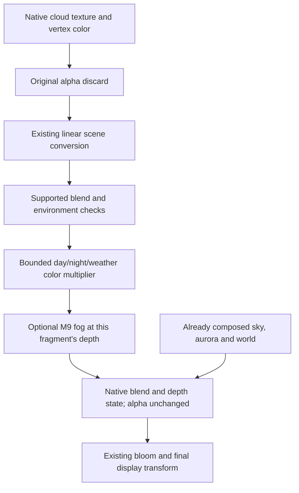

# Milestone 12: Native clouds in Aurora's atmosphere

Date: 2026-11-13. Branch: `codex/milestone-12-cloud-atmosphere`.
Base: M11 commit `b0f6e105a11b1c09e97ff3100cc58f8bed7c986a`.
[中文学习版](MILESTONE_12.zh-CN.md).

Minecraft/Iris appearance, cloud overlap and GPU timing remain **unmeasured**.
This implementation follows documented contracts and pinned source evidence;
the currently installed Iris/Minecraft version has not been freshly verified.
Executed offline checks belong in a separate record. Empty runtime observations
remain open without becoming a routine acceptance gate.

## 1. Improve the existing clouds before replacing them

M12 connects native cloud colors to Aurora's day/twilight/night palette and applies
the existing distance/height fog to each supported cloud fragment. It keeps the
native cloud mesh, shape, movement, source weather color, face shading and coverage.

There is no new procedural cloud geometry, noise field, wind model, cloud shadow,
ray-marched volume, physical cloud lighting or scattering simulation. Minecraft's
cloud setting still determines whether native clouds are drawn. This stage styles
the existing cloud source; it does not generate clouds when that source is absent.

## 2. One cloud-only hook

Only `gbuffers_clouds.fsh` defines `APPLY_CLOUD_ATMOSPHERE`. The shared
`textured_fragment.glsl` includes/calls the new helper only under that flag.
Other programs sharing the fragment implementation retain their existing path.

The original sequence remains intact:

```text
sourceRGBA = texture(gtexture, texcoord) * glcolor
discard if sourceRGBA.a < alphaTestRef
sceneRGB = sceneFromDisplay(sourceRGBA.rgb)
cloudRGB = applyCloudAtmosphere(sceneRGB)
output = (cloudRGB, sourceRGBA.a)
```

Thus the new operation happens after the existing coverage decision and RGB
conversion. It does not overwrite native source color with a flat white cloud,
repeat the vertex color multiplication, or change alpha/discard thresholds.



The pinned Iris patcher reconstructs native cloud face colors and supplies UV
fallbacks; its program setup binds a white texture for geometry without UVs.
Keeping the existing texture-times-color path therefore retains the engine's
cloud data rather than assuming every cloud is a conventional textured quad.
[Cloud patcher](https://github.com/IrisShaders/Iris/blob/99d855970316329f2e0e42ac2b79ef763cb77cc3/common/src/main/java/net/irisshaders/iris/pipeline/transform/transformer/VanillaTransformer.java),
[texture fallback](https://github.com/IrisShaders/Iris/blob/99d855970316329f2e0e42ac2b79ef763cb77cc3/common/src/main/java/net/irisshaders/iris/pipeline/programs/ExtendedShader.java).

## 3. A bounded multiplier, not a second lighting pass

M12 uses the existing solar phase helper. For solar elevation `e`:

```text
day = smoothstep(-0.10,0.16,e)
twilight = smoothstep(-0.18,-0.04,e) * (1-smoothstep(0.08,0.35,e))

nightTint = (0.55,0.65,1.05)
dayTint = (1.02,1.00,0.96)
twilightTint = (1.15,0.72,0.50)
tint = mix(mix(nightTint,dayTint,day),twilightTint,twilight)
weatherTint = mix(tint,(1,1,1),0.8*clamp(rainStrength,0,1))

w = clamp(CLOUD_COLOR_STRENGTH,0,1) * celestialEnvironmentWeight()
tintedRGB = sceneRGB * mix((1,1,1),weatherTint,w)
```

These vectors are **linear multipliers**, not display-sRGB colors or replacement
cloud radiance. The native cloud color and face brightness are already baked into
`sceneRGB`. The new multiplier adds cool night color and warm twilight color
without estimating cloud normals or computing another Lambert/shadow term.

The multipliers are bounded by their endpoints and interpolation weights. This
bounds the gain, not arbitrary input radiance; there is no new scene-color clamp.
At full rain, 80% of the added tint moves toward neutral gain. It does not move
the cloud itself toward white or undo Minecraft's existing rain shading.

The color helper reuses solar phases, not M7's sky-style switch or sky blend
strength. `CLOUD_STYLE` and `CLOUD_COLOR_STRENGTH` are independent cloud controls.
For example, a base sky can still have the new cloud tint. The fog color continues
to follow the existing sky/fog palette settings.

## 4. Fog the foreground before native blending

The cloud source is already shaded by Minecraft. Tint it first, then use M9 fog:

```text
uv = gl_FragCoord.xy / (viewWidth,viewHeight)
viewPosition = reconstructViewPosition(uv,gl_FragCoord.z)
cloudFogged = T(viewPosition)*tintedRGB
              + (1-T(viewPosition))*atmosphereRGB
```

The current fragment's depth describes the cloud face. Reading a previously
written opaque depth instead would describe terrain or sky behind that cloud.
Iris documents the ordinary gbuffer projection for all gbuffers except hand
programs, supporting this reconstruction for clouds.
[Projection contract](https://shaders.properties/current/reference/uniforms/matrices/#gbufferprojection).

All accepted cloud blend cases call the existing `applyAtmosphericFog` directly.
Neither its transmission model nor M9's generic late-blend helper is changed.
The inherited model retains its clear near distance, capped height density,
three-point density estimate, rain boost, camera skylight safeguard and vision/
fluid/dimension guards. See [M9](MILESTONE_9.md) for the full equations and limits.

For straight-alpha blending over the already composed background:

```text
resultRGB = alpha * cloudFogged + (1-alpha) * backgroundRGB
```

Alpha zero contributes nothing; alpha one uses the cloud's fogged color. Fog does
not make the cloud more opaque. The background is neither sampled nor fogged again
by this helper. Applying fog to the already blended result would lose the separate
foreground/background depths.

Clouds still write only scene color, with no normal/light metadata. They do not
enter the deferred surface-lighting path again. M12 does not add fullscreen fog.

## 5. Explicit blend scope, including disabled blending

| Reported blend state | M12 treatment |
|---|---|
| All four `blendFunc` components zero | Treat as blending disabled on this cloud path; tint/fog the replacing source |
| RGB `SRC_ALPHA / ONE_MINUS_SRC_ALPHA` (770/771) | Tint/fog the source before the original alpha blend |
| RGB `ONE / ZERO` (1/0) | Tint/fog the replacing source |
| Any other state | Return the original source; skip both new tint and fog |

The pinned Iris uniform implementation reports an all-zero vector when blending
is disabled. Here that value is a state signal, not a request to multiply both
source and destination RGB by zero. The exception is confined to the cloud helper;
M9's other late paths keep their earlier rules.
[Iris blend uniform implementation](https://github.com/IrisShaders/Iris/blob/99d855970316329f2e0e42ac2b79ef763cb77cc3/common/src/main/java/net/irisshaders/iris/uniforms/CommonUniforms.java).

The helper does not enable blending, select new blend factors or write depth.
Unsupported additive/custom cloud modes are deliberately outside its contract.
Native alpha factors and coverage remain the engine's responsibility.

## 6. Settings and meaningful comparisons

Open **Cloud Color and Atmosphere** (`CLOUDS`).

| Setting | Default | Choices | Meaning |
|---|---:|---|---|
| `CLOUD_STYLE` | 1 | 0, 1 | Entire M12 cloud effect off/on |
| `CLOUD_COLOR_STRENGTH` | .6 | 0, .3, .6, 1 | Tint strength only |
| `CLOUD_FOG` | 1 | 0, 1 | Per-cloud M9 fog; also requires global fog |

`CLOUD_STYLE=0` restores the complete M11 cloud source path, within this shader
pack's existing color pipeline. It does not turn off Minecraft clouds or remove
earlier sky/bloom/grading features.

`CLOUD_COLOR_STRENGTH=0` disables **only tint**. Cloud fog may still run.
`CLOUD_FOG=0` or global `FOG_ENABLED=0` returns the tinted source before position
reconstruction. Global density zero also removes fog through M9's transmission
rule, but is not the same code path as those compile-time fog switches.

Legacy scene mode or a debug view bypasses M12. Disallowed environments, invalid
environment/rain values or an unsupported blend state return the original source.
The shared environment gate requires open skylit dimensions, excludes fluid
cameras and fades with vision effects. The camera skylight cave heuristic belongs
to the fog portion; it does not separately control the color tint.

To isolate each system, compare:

- Style off: M11 baseline.
- Style on, color strength zero, cloud fog on: fog alone.
- Style on, ordinary color strength, cloud fog off: tint alone.
- Style on, both enabled: the intended combination.

Keep global fog, exposure, bloom and sky settings fixed while making each comparison.

## 7. Ordering evidence and compatibility boundary

The source review used pinned Iris commit
`99d855970316329f2e0e42ac2b79ef763cb77cc3`, whose build metadata declares Iris
1.10.5 and Minecraft 1.21.11. This is a source snapshot, **not a fresh verification
of the installed jar**.
[Version metadata](https://github.com/IrisShaders/Iris/blob/99d855970316329f2e0e42ac2b79ef763cb77cc3/build.gradle.kts).

The Minecraft context in the pinned NeoForge patch schedules main rendering,
particles, clouds, then weather. Iris enters its translucent transition inside
the main pass, where its pipeline executes deferred. From those sources, ordinary
clouds are inferred to arrive after deferred in that reviewed path.
[Frame scheduling context](https://github.com/neoforged/NeoForge/blob/0753a6a7dd9ed0bafc5441142206f33618f031b3/patches/net/minecraft/client/renderer/LevelRenderer.java.patch),
[Iris main-pass hook](https://github.com/IrisShaders/Iris/blob/99d855970316329f2e0e42ac2b79ef763cb77cc3/common/src/main/java/net/irisshaders/iris/mixin/MixinLevelRenderer.java),
[deferred transition](https://github.com/IrisShaders/Iris/blob/99d855970316329f2e0e42ac2b79ef763cb77cc3/common/src/main/java/net/irisshaders/iris/pipeline/IrisRenderingPipeline.java).

That inference motivates source fog after deferred; it is not runtime evidence
for every Minecraft version, renderer mod, cloud mode or resource pack. The engine
still determines cloud overlap with stars, sun/moon, aurora and geometry through
native ordering, depth and alpha. M12 does not add a custom occlusion buffer.

The fog palette still excludes M11 aurora ribbon shapes. Bright cloud pixels may
participate in existing M10 bloom afterward; that is a downstream image effect.

## 8. Files, cost and open observations

- `lib/cloud_settings.glsl`: three options.
- `lib/clouds.glsl`: blend/environment scope, tint and existing fog composition.
- `gbuffers_clouds.fsh`: cloud-only opt-in flag.
- `lib/geometry/textured_fragment.glsl`: conditional hook after original discard
  and scene-color conversion.
- `shaders.properties` and `lang/en_us.lang`: settings screen and descriptions.

No new vertex geometry, passes, attachments or textures are introduced; the pack
still has 24 program pairs. Color operations and optional position/fog arithmetic
are added to supported cloud fragments. Unchanged pass count is not proof of zero
cost, and no FPS or GPU-time claim is made.

Run the existing validator, available standalone GLSL compilation and whitespace
review; record executed results separately. These do not execute the Iris patcher
or observe Minecraft's cloud framebuffer/ordering behavior.

| Comparison | Observation needed | Actual result |
|---|---|---|
| Style off versus M11 | Original cloud source, shape, movement and coverage | |
| Tint-only / fog-only / both | Independent control semantics | |
| Minecraft clouds Off / Fast / Fancy | No forced clouds; preserved native geometry and face shading | |
| Day, sunset, night and sunrise | Smooth tint transitions without flat replacement color | |
| Clear, rain and thunder | Added hue becomes neutral while native weather shading remains | |
| Near/far clouds and altitude changes | Own-fragment depth and inherited height fog | |
| Above/below/inside the native cloud layer | Native depth/coverage and usable fog behavior | |
| Cloud edges over terrain, sky, stars, sun/moon and aurora | Actual occlusion and blending without refogging the background | |
| Camera movement, rotation and view bobbing | Position reconstruction stability | |
| Fog off / density zero / clear near distance | Expected fallback and global control interaction | |
| Base sky and Sky Blend changes | Cloud tint remains independent; fog palette follows existing controls | |
| Cave entrances, fluid cameras and vision effects | Separate tint environment and fog cave protections | |
| Nether/End and modded dimensions | Property-based gates and renderer routing | |
| Legacy mode and Debug 1-6 | No added cloud atmosphere | |
| Custom cloud mods, resource packs or unknown blends | Record scope gaps rather than assume support | |
| Bloom on/off and fixed exposure | Distinguish cloud color from downstream spread | |
| Same scene with style on/off | Measure real frame/GPU cost | |

Unobserved results stay blank. The next planned stage establishes water classification
and bounded sky-color reflection before fog while preserving alpha. It does not
include SSR, refraction or waves. Custom cloud geometry, volumetric lighting and
cloud shadows remain later systems.

## 9. Interview-sized explanations

1. **Is this a new cloud renderer?** No. It processes the color of native cloud
   fragments while retaining their geometry, movement and coverage.
2. **Why retain texture times vertex color?** The engine supplies native face and
   weather shading through that source contract; replacing it would lose those cues.
3. **Why tint after scene decoding?** The multiplier belongs to linear scene
   composition, alongside the existing HDR/fog pipeline.
4. **Why tint before fog?** The tint belongs to the cloud surface; atmospheric
   color added afterward should not inherit the cloud's material multiplier.
5. **Why use the cloud fragment's depth?** A background depth belongs to a
   different surface and would produce the wrong path length.
6. **Why preserve alpha?** It controls coverage and native blending; RGB fog
   describes atmospheric color/transmission without changing cloud opacity.
7. **Why is an all-zero blend vector special?** Iris uses it for disabled blending;
   this cloud-local interpretation differs from literal enabled ZERO/ZERO factors.
8. **Does color strength zero restore M11?** No, it removes tint only. Style zero
   is the complete M12 bypass; fog has its own switch.
9. **Why move tint toward neutral during rain?** Native clouds already carry
   weather shading; only the newly added hue should be reduced.
10. **What does source inspection prove?** It supports the intended data/order
    contract for a pinned implementation, not the installed game's runtime result.

## Primary references

The versioned links above pin the source reasoning instead of relying on a moving
branch. Also see [Iris rendering uniforms](https://shaders.properties/current/reference/uniforms/rendering/),
[M9 fog](MILESTONE_9.md), [M11 sky aurora](MILESTONE_11.md) and
[the continuing roadmap](AURORA_ROADMAP.md).

## Recorded offline verification (2026-11-13)

- Full `tools/validate.py` passed all historical and current checks, including 83 prior shader/property pins and 2,160 bounded cloud-palette cases.
- All 1,062 standalone GLSL compile/link configurations passed.
- The focused cloud check also passed after explicitly distinguishing opaque replacement from straight-alpha composition in the numerical blend model.
- Full code/tool/document review and whitespace checks passed.
- Native Fast/Fancy/Sodium cloud appearance, overlap, actual installed-version behavior and GPU cost remain unmeasured.
