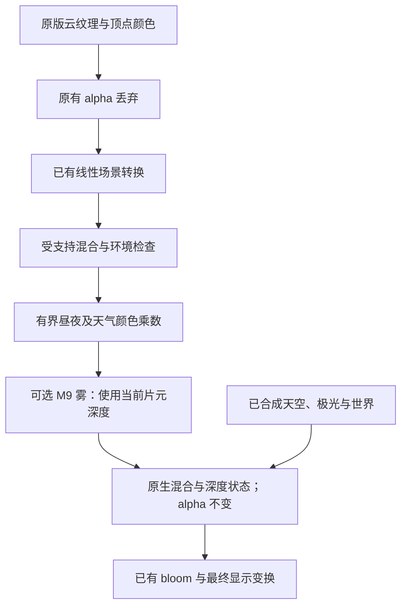

# Milestone 12：让原版云融入 Aurora 大气

日期：2026-11-13。分支：`codex/milestone-12-cloud-atmosphere`。
基于 M11 提交 `b0f6e105a11b1c09e97ff3100cc58f8bed7c986a`。
[English](MILESTONE_12.md)。

**尚未测量 Minecraft／Iris 实际画面、云层覆盖关系与 GPU 耗时。**
实现依据文档约定与固定提交的源代码；没有重新核实当前安装的 Iris／Minecraft 版本。
已执行离线检查应单独记录，运行观察保留空白，不作为日常持续开发的验收门槛。

## 1. 先协调已有云，再考虑替换它

M12 把原版云颜色接入 Aurora 的白天／晨昏／夜晚配色，并对受支持的云片元应用
已有距离／高度雾。保留原版云网格、形状、运动、天气源颜色、各面明暗与覆盖率。

没有新增程序化云几何体、噪声场、风模型、云阴影、沿光路步进的体积、物理云光照
或散射模拟。Minecraft 的云设置仍决定是否绘制云，没有原生云源时，本阶段不会生成云。

## 2. 只接入云程序

只有 `gbuffers_clouds.fsh` 定义 `APPLY_CLOUD_ATMOSPHERE`。
共享 `textured_fragment.glsl` 只在该标记下包含并调用新函数，其他使用这份共享代码
的程序仍沿用已有路径。

原有顺序保留：

```text
sourceRGBA = texture(gtexture, texcoord) * glcolor
discard if sourceRGBA.a < alphaTestRef
sceneRGB = sceneFromDisplay(sourceRGBA.rgb)
cloudRGB = applyCloudAtmosphere(sceneRGB)
output = (cloudRGB, sourceRGBA.a)
```

新增操作位于原来的覆盖率判断与 RGB 转换之后，不用一片纯白取代云源颜色，
不重复乘顶点颜色，也不改变 alpha 或丢弃阈值。



所检查的 Iris patcher 会重建原版云各面的颜色，并提供 UV 回退；缺少 UV 的几何体
还会绑定白纹理。因此保留纹理乘颜色这条路径，才能继续使用引擎提供的云数据，
不能假定每种云都是普通的贴图四边形。
[云 patcher](https://github.com/IrisShaders/Iris/blob/99d855970316329f2e0e42ac2b79ef763cb77cc3/common/src/main/java/net/irisshaders/iris/pipeline/transform/transformer/VanillaTransformer.java)、
[纹理回退](https://github.com/IrisShaders/Iris/blob/99d855970316329f2e0e42ac2b79ef763cb77cc3/common/src/main/java/net/irisshaders/iris/pipeline/programs/ExtendedShader.java)。

## 3. 有界乘数，不是再算一次光照

M12 复用已有太阳阶段函数。设太阳高度为 `e`：

```text
day = smoothstep(-0.10,0.16,e)
twilight = smoothstep(-0.18,-0.04,e) * (1-smoothstep(0.08,0.35,e))

nightTint = (0.55,0.65,1.05)
dayTint = (1.02,1.00,0.96)
twilightTint = (1.15,0.72,0.50)
tint = mix(mix(nightTint,dayTint,day),twilightTint,twilight)
weatherTint = mix(tint,(1,1,1),0.8*clamp(rainStrength,0,1))

w = clamp(CLOUD_COLOR_STRENGTH,0,1) * celestialEnvironmentWeight()
tintedRGB = sceneRGB * mix((1,1,1),weatherTint,w)
```

这些向量是**线性乘数**，不是显示 sRGB 颜色，也不是替代云辐亮度。
原版云颜色和各面亮度已经烘焙在 `sceneRGB` 中。新增乘数只添加偏冷夜色与偏暖晨昏，
没有估计云法线，也没有再计算 Lambert 或阴影项。

端点与插值权重限制了乘数的范围；限制的是增益，不是任意输入颜色的最大值，
这里没有新增场景颜色截断。满雨量时，新增色调有 80% 向中性增益靠拢，
并不把云本身变白，也不取消 Minecraft 原有的雨天明暗。

这里复用的是太阳阶段，不是 M7 天空样式开关或天空混合强度。
`CLOUD_STYLE`、`CLOUD_COLOR_STRENGTH` 独立控制云。例如使用基础天空时，
新增云色仍可生效；雾色则继续遵循已有天空／雾配色设置。

## 4. 在原生混合之前，给前景云加雾

云源颜色已经包含 Minecraft 的明暗。先乘新增色调，再应用 M9 雾：

```text
uv = gl_FragCoord.xy / (viewWidth,viewHeight)
viewPosition = reconstructViewPosition(uv,gl_FragCoord.z)
cloudFogged = T(viewPosition)*tintedRGB
              + (1-T(viewPosition))*atmosphereRGB
```

当前片元深度对应这片云面。如果读取先前写入的不透明深度，读到的可能是背后的
地形或天空。Iris 文档说明除手持物外，gbuffers 使用普通场景投影，支持这里的云位置重建。
[投影约定](https://shaders.properties/current/reference/uniforms/matrices/#gbufferprojection)。

所有接受的云混合情况都直接调用已有 `applyAtmosphericFog`。它的透射率模型和
M9 通用后绘制混合函数均没有修改。继续沿用清晰近景、高度密度下方封顶、三点密度
估计、雨量增强、相机天空光保护，以及视觉状态／流体／维度条件。
完整公式与局限见 [M9](MILESTONE_9.zh-CN.md)。

在已有背景上使用普通 straight-alpha 混合时：

```text
resultRGB = alpha * cloudFogged + (1-alpha) * backgroundRGB
```

alpha 为零时没有贡献，为一时使用云自身加雾后的颜色。雾不会增加云的不透明度。
本函数既不采样背景，也不把背景重新加雾；若对已经混合的颜色处理，就会失去
前景与背景各自的深度。

云仍只写场景颜色，不写法线／光照数据，不会再进入 deferred 表面光照路径。
M12 没有新增全屏雾。

## 5. 明确混合范围，包括关闭混合

| 报告的混合状态 | M12 行为 |
|---|---|
| `blendFunc` 四个分量全为零 | 在这条云路径中视为混合关闭；处理替换目标的云源颜色 |
| RGB 为 `SRC_ALPHA / ONE_MINUS_SRC_ALPHA`（770/771） | 先对源颜色调色／加雾，再走原有 alpha 混合 |
| RGB 为 `ONE / ZERO`（1/0） | 处理替换目标的云源颜色 |
| 其他状态 | 返回原源颜色，同时跳过新色调与雾 |

固定提交的 Iris 实现用全零向量表示混合关闭。这里它是状态信号，不是在要求把
源颜色和目标颜色都乘零。这个例外仅限云辅助函数；M9 其他后绘制路径保留原规则。
[Iris 混合 uniform 实现](https://github.com/IrisShaders/Iris/blob/99d855970316329f2e0e42ac2b79ef763cb77cc3/common/src/main/java/net/irisshaders/iris/uniforms/CommonUniforms.java)。

本函数不打开混合、不指定新混合因子，也不写深度。加法或自定义云混合没有建立
支持约定，故保留原结果；原生 alpha 因子与覆盖率仍由引擎负责。

## 6. 设置与有效对照

设置页为 **Cloud Color and Atmosphere**，内部名称 `CLOUDS`。

| 设置 | 默认值 | 可选值 | 含义 |
|---|---:|---|---|
| `CLOUD_STYLE` | 1 | 0、1 | 整个 M12 云效果关闭／开启 |
| `CLOUD_COLOR_STRENGTH` | .6 | 0、.3、.6、1 | 只控制色调强度 |
| `CLOUD_FOG` | 1 | 0、1 | 每片云使用 M9 雾，还要求全局雾开启 |

`CLOUD_STYLE=0` 在本光影包已有颜色管线中恢复完整 M11 云源路径。
它不会关闭 Minecraft 云，也不会移除之前的天空、bloom 或调色效果。

`CLOUD_COLOR_STRENGTH=0` **只关闭色调**，云雾仍可能生效。
`CLOUD_FOG=0` 或全局 `FOG_ENABLED=0` 会在位置重建前直接返回调色后的源颜色。
全局密度为零也能通过 M9 透射率规则移除雾，但不等于上述编译期开关路径。

旧场景模式或调试视图绕过 M12。环境不允许、环境／雨量无效、混合不受支持时，
也返回原源颜色。共享环境保护要求开放且有天空光的维度，排除流体镜头，并随
视觉状态淡出。相机天空光洞穴保护属于雾部分，不单独控制新增云色。

可以这样拆开比较：

- Style 关闭：M11 基线。
- Style 开启、颜色强度零、云雾开启：只观察雾。
- Style 开启、普通颜色强度、云雾关闭：只观察色调。
- Style 开启、两者均开启：观察组合效果。

每次对照时保持全局雾、曝光、bloom 和天空设置一致。

## 7. 顺序证据与兼容性边界

源代码审查使用固定 Iris 提交
`99d855970316329f2e0e42ac2b79ef763cb77cc3`，其构建元数据声明 Iris 1.10.5、
Minecraft 1.21.11。这是源代码快照，**不是重新核实了当前安装的 jar**。
[版本元数据](https://github.com/IrisShaders/Iris/blob/99d855970316329f2e0e42ac2b79ef763cb77cc3/build.gradle.kts)。

固定 NeoForge 补丁里的 Minecraft 上下文，按 main、粒子、云、天气安排绘制。
Iris 在 main 内进入透明阶段转换，并在那里执行 deferred。据这些源代码推断，
所审查的普通云路径位于 deferred 之后。
[帧调度上下文](https://github.com/neoforged/NeoForge/blob/0753a6a7dd9ed0bafc5441142206f33618f031b3/patches/net/minecraft/client/renderer/LevelRenderer.java.patch)、
[Iris main 阶段接入](https://github.com/IrisShaders/Iris/blob/99d855970316329f2e0e42ac2b79ef763cb77cc3/common/src/main/java/net/irisshaders/iris/mixin/MixinLevelRenderer.java)、
[deferred 转换](https://github.com/IrisShaders/Iris/blob/99d855970316329f2e0e42ac2b79ef763cb77cc3/common/src/main/java/net/irisshaders/iris/pipeline/IrisRenderingPipeline.java)。

这个推断支持在 deferred 之后处理云源雾，不是所有 Minecraft 版本、渲染模组、
云模式或资源包的运行证据。云与星星、日月、极光、几何体之间的覆盖仍由原生顺序、
深度和 alpha 决定，M12 没有新增遮挡缓冲。

雾配色仍不包含 M11 极光光带。明亮云像素之后可能参与已有 M10 bloom，
这是下游的图像效果。

## 8. 文件、开销与待观察项目

- `lib/cloud_settings.glsl`：三个选项。
- `lib/clouds.glsl`：混合／环境范围、色调与已有雾合成。
- `gbuffers_clouds.fsh`：只为云开启的标记。
- `lib/geometry/textured_fragment.glsl`：原有丢弃与颜色转换之后的条件接入。
- `shaders.properties`、`lang/en_us.lang`：设置页及说明。

没有新增顶点几何体、阶段、附件或纹理，程序对仍为 24。受支持云片元新增颜色运算，
以及可选位置／雾计算。阶段数不变不代表零开销，没有 FPS 或 GPU 耗时声明。

运行已有验证器、可用独立 GLSL 编译与空白检查，已执行结果单独记录。
这些检查不执行 Iris patcher，也没有观察 Minecraft 的云帧缓冲与实际绘制顺序。

| 对照项目 | 需要观察的内容 | 实际结果 |
|---|---|---|
| Style 关闭与 M11 对照 | 原有云源颜色、形状、运动和覆盖率 | |
| 仅色调／仅雾／组合 | 独立控制含义正确 | |
| Minecraft 云 Off／Fast／Fancy | 不强制出现云，保留原生几何体与各面明暗 | |
| 白天、日落、夜晚、日出 | 色调平滑变化，不以平面颜色替换原云 | |
| 晴天、雨天、雷雨 | 新色调趋于中性，原生天气明暗仍保留 | |
| 近远云层、改变高度 | 使用自身片元深度并沿用高度雾 | |
| 云层上方／下方／内部 | 原生深度／覆盖与可用的雾表现 | |
| 地形、天空、星星、日月、极光前的云边缘 | 实际遮挡混合，不对背景重复加雾 | |
| 相机移动、旋转、视角摇晃 | 位置重建稳定性 | |
| 雾关闭／密度零／清晰近景距离 | 回退与全局参数关系 | |
| 基础天空和 Sky Blend 调整 | 云色独立，雾色沿用已有配色控制 | |
| 洞口、流体镜头与视觉状态 | 云色环境与雾洞穴保护的区别 | |
| 下界／末地与模组维度 | 属性条件与渲染路径 | |
| 旧模式和 Debug 1–6 | 没有新增云大气效果 | |
| 自定义云模组、资源包、未知混合 | 记录支持缺口，不假定完全兼容 | |
| 固定曝光并开关 bloom | 区分云色与下游扩散 | |
| 同场景开关 Style | 测量实际帧时／GPU 开销 | |

没有观察过的结果保留空白。下一计划阶段建立水材质识别，在雾之前加入有界天空色
反射并保留 alpha，不包含 SSR、折射或波浪。自定义云几何体、体积光和云阴影
仍属于后续独立系统。

## 9. 面试时如何解释

1. **这是新的云渲染器吗？** 不是，它处理原生云片元颜色，保留几何体、运动与覆盖率。
2. **为什么保留纹理乘顶点颜色？** 引擎通过这些输入提供各面与天气明暗，替换掉会失去这些信息。
3. **为什么在线性转换后调色？** 乘数属于线性场景合成，与已有 HDR／雾管线使用一致空间。
4. **为什么调色在雾之前？** 色调属于云表面，之后加入的空气颜色不应再乘云的材质色调。
5. **为什么用当前云片元深度？** 背景深度属于另一个表面，会给出错误路径长度。
6. **为什么 alpha 不变？** 它控制覆盖率与原生混合；RGB 雾描述空气颜色／透射，不改变云的不透明度。
7. **全零混合向量为什么特殊？** Iris 用它表示混合关闭；这里的云局部解释不同于启用 ZERO／ZERO 因子。
8. **颜色强度零会恢复 M11 吗？** 不会，只移除色调。Style 零才是完整回退；雾有独立开关。
9. **雨天为什么让色调趋于中性？** 原生云已有天气明暗，只需要削弱新增的颜色倾向。
10. **源码审查能证明什么？** 它支持固定实现的数据／顺序约定，不代表当前游戏已通过运行验证。

## 原始资料

上文链接固定到具体源代码提交，避免依赖不断变化的分支。
另见 [Iris 渲染输入](https://shaders.properties/current/reference/uniforms/rendering/)、
[M9 雾](MILESTONE_9.zh-CN.md)、[M11 天空极光](MILESTONE_11.zh-CN.md)、
[持续开发路线](AURORA_ROADMAP.zh-CN.md)。

## 已执行的离线验证（2026-11-13）

- 完整 `tools/validate.py` 通过历史及当前检查，包括 83 个旧着色器／配置文件比对和 2,160 组有界云色输入。
- 1,062 组独立 GLSL 编译／链接配置全部通过。
- 数值混合模型明确区分不透明替换与普通 alpha 合成后，云专项检查再次通过。
- 完整代码／工具／文档差异复核与空白检查通过。
- 原生 Fast／Fancy／Sodium 云画面、覆盖关系、当前安装版本行为与 GPU 开销仍未测量。
