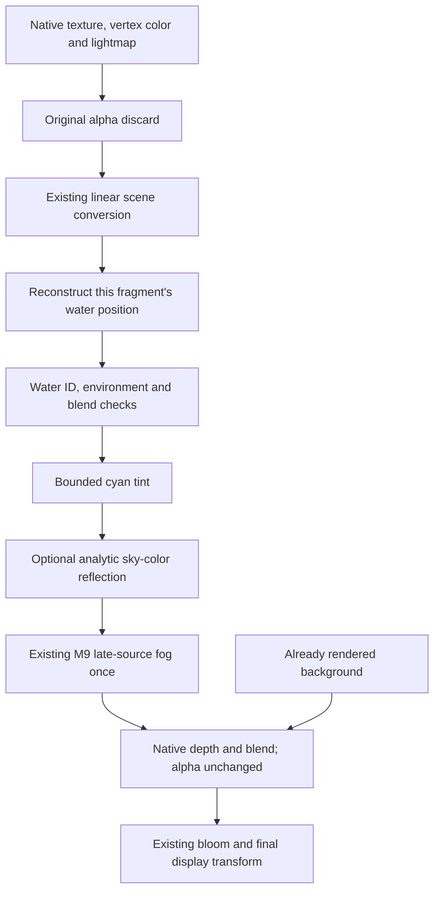

# Milestone 13: Water color and analytic sky reflection

Date: 2026-11-13. Branch: `codex/milestone-13-water-foundation`.
Base: M12 commit `4e7b8b4bb943d24eee9e46745ffeaef16bee5f4f`.
[中文学习版](MILESTONE_13.zh-CN.md).

Minecraft/Iris appearance, translucent overlap and GPU timing remain **unmeasured**.
The source contracts below were checked against documentation and a pinned Iris
snapshot; the currently installed game/mod version has not been freshly verified.
Executed offline checks belong in a separate record. Empty runtime observations
remain open without becoming a routine acceptance gate.

## 1. A small water foundation

M13 gives actual water-fluid surfaces a restrained cyan tint and an angle-dependent
reflection of Aurora's existing analytic sky palette. It keeps native geometry,
texture/lightmap inputs, alpha, discard, depth and blending. The result enters
the existing late-source fog once, then the existing bloom/display pipeline.

This is an artistic source-color treatment. It adds no waves, SSR, refraction,
water-depth absorption, underwater styling, scene reflection, new water shadows
or material/PBR system. The reflected color has no information about terrain,
entities, clouds, sun/moon discs, stars or the M11 aurora.

## 2. Identify water by its fluid data

`gbuffers_water` can also draw glass and other translucent blocks. Its program
name alone is therefore insufficient. The new mapping is deliberately narrow:

```properties
block.10001 = minecraft:water
```

The water vertex entry point enables a shared classifier:

```glsl
waterSurface = (mc_Entity.x == 10001.0 && mc_Entity.y == 1.0) ? 1 : 0;
```

The result travels as a `flat int`, so interpolation cannot turn an identifier into
a fractional material value. Iris defines `mc_Entity.x` through `block.properties`
and uses `mc_Entity.y == 1` for fluids. Non-fluid sentinel values vary between
documented/general and patched paths; the classifier only accepts the fluid value.
[Attribute contract](https://shaders.properties/current/reference/attributes/mc_entity/),
[block mapping syntax](https://shaders.properties/current/reference/miscellaneous/block_properties/).

The pinned Iris/Sodium fluid path looks up the ID of
`fluidState.createLegacyBlock()` and marks that draw as fluid. From this source
contract, source/flowing water and water-fluid geometry inside waterlogged or
bubble-column locations should receive the water ID. This coverage is a
**source-based inference**, not a recorded Minecraft observation. The host block,
bubble particles, lava, glass, cauldron contents and held items are not explicitly
classified as water by this change. No host-block IDs or render-layer overrides
were added.
[Fluid mapping implementation](https://github.com/IrisShaders/Iris/blob/99d855970316329f2e0e42ac2b79ef763cb77cc3/common/src/main/java/net/irisshaders/iris/compat/sodium/mixin/MixinChunkMeshBuildTask.java).

## 3. Style the source, then fog and blend it



The fragment position comes from this water fragment's `gl_FragCoord` and the
existing inverse-projection reconstruction. It is reused for reflection and fog;
the code does not substitute a background surface's position. Iris documents the
shared gbuffer projection for these programs, with hands as the exception.
[Matrix uniforms](https://shaders.properties/current/reference/uniforms/matrices/).

The water hook runs after the original alpha test and `sceneFromDisplay`.
It does not newly write opaque G-buffer normal/light metadata or add another
deferred pass. The M9 late-fog helper is unchanged. Returning the input from the
**water helper** still allows that pre-existing fog path to run afterward.

## 4. Tint: bounded, skylight-aware and gentle near block light

The lightmap convention matches the existing surface-data writer:

```text
(block,sky) = clamp((lightmapUV - 0.5/16) * (16/15), 0, 1)
t = clamp(WATER_TINT_STRENGTH,0,1) * environment * sky * (1-block)
tinted = scene * mix((1,1,1), (0.80,1.03,1.08), t)
```

Subtracting the half-cell offset maps the lightmap's cell centers back to normalized
levels. These levels are artistic availability weights, not physical irradiance.

The tint retains the original source texture and lighting while gently reducing
red and increasing green/blue. At the default strength 0.35, full environment/sky
and zero block light give a multiplier of `(0.93,1.0105,1.028)`.
Full block light disables **tint only**; reflection can remain if skylight is
available. Zero skylight bypasses both new water effects. This prevents an analytic
open-sky color from automatically washing over fully unskylit cave water.

The multiplier is bounded by its endpoints. It is not a clamp on HDR scene values.

## 5. Reflection: consistent directions and a Fresnel-shaped weight

All directions in this calculation are in view space:

```text
N = unit(normalView)
V = unit(-viewPosition)             // surface toward eye
R = reflect(-V,N)                   // reflected eye-to-surface ray
U = unit(upPosition)
F = 0.02 + 0.98 * (1-clamp(dot(N,V),0,1))^5

upperFace = smoothstep(0.50,0.95,dot(N,U))
horizon = smoothstep(-0.10,0.0,dot(R,U))
r = clamp(WATER_REFLECTION_STRENGTH,0,1)
    * environment * sky * clamp(SKY_BLEND,0,1)
    * upperFace * horizon * F

waterRGB = mix(tinted, auroraSkyLinear(R,vanillaFog), clamp(r,0,1))
```

Using the same coordinate frame for position, normal, reflection and up is what
allows camera rotation to preserve their geometric relationships. The original
normal transform is retained; M13 does not displace geometry or create wave normals.

The fifth power follows Schlick's familiar angle dependence with a fixed,
water-like normal-incidence value of 0.02. It shapes an artistic source mix; it
does not establish a complete physical reflection/transmission balance.
At default strength and all other gates equal to one, the mix weight is
0.007 face-on and approaches 0.35 at grazing angles.

The upper-face mask removes reflection from vertical waterfall faces and gradually
introduces it on upward normals. Tint can still affect those vertical faces.
The horizon mask stays fully enabled at and above the horizon, then fades over
slightly downward reflected directions. That small below-horizon band uses M7's
clamped horizon palette. It does not reflect the ground.

`auroraSkyLinear` is the **M7 sky-palette helper**, despite its name. It supplies
bounded linear day/twilight/night colors, directional warmth and weather/fog-color
influence. It does not sample the rendered sky or contain the M11 aurora ribbons.
`SKY_STYLE=0` or `SKY_BLEND=0` removes reflection while allowing tint to remain.
Existing sky-palette controls can affect the reflected color.

## 6. Native alpha also attenuates reflection

For the ordinary source-alpha blend, before considering the subsequent fog:

```text
source = (1-r)*tinted + r*analyticSky
frame = alpha*source + (1-alpha)*background
```

The reflected sky's contribution is therefore `alpha*r`. For example, alpha 0.5
and a source mix weight 0.35 contribute 0.175 of the reflected palette. This is
a numerical illustration, not a runtime measurement.

M13 never divides by alpha to compensate. It preserves native transparency and
avoids introducing an opacity change, but does not produce physically correct
water transmission or a perfect grazing-angle mirror. It also cannot fix native
transparent sorting or resource-pack opacity choices. Reflection is mixed first;
the existing foreground fog then attenuates and colors that whole water source.

## 7. Controls, blend scope and fallbacks

The `Water Color and Sky Reflection` settings screen contains:

| Setting | Default | Values | Meaning |
|---|---:|---|---|
| `WATER_STYLE` | 1 | 0, 1 | 0 restores the M12 water-source path; 1 enables this system |
| `WATER_TINT_STRENGTH` | 0.35 | 0, 0.2, 0.35, 0.5, 1 | Cyan multiplier strength |
| `WATER_REFLECTION_STRENGTH` | 0.35 | 0, 0.2, 0.35, 0.5, 0.75 | Maximum pre-alpha sky mix, further reduced by all gates |

The water helper returns its input for legacy scene mode, a nonzero debug view,
a non-water ID, both strengths at zero, an unsupported blend, invalid environment/
rain/lightmap data, or no skylight availability. Turning one strength off leaves
the other system available.

Supported blend states are disabled blending, represented by Iris's all-zero
`ivec4`, RGB `SRC_ALPHA/ONE_MINUS_SRC_ALPHA` (770/771), and RGB `ONE/ZERO` (1/0).
Other states bypass this water treatment; existing M9 late-fog behavior remains
independently governed by its own blend rules.
[Blend-uniform implementation](https://github.com/IrisShaders/Iris/blob/99d855970316329f2e0e42ac2b79ef763cb77cc3/common/src/main/java/net/irisshaders/iris/uniforms/CommonUniforms.java).

The reused environment gate excludes a submerged/fluid camera, dimensions without
skylight, and dimensions with ceilings; blindness/darkness fade its weight. This
is a capability gate, not an Overworld-name test. Open skylit modded dimensions
may qualify. It is also not a physical visibility query.

Invalid or near-zero normal/view vectors bypass **reflection while retaining
valid tint**. The helper performs no general repair of arbitrary invalid source
RGB. No alpha or native depth/blend state is changed by these guards.

## 8. Files, cost and compatibility boundary

| File | Responsibility |
|---|---|
| `shaders/block.properties` | Assign water-fluid material ID 10001 |
| `shaders/gbuffers_water.vsh/.fsh` | Opt the existing water category into classification/style |
| `shaders/lib/geometry/lit_vertex.glsl` | Conditional flat water classification |
| `shaders/lib/geometry/lit_fragment.glsl` | Conditional water call before existing late fog |
| `shaders/lib/water_settings.glsl` | Three exposed options and defaults |
| `shaders/lib/water.glsl` | Tint, direction/Fresnel masks and analytic sky mix |
| `shaders/shaders.properties`, language files | Settings screen and bilingual descriptions |

The pack retains 24 vertex/fragment program pairs. M13 adds no render targets,
fullscreen passes, texture lookups in the water helper, geometry displacement
or scene-ray traversal. It does add arithmetic and palette evaluation on eligible
water fragments; this is a cost description, not a measured performance claim.

Source reasoning uses Iris commit `99d855970316329f2e0e42ac2b79ef763cb77cc3`,
whose build declares Iris 1.10.5 / Minecraft 1.21.11. That identifies the inspected
source snapshot, not the user's installed version.
[Pinned version declarations](https://github.com/IrisShaders/Iris/blob/99d855970316329f2e0e42ac2b79ef763cb77cc3/build.gradle.kts).

## 9. Runtime observation sheet

Use a fixed world, view, weather/time and resource pack when comparing M12,
`WATER_STYLE=0`, and defaults. Reload the pack after material mapping changes;
if a loader retains old chunk attributes, rebuild/reload chunks before judging
classification. Leave unobserved results blank.

| Observation | Expected question to resolve | Actual result |
|---|---|---|
| Source and flowing water | Both classify, retaining native flow texture and alpha | |
| Waterlogged block and bubble column | Only water-fluid geometry receives the style; host/particles retain theirs | |
| Glass, lava, cauldrons and held items | None accidentally receive the water classification | |
| Shoreline, sloped water and waterfall | Top faces reflect; vertical faces retain tint without sky reflection | |
| Face-on versus grazing view | Smooth Fresnel-shaped transition, without disappearing at the horizon | |
| Camera translation/rotation | Reflected directions remain geometrically consistent | |
| Day, twilight, night and rain | Analytic reflection follows the palette without implying reflected discs/clouds | |
| Open water beside a block light | Tint reduces; skylight can still allow reflection | |
| Zero-skylight cave water | New tint and reflection both bypass | |
| Underwater/fluid camera, ceiling/no-skylight dimensions | Environment fallback works; no underwater redesign appears | |
| Sky style/blend off; individual water controls off | Reflection and tint obey their independent gates | |
| Distant water and overlapping glass/particles | Existing late fog appears once; native sorting limits are recorded | |
| Different water alpha/resource packs | Coverage stays native; reflection strength is alpha-dependent | |
| Legacy/debug/baseline comparison | Water feature bypass is preserved | |
| Matched scene GPU timing | Record cost, resolution, hardware and settings before making claims | |

## 10. Ten rendering questions

1. **Why not style every `gbuffers_water` fragment?** That program also serves
   other translucent geometry; a material ID plus fluid marker gives a narrower scope.
2. **Why use a flat integer?** Material classification is discrete and must not
   interpolate across a primitive.
3. **Why combine an ID with the fluid marker?** It excludes a non-fluid draw that
   happens to share a mapping and makes the intended source contract explicit.
4. **Why use `-V` in `reflect`?** `V` points toward the eye; the incident ray
   travels in the opposite direction, toward the surface.
5. **Why keep all directions in one space?** Dot products and reflection only
   describe the intended geometry when their vectors share a coordinate frame.
6. **What does Fresnel change?** It increases the reflected-source weight toward
   grazing angles; it does not supply reflection content.
7. **What supplies that content here?** The analytic M7 palette, which has no
   scene visibility or rendered-sky detail.
8. **Why fog after the reflection mix?** The whole water source lies behind the
   camera-to-water atmosphere, so the existing source-depth fog acts on both terms.
9. **Why is this not physical water?** Native alpha attenuates reflection and
   transmission together; depth-dependent absorption and refraction are absent.
10. **What should follow?** Research opaque/translucent depth availability, sorting
    and composition before choosing a bounded water-depth/transmission feature.
    That next feature is not implemented by M13.

Related foundations: [M7 sky palette](MILESTONE_7.md),
[M8 scene color](MILESTONE_8.md), [M9 fog](MILESTONE_9.md),
[M12 native clouds](MILESTONE_12.md), [roadmap](AURORA_ROADMAP.md).

## Recorded offline verification (2026-11-13)

- Full `tools/validate.py` passed all M1–M13 contracts, including 85 prior shader/property pins and 10,800 bounded water cases.
- All 1,168 standalone GLSL compile/link configurations passed. Stage checks now include interpolation qualifiers and duplicate declarations.
- Classification, camera invariance, Fresnel limits, cave/tint protection, alpha preservation, fog order and exact bypass checks passed.
- Full code/tool/document diff review and whitespace checks passed. Runtime water classification, appearance and GPU cost remain unmeasured.

Angle-approximation background: [Christophe Schlick, An Inexpensive BRDF Model for Physically-based Rendering (1994)](https://onlinelibrary.wiley.com/doi/10.1111/1467-8659.1330233). M13 uses the angle-weight idea, not that paper's complete BRDF.
