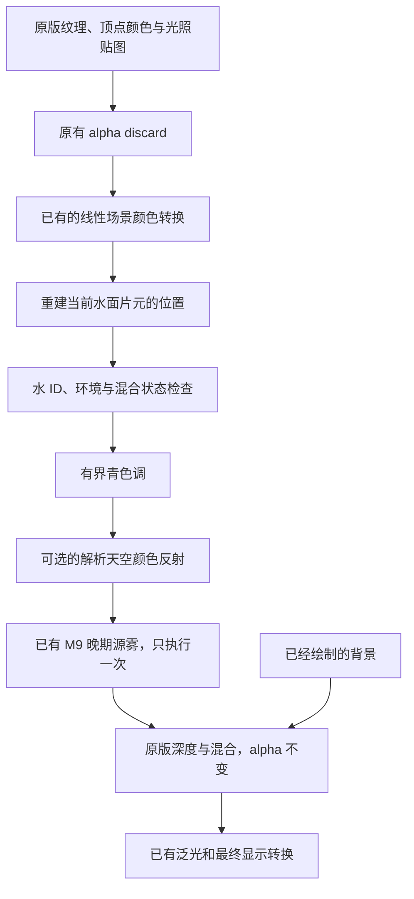

# Milestone 13：水面颜色与解析天空反射

日期：2026-11-13。分支：`codex/milestone-13-water-foundation`。
基线：M12 提交 `4e7b8b4bb943d24eee9e46745ffeaef16bee5f4f`。
[English version](MILESTONE_13.md)。

Minecraft/Iris 中的实际观感、透明物体叠加和 GPU 耗时仍然**未测量**。
下面的接口依据来自文档与固定版本的 Iris 源码，没有重新核实当前安装的游戏和模组版本。
实际执行的离线检查另外记录；运行观察表中的空白保持为空，不把每次人工验收变成继续开发的前提。

## 1. 先建立一个范围明确的水面基础

M13 为实际的水流体表面添加克制的青色调，以及随观察角度变化的 Aurora 解析天空颜色反射。
原版几何、纹理/光照贴图输入、alpha、discard、深度与混合状态保留。
处理后的水面源颜色先经过已有的晚期雾一次，再进入原有的泛光和最终显示流程。

这是对源颜色的艺术化处理。本阶段没有波浪、SSR、折射、水深吸收、水下风格、
场景反射、新的水面阴影或材质/PBR 系统。反射颜色不知道地形、实体、云、太阳/月亮圆盘、
星星或 M11 极光的位置和外观。

## 2. 根据流体数据识别水

`gbuffers_water` 也可能绘制玻璃等透明方块，因此不能仅凭程序名把整个通道当成水。
新增的映射只包含：

```properties
block.10001 = minecraft:water
```

水面顶点入口启用共享代码中的分类：

```glsl
waterSurface = (mc_Entity.x == 10001.0 && mc_Entity.y == 1.0) ? 1 : 0;
```

结果以 `flat int` 传给片元阶段，防止插值把离散的材质标识变成小数。
Iris 使用 `block.properties` 指定 `mc_Entity.x`，并用 `mc_Entity.y == 1` 标记流体。
通用文档和具体补丁路径中的非流体标记值并不完全相同；这里仅接受明确的流体值。
[属性约定](https://shaders.properties/current/reference/attributes/mc_entity/)，
[方块映射语法](https://shaders.properties/current/reference/miscellaneous/block_properties/)。

固定版本的 Iris/Sodium 流体路径根据 `fluidState.createLegacyBlock()` 查找 ID，
并将该次绘制标记为流体。由这个源码约定可以推断：水源、流水，以及含水方块或气泡柱位置中的
**水流体几何部分**应得到水 ID。这是**源码推断**，尚不是记录过的 Minecraft 实测结果。
宿主方块模型、气泡粒子、岩浆、玻璃、炼药锅内容物和手持物品没有被这次改动显式分类为水。
没有给宿主方块添加 ID，也没有覆盖渲染层。
[流体映射实现](https://github.com/IrisShaders/Iris/blob/99d855970316329f2e0e42ac2b79ef763cb77cc3/common/src/main/java/net/irisshaders/iris/compat/sodium/mixin/MixinChunkMeshBuildTask.java)。

## 3. 先处理水面源颜色，再加雾和混合



片元位置来自当前水面自己的 `gl_FragCoord` 和已有的逆投影重建，然后供反射与雾共同使用；
这里没有拿水面背后的背景深度冒充水面位置。Iris 文档说明这些 gbuffer 程序共用投影，
手部程序是例外。
[矩阵 uniform](https://shaders.properties/current/reference/uniforms/matrices/)。

水面处理位于原有 alpha 测试和 `sceneFromDisplay` 之后。
它不新增不透明 G-buffer 的法线/光照元数据写入，也不增加 deferred pass。
M9 晚期雾函数保持原样。即便**水面函数**返回输入颜色，后面的旧雾流程仍然可以继续执行。

## 4. 色调：有界、依赖天空光，并减轻对方块光的影响

光照贴图坐标转换与已有表面数据写入规则一致：

```text
(block,sky) = clamp((lightmapUV - 0.5/16) * (16/15), 0, 1)
t = clamp(WATER_TINT_STRENGTH,0,1) * environment * sky * (1-block)
tinted = scene * mix((1,1,1), (0.80,1.03,1.08), t)
```

减去半个格子的偏移，是把光照贴图格子中心还原成归一化等级。
这些等级用来控制效果可用程度，不代表物理辐照度。

色调保留原有纹理与光照结果，温和地减少红色、增加绿色和蓝色。
默认强度 0.35、环境/天空光权重为 1、方块光为 0 时，颜色乘数为
`(0.93,1.0105,1.028)`。
满方块光只关闭**色调项**；只要仍有天空光，反射就可能继续存在。
天空光为零时，两种新水面效果都跳过，避免把解析的露天天空颜色直接覆盖到完全无天空光的洞穴水上。

乘数被限制在两个端点之间，但这并不等于对 HDR 场景值进行上限裁剪。

## 5. 反射：一致的坐标空间和菲涅耳形状的权重

下面的方向都在观察空间中计算：

```text
N = unit(normalView)
V = unit(-viewPosition)             // 表面指向眼睛
R = reflect(-V,N)                   // 眼睛射向表面的光线被反射
U = unit(upPosition)
F = 0.02 + 0.98 * (1-clamp(dot(N,V),0,1))^5

upperFace = smoothstep(0.50,0.95,dot(N,U))
horizon = smoothstep(-0.10,0.0,dot(R,U))
r = clamp(WATER_REFLECTION_STRENGTH,0,1)
    * environment * sky * clamp(SKY_BLEND,0,1)
    * upperFace * horizon * F

waterRGB = mix(tinted, auroraSkyLinear(R,vanillaFog), clamp(r,0,1))
```

位置、法线、反射方向和向上方向使用同一个坐标系，旋转相机时才能保持正确的几何关系。
原来的法线变换继续使用；M13 没有位移顶点，也没有生成波浪法线。

五次方采用 Schlick 常见的角度变化形式，正视反射基值固定为接近水的 0.02。
它控制的是艺术化的源颜色混合，不构成完整的物理反射/透射能量关系。
默认强度且其余权重均为 1 时，正视混合权重为 0.007，掠射时趋近 0.35。

朝上表面遮罩在竖直瀑布面上关闭反射，并随法线向上逐渐开启；这些竖直表面仍然可以有色调。
地平线遮罩在水平及以上的反射方向保持完全开启，只在略微朝下的方向渐隐。
这个略低于地平线的过渡带使用 M7 限制后的地平线调色结果，并没有真的反射地面。

`auroraSkyLinear` 虽然名字含有 aurora，实际是 **M7 天空调色函数**。
它提供有界的线性昼夜/暮光颜色、方向性暖色，以及天气和雾色的影响。
它不采样已经绘制的天空，也不包含 M11 极光带。
`SKY_STYLE=0` 或 `SKY_BLEND=0` 会关闭反射，但色调仍可保留。
已有天空调色选项也可能影响反射颜色。

## 6. 原版 alpha 也会削弱反射

对于普通源 alpha 混合，先不计后续雾：

```text
source = (1-r)*tinted + r*analyticSky
frame = alpha*source + (1-alpha)*background
```

因此反射天空的最终贡献为 `alpha*r`。例如 alpha 为 0.5、源反射混合权重为 0.35，
反射调色结果的贡献为 0.175。这是公式举例，不是运行测量。

M13 不会除以 alpha 来补偿反射。这样保留原版透明度，不引入不透明度变化，
但也无法得到物理正确的水体透射或理想的掠射镜面。
它不能修复原生透明排序，也不重定义资源包的透明度选择。
先混合反射，再由已有的前景雾衰减并着色整个水面源颜色。

## 7. 选项、混合范围和回退规则

“水面颜色与天空反射”设置页包含：

| 选项 | 默认值 | 可选值 | 含义 |
|---|---:|---|---|
| `WATER_STYLE` | 1 | 0、1 | 0 恢复 M12 的水面源路径，1 启用本系统 |
| `WATER_TINT_STRENGTH` | 0.35 | 0、0.2、0.35、0.5、1 | 青色乘数强度 |
| `WATER_REFLECTION_STRENGTH` | 0.35 | 0、0.2、0.35、0.5、0.75 | alpha 混合前的天空混合上限，还会被其他权重削弱 |

旧场景颜色模式、非零调试视图、非水 ID、两个强度同时为零、不支持的混合状态、
无效环境/雨量/光照贴图数据，或没有天空光时，水面函数返回输入。
单独关闭一种强度，另一种效果仍然可以工作。

支持的状态为：Iris 用全零 `ivec4` 表示的关闭混合、RGB
`SRC_ALPHA/ONE_MINUS_SRC_ALPHA`（770/771），以及 RGB `ONE/ZERO`（1/0）。
其他状态跳过本阶段水面处理；已有 M9 晚期雾仍按自己的混合规则独立决定行为。
[混合 uniform 实现](https://github.com/IrisShaders/Iris/blob/99d855970316329f2e0e42ac2b79ef763cb77cc3/common/src/main/java/net/irisshaders/iris/uniforms/CommonUniforms.java)。

复用的环境权重排除处于流体/浸没状态的相机、没有天空光的维度和有天花板的维度；
失明/黑暗效果会让权重渐弱。它按能力判断，不按“主世界”名称判断，
所以开放且有天空光的模组维度也可能启用。这也不是物理可见性查询。

无效或接近零的法线/观察位置只跳过**反射，同时保留有效的色调**。
函数不负责修复任意无效的输入 RGB。这些保护不会改变 alpha 或原版深度/混合状态。

## 8. 文件、成本和兼容性边界

| 文件 | 职责 |
|---|---|
| `shaders/block.properties` | 为水流体指定材质 ID 10001 |
| `shaders/gbuffers_water.vsh/.fsh` | 让已有水面类别启用分类与风格 |
| `shaders/lib/geometry/lit_vertex.glsl` | 条件启用的 flat 水面分类 |
| `shaders/lib/geometry/lit_fragment.glsl` | 在已有晚期雾之前条件调用水面处理 |
| `shaders/lib/water_settings.glsl` | 三个选项及其默认值 |
| `shaders/lib/water.glsl` | 色调、方向/菲涅耳遮罩和解析天空混合 |
| `shaders/shaders.properties`、语言文件 | 设置页与双语说明 |

项目仍为 24 对顶点/片元程序。M13 不增加渲染目标、全屏 pass、水面函数中的纹理查询、
几何位移或场景光线遍历。满足条件的水面片元会增加算术和调色函数求值；
这只是成本来源说明，并不是已经测量过的性能结论。

源码推理采用 Iris 提交 `99d855970316329f2e0e42ac2b79ef763cb77cc3`，
其构建文件声明 Iris 1.10.5 / Minecraft 1.21.11。这说明检查的是哪个源码快照，
不代表用户当前安装的版本已经验证。
[固定版本声明](https://github.com/IrisShaders/Iris/blob/99d855970316329f2e0e42ac2b79ef763cb77cc3/build.gradle.kts)。

## 9. 运行观察表

比较 M12、`WATER_STYLE=0` 和默认设置时，固定世界、视角、天气/时间与资源包。
材质映射变化后重载光影；如果加载器保留旧的区块属性，先重建/重载区块再判断分类。
没有观察到的项目保持空白。

| 场景 | 需要确认的问题 | 实际结果 |
|---|---|---|
| 水源与流水 | 两者都被分类，原有流动纹理和 alpha 保留 | |
| 含水方块和气泡柱 | 只有水流体几何接受风格，宿主/粒子保持各自效果 | |
| 玻璃、岩浆、炼药锅和手持物品 | 没有误用水分类 | |
| 岸边、斜面流水与瀑布 | 顶面有反射，竖直面可着色但没有天空反射 | |
| 正视与掠射角 | 菲涅耳过渡平滑，地平线处不会突然失去反射 | |
| 相机平移/旋转 | 反射方向保持正确的几何关系 | |
| 白天、暮光、夜晚和雨天 | 反射跟随调色，不能误认为反射了真实圆盘或云 | |
| 方块光附近的露天水面 | 色调减弱，有天空光时反射仍可存在 | |
| 零天空光的洞穴水面 | 新色调和新反射都跳过 | |
| 水下/流体相机、有顶/无天空光维度 | 环境回退生效，没有出现本阶段未实现的水下改造 | |
| 关闭天空风格/混合，以及分别关闭水面选项 | 反射与色调遵循各自开关 | |
| 远处水面与玻璃/粒子叠加 | 已有晚期雾只作用一次，记录原生排序限制 | |
| 不同资源包/水面 alpha | 覆盖率保持原版，反射受 alpha 影响 | |
| 旧模式、调试模式和基线对照 | 水面功能回退保持正确 | |
| 匹配场景下的 GPU 耗时 | 先记录成本、分辨率、硬件和设置，再讨论性能 | |

## 10. 十个图形学问题

1. **为什么不处理所有 `gbuffers_water` 片元？** 这个程序也服务于其他透明几何；
   材质 ID 加流体标记可以更精确地限定范围。
2. **为什么用 flat 整数？** 材质分类是离散信息，不应该沿图元插值。
3. **为什么同时检查 ID 和流体标记？** 排除碰巧共享映射的非流体绘制，
   同时把所依赖的数据约定明确写出来。
4. **为什么 `reflect` 接收 `-V`？** `V` 指向眼睛，入射光线则朝表面前进，方向相反。
5. **为什么所有向量必须处于同一空间？** 点积和反射只有在坐标系一致时才表达预期几何关系。
6. **菲涅耳改变了什么？** 它让源颜色中的反射权重随掠射角增加，并不提供反射内容。
7. **这里的反射内容来自哪里？** M7 解析天空调色，不包含场景可见性或真实天空细节。
8. **为什么先混合反射，再加雾？** 整个水面源都位于相机到水面的空气之后，
   所以已有水面源深度雾应该作用于两个颜色项。
9. **为什么这还不是物理水？** 原版 alpha 同时削弱反射和透射，且没有深度吸收或折射。
10. **下一步是什么？** 先研究不透明/透明深度的可用性、排序与合成约定，
    再选择一个范围可控的水深/透射功能。M13 并没有实现该下一步功能。

相关基础：[M7 天空调色](MILESTONE_7.zh-CN.md)、
[M8 场景颜色](MILESTONE_8.zh-CN.md)、[M9 雾](MILESTONE_9.zh-CN.md)、
[M12 原版云](MILESTONE_12.zh-CN.md)、[路线图](AURORA_ROADMAP.zh-CN.md)。

## 已执行的离线验证（2026-11-13）

- 完整 `tools/validate.py` 通过 M1–M13 约定，包括 85 个旧着色器／配置文件比对与 10,800 组有界水面输入。
- 1,168 组独立 GLSL 编译／链接配置全部通过。阶段接口检查已覆盖插值限定符与重复声明。
- 材质分类、相机不变性、菲涅耳边界、洞穴／色调保护、alpha 保留、雾顺序与精确回退检查通过。
- 完整代码／工具／文档差异复核与空白检查通过。游戏中的水分类、画面与 GPU 开销仍未测量。

角度近似的背景阅读：[Christophe Schlick, An Inexpensive BRDF Model for Physically-based Rendering（1994）](https://onlinelibrary.wiley.com/doi/10.1111/1467-8659.1330233)。M13 使用角度权重思路，没有实现该论文的完整 BRDF。
