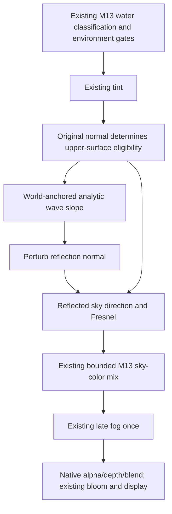

# Milestone 14: Gentle water reflection waves

Date: 2026-11-13. Branch: `codex/milestone-14-water-waves`.
Base: M13 commit `fd394d3e5f60ebbb101f3cc4a48656623dcd3e34`.
[中文学习版](MILESTONE_14.zh-CN.md).

Minecraft/Iris appearance, motion stability and GPU timing remain **unmeasured**.
The equations explain the implementation and its intended limits; numerical or
standalone compiler checks are not Minecraft runtime evidence. Executed offline
checks belong in a separate record. Runtime observations remain open while
development continues.

## 1. Make the reflection move, without moving the surface

M14 adds three gentle analytic wave slopes to the normal used by M13's water
reflection. It changes the reflected sky direction and Fresnel weight. Original
water classification, tint, geometry, depth, alpha, blending and fog stay intact.

A normal describes which direction a surface appears to face. Changing that
direction can make reflected colors move even when the mesh remains flat.
It cannot change the shoreline silhouette, displace a floating object, alter
water depth, bend the background or create wave geometry in shadows.

Only classified water that reaches the existing sky-reflection path can show this
effect. It adds no scene/terrain reflection, aurora reflection, SSR, refraction,
foam, water absorption, physical simulation or new light source.
The reflection still samples an analytic palette, not the rendered scene.

## 2. Keep eligibility separate from the animated normal



The original normal determines the upward-surface mask before any wave perturbation.
That mask both limits the normal perturbation and continues to limit reflection.
A vertical waterfall face therefore does not become reflection-eligible merely
because its animated normal happens to tilt upward.

The wave normal is used for `reflect` and the Fresnel dot product. The existing
reflected-horizon mask still evaluates the resulting reflected ray. M13's tint
does not use this new normal, and the current fragment position/depth remains the
position used by fog.

## 3. Anchor the pattern to the world without a huge float

The existing inverse-view position transform converts the fragment's view-space
position into a position aligned with Minecraft's axes and relative to the camera
anchor. It includes the inverse-view translation once; adding that translation a
second time would introduce movement with camera bobbing.
[Iris coordinate spaces](https://shaders.properties/current/how-to/coordinate_spaces/).

The camera anchor uses an integer plus a fractional part:

```text
playerRelative = viewToPlayerPosition(viewPosition)
cameraTileXZ = vec2(uvec2(cameraPositionInt.xz) & uvec2(127u))
tile = fract((cameraTileXZ + cameraPositionFract.xz
              + playerRelative.xz) / 128)
```

The complete large world coordinate is never assembled as a float. Only the
camera's low seven integer bits are converted, then combined with the fraction
and nearby fragment offset. The resulting pattern repeats every 128 blocks along
X and Z. This is intentional tiling, not an infinite nonrepeating ocean model.

Pinned Iris source constructs the integer anchor with `floor` and the fraction
by subtracting that floor, using the unshifted camera position. For example,
-0.25 splits into -1 and 0.75. This retains consistent behavior across zero and
avoids the separately shifted `cameraPosition` uniform.
[Camera anchor implementation](https://github.com/IrisShaders/Iris/blob/99d855970316329f2e0e42ac2b79ef763cb77cc3/common/src/main/java/net/irisshaders/iris/uniforms/CameraUniforms.java).

Why unsigned bit masking? In GLSL 3.30, integer `%` with a negative operand has
undefined results. Conversion from `int` to `uint` preserves the bit pattern;
masking with 127 keeps the low seven bits, providing the desired nonnegative
power-of-two wrap. For example, -1 maps to 127 and -128 maps to 0. This also avoids
negating the most negative signed integer.
[GLSL 3.30, sections 5.4.1 and 5.9](https://registry.khronos.org/OpenGL/specs/gl/GLSLangSpec.3.30.pdf).

This reduces large-world precision loss; it does not eliminate floating-point
error in position reconstruction or promise verified behavior for every modded
camera transform.

## 4. Analytic derivatives instead of a sampled normal texture

A convenient conceptual height field is:

```text
h(p,t) = sum_i amplitude_i * sin(dot(k_i,p) + harmonic_i * phase)
gradient(h) = sum_i amplitude_i * k_i
                    * cos(dot(k_i,p) + harmonic_i * phase)
```

The implementation only needs the gradient. It does not evaluate a displaced
vertex height or change the depth buffer.

| Component | Spatial vector before multiplying by TAU/128 | Amplitude | Time harmonic |
|---|---|---:|---:|
| 1 | (11, 3) | 0.06 | 10 |
| 2 | (4, -9) | 0.04 | -13 |
| 3 | (7, 13) | 0.03 | 7 |

Here `TAU = 2*pi`, `p = 128*tile`, and `k_i = spatialVector_i * TAU/128`.
The code keeps `tile` normalized, computes each angle as
`TAU*fract(dot(spatialVector_i,tile)+harmonic_i*cycle)`, and directly sums
`amplitude_i*(TAU/128)*spatialVector_i*cos(angle)`.
The amplitude values describe the conceptual field whose derivatives generate
slopes. They are **not measured wave heights**, because no geometry is displaced.

For a horizontal height field, the unnormalized normal is
`(-dh/dx,1,-dh/dz)`. Taking the derivative analytically gives smooth slopes
without neighboring height samples, a normal-map texture or finite differences.
Multiple directions and time harmonics produce interference rather than one
parallel moving stripe.

Each spatial vector has integer components. Crossing the 128-block tile boundary
therefore changes each phase by a whole number of turns. Both the conceptual
height and its gradient match across that seam, subject to floating-point error.

## 5. Periodic motion and what “Static” means

```text
seconds = finite(frameTimeCounter) ? max(frameTimeCounter,0) : 0
cycle = fract(seconds * (float(WATER_WAVE_SPEED)/200))
phase = TAU * cycle
```

At normal speed the complete pattern repeats every 200 seconds; at double speed
it repeats every 100 seconds. Every wave's time harmonic is an integer, so wrapping
the common phase changes its angle by a whole number of turns.

Iris documents a reset of `frameTimeCounter` after 3600 seconds. Because 3600
contains a whole number of 200-second loops, speeds 1 and 2 also match across that
documented reset in the ideal equations. This is continuity by construction,
not a claim that a long Minecraft session has already been observed.
[System time uniform](https://shaders.properties/current/reference/uniforms/system/#frametimecounter).

Speed 0 selects a fixed phase-zero pattern. It freezes the analytic animation
rather than making the water normal flat or capturing whichever frame was visible
when the setting changed. Invalid time also falls back to phase zero.

## 6. Transform a slope as a normal, and bound its size

Let `N0` be the normalized original view-space normal, `g=(dh/dx,dh/dz)`,
and `s` the wave strength multiplied by the original upper-surface eligibility.

```text
normalTransform = transpose(mat3(gbufferModelViewInverse))
worldSlope = (-g.x,0,-g.y)
upLength = length(normalTransform * (0,1,0))
waveNormal = unit(N0 + normalTransform * worldSlope * s / upLength)
```

Normals use the inverse transpose of the position transform. Here the available
matrix already maps from view to world-aligned space, so its transpose supplies
the world-to-view normal transform. The `upLength` normalization keeps a horizontal
base normal and its added slope on the same scale if the view transform contains
scaling. It is not a complete treatment of arbitrary deformed/sloped surfaces.

For horizontal water under a rigid view transform, the triangle inequality gives:

```text
S = sum_i amplitude_i * length(k_i) ≈ 0.07466212
length(gradient) <= S
maximum tilt <= atan(S * strength)
```

The resulting upper bounds are approximately 4.2699 degrees at strength 1 and
2.5650 degrees at the default 0.6, when surface eligibility is one.
They are mathematical bounds, not measured animation amplitudes. Smaller
eligibility further reduces the perturbation. They should not be generalized
to arbitrary scaled camera transforms as angle guarantees.

## 7. Controls and fallbacks

M14 adds three settings to the existing water screen:

| Setting | Default | Values | Meaning |
|---|---:|---|---|
| `WATER_WAVES` | 1 | 0, 1 | Enable the normal perturbation |
| `WATER_WAVE_STRENGTH` | 0.6 | 0, 0.3, 0.6, 1 | Scale the analytic slope |
| `WATER_WAVE_SPEED` | 1 | 0, 1, 2 | Static, normal or double temporal speed |

Turning waves off or setting strength to zero returns the original normal exactly,
restoring the M13 reflection calculation. Static speed keeps nonzero static slopes.
Turning off the existing reflection or sky path makes waves visually inactive;
the original water tint can remain.

The existing material, blend, scene/debug, environment, fluid-camera and skylight
checks continue to bound the system. Invalid position/matrix data or an unusable
transformed normal falls back to the original normal; invalid time selects a
static phase. These guards do not alter native alpha, repair transparent sorting
or make an unsupported draw path supported.

## 8. Files, cost and the next architectural question

| File | Responsibility |
|---|---|
| `shaders/lib/water_wave_settings.glsl` | Three wave options and defaults |
| `shaders/lib/water_waves.glsl` | World tile, time cycle, analytic gradient and normal transform |
| `shaders/lib/water.glsl` | Preserve original face eligibility, then use the wave normal for reflection/Fresnel |
| `shaders/lib/camera_anchor.glsl` | Guarded shared declarations for existing integer/fractional camera uniforms |
| `shaders/lib/fog.glsl` | Include the shared anchor instead of repeating its two declarations |
| `shaders/shaders.properties`, language files | Add options to the existing water screen |

The fog edit moves two uniform declarations into an include; its mathematical
behavior is unchanged. The wave helper adds a time uniform and reuses the existing
inverse-view matrix and position helper. It does not add another camera offset.

The project still has 24 vertex/fragment program pairs. M14 adds no attachments,
fullscreen passes, texture samples or vertex-to-fragment varyings. Eligible
reflection fragments do gain trigonometric and matrix arithmetic. GPU cost and
visual benefit have not been measured.

A later water-transmission feature needs more than these normals. In gbuffer
programs, Iris maps reads of `colortex0`–`colortex3` to atlas data, so declaring
one as a sampler does not expose the composed opaque scene. Aurora's 3/4 buffers
also serve half-resolution bloom. A future design needs a dedicated suitable
opaque-scene copy, such as an attachment numbered 5 or higher, plus an explicit
depth, alpha and fog composition policy. M14 creates none of those resources.
[Iris color-buffer contract](https://shaders.properties/current/reference/buffers/colortex/).

The source snapshot used for the camera contract is Iris commit
`99d855970316329f2e0e42ac2b79ef763cb77cc3`. It is not a newly verified installed
version. Depth-dependent transmission remains the next research priority, not
an implemented feature or an automatic consequence of adding moving normals.

## 9. Runtime observation sheet

Compare waves off, strength zero, static and default motion with the same world,
time/weather, resource pack and viewpoint. Leave unobserved results blank.

| Observation | Question to resolve | Actual result |
|---|---|---|
| Off versus strength zero versus M13 | Does the original reflection match? | |
| Static versus normal/double speed | Is static a static pattern, with only motion speed changing? | |
| Still lake, river and flowing water | Is motion gentle and coherent with native textures? | |
| Waterlogged and bubble-column fluid geometry | Does the existing water classification remain intact? | |
| Waterfall and sloped water faces | Does original upper-surface eligibility remain stable? | |
| Shoreline and silhouette | Is the geometry visibly unchanged despite moving reflection? | |
| Translation, rotation and view bobbing | Does the pattern stay attached to world positions? | |
| Third person and camera effects | Are position and normal transforms consistent? | |
| Positive/negative coordinates near zero | Is there a sign-boundary discontinuity? | |
| 128-block tile boundaries and far coordinates | Are periodic seams and precision artifacts absent in observed cases? | |
| 200-second loop / documented 3600-second reset | Is temporal continuity preserved in actual play? | |
| Day, sunset, night and rain | Does the existing analytic sky reflection remain recognizable? | |
| Reflection/sky off, cave, fluid camera, debug and legacy modes | Do the existing fallback paths remain intact? | |
| Alpha, fog and transparent overlap | Are old composition behavior and limitations unchanged? | |
| Matched GPU timing | Record hardware, resolution, settings and cost before drawing conclusions | |

## 10. Ten rendering questions

1. **How can flat water look wavy?** A varying normal changes reflection direction
   without changing rasterized geometry.
2. **What can normal-only waves never supply?** Displaced silhouettes, actual depth
   changes, buoyancy or refracted scene content.
3. **Why calculate a gradient analytically?** The derivative of a sine sum is
   available directly, avoiding texture or neighboring-height samples.
4. **Why retain the original eligibility mask?** Animated shading should not change
   which native faces the feature is intended to affect.
5. **Why avoid a full floating-point world position?** Large coordinates lose small
   offsets; a small integer tile plus fraction preserves more useful local detail.
6. **Why unsigned masking instead of signed remainder?** It gives a defined
   power-of-two wrap for negative coordinates under the pack's GLSL 3.30 contract.
7. **Why integer spatial/time harmonics?** A whole tile or clock loop advances every
   phase by a whole turn, keeping the field and its derivatives periodic.
8. **Why inverse transpose for normals?** Normals must stay perpendicular to
   transformed tangents, including when the position transform has scaling.
9. **Why is static different from off?** Static retains spatial slopes at phase
   zero; off restores the original normal.
10. **Why not immediately sample the current scene for refraction?** The needed
    opaque source is not available through gbuffer `colortex0`–`colortex3`;
    depth, storage and composition must be designed first.

Related notes: [M13 water foundation](MILESTONE_13.md),
[M9 fog](MILESTONE_9.md), [M10 bloom buffers](MILESTONE_10.md),
[roadmap](AURORA_ROADMAP.md).

## 11. Executed validation

- Full M1–M14 validator passed, including 88 historical shader/property file pins.
- 3,840 bounded normal cases and 78 camera-anchor cases passed.
- All 1,272 offline GLSL compile/link configurations passed.
- Sampled float32 clock arithmetic with the CPU gradient reference produced a maximum wrap delta of `4.89637e-05`; this is not a GPU measurement.
- Independent source/document review and Git whitespace checks passed.
- Minecraft/Iris runtime appearance, driver execution and performance were not tested in this milestone.
