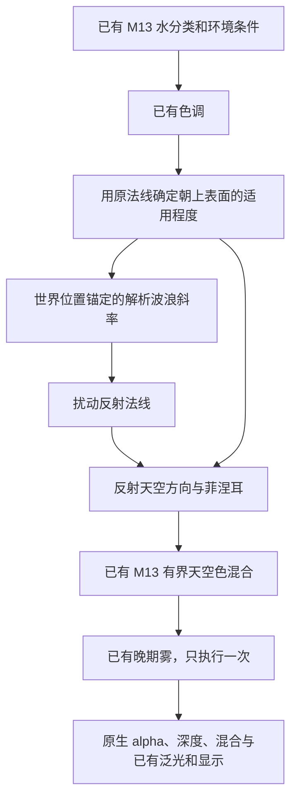

# Milestone 14：轻柔的水面反射波动

日期：2026-11-13。分支：`codex/milestone-14-water-waves`。
基线：M13 提交 `fd394d3e5f60ebbb101f3cc4a48656623dcd3e34`。
[English version](MILESTONE_14.md)。

Minecraft/Iris 实际观感、运动稳定性和 GPU 耗时仍然**未测量**。
本文公式说明实现与适用边界；数值检查或独立编译器通过，不等于 Minecraft 运行测试通过。
真正执行的离线检查另外记录。继续开发时，尚未进行的运行观察保持待补充。

## 1. 让反射运动，不移动水面几何体

M14 为 M13 水面反射使用的法线加入三组轻柔的解析波浪斜率，改变天空反射方向和菲涅耳权重。
原来的水分类、色调、几何体、深度、alpha、混合与雾都保留。

法线描述表面看起来朝向哪里。改变这个方向，即使网格仍然平坦，也能让反射颜色流动。
但它不能改变岸边轮廓、抬起漂浮物、改变水深、扭曲水下背景，或在阴影中产生波浪几何体。

只有通过现有天空反射条件的已分类水面才能显示这个效果。
本阶段没有场景/地形反射、极光反射、SSR、折射、泡沫、水体吸收、物理模拟或新光源。
反射来源仍是解析调色，并非实际绘制的场景。

## 2. 原表面适用范围与动态法线分开



在任何波浪扰动之前，用原始法线计算朝上表面遮罩。
它既限制法线扰动的强度，也继续限制反射权重。
因此竖直瀑布面不会因为某一帧动态法线碰巧向上倾斜，就突然变成可反射的表面。

扰动后的法线参与 `reflect` 和菲涅耳点积。
原有的反射地平线遮罩仍然检查最终反射方向。
M13 色调不使用这个新法线；雾继续使用当前片元原有的位置和深度。

## 3. 锚定世界位置，避免拼出巨大的浮点坐标

已有逆观察位置变换把片元的观察空间位置转换为与 Minecraft 坐标轴一致、
相对于相机锚点的位置。它已经包含一次逆观察平移；
再次添加同一个平移，会让图案随相机摆动产生不必要的偏移。
[Iris 坐标空间](https://shaders.properties/current/how-to/coordinate_spaces/)。

相机锚点分为整数部分和小数部分：

```text
playerRelative = viewToPlayerPosition(viewPosition)
cameraTileXZ = vec2(uvec2(cameraPositionInt.xz) & uvec2(127u))
tile = fract((cameraTileXZ + cameraPositionFract.xz
              + playerRelative.xz) / 128)
```

这里从不把完整的大世界坐标先合成一个浮点数。
先把相机整数坐标的低七位转成浮点数，再加小数部分与附近片元的相对偏移。
最终图案沿 X、Z 每 128 格重复一次。这是有意采用的平铺，不是无限且不重复的海洋模型。

固定版本的 Iris 源码对未平移的相机坐标取 `floor` 得到整数部分，
再用原坐标减去它得到小数部分。例如 -0.25 被拆成 -1 和 0.75。
这样在跨过零点时仍保持一致，也避免依赖另一个会单独重置偏移的 `cameraPosition` uniform。
[相机锚点实现](https://github.com/IrisShaders/Iris/blob/99d855970316329f2e0e42ac2b79ef763cb77cc3/common/src/main/java/net/irisshaders/iris/uniforms/CameraUniforms.java)。

为什么使用无符号按位与？GLSL 3.30 中，整数 `%` 遇到负操作数时结果未定义。
`int` 转 `uint` 保留位模式，再与 127 按位与，取出低七位，
就能得到预期的非负、二次幂周期坐标。例如 -1 映射到 127，-128 映射到 0。
这也不需要对最小有符号整数取负，因此避开该操作的溢出问题。
[GLSL 3.30，第 5.4.1 与 5.9 节](https://registry.khronos.org/OpenGL/specs/gl/GLSLangSpec.3.30.pdf)。

这种方法降低大坐标带来的精度损失，但不能消除位置重建的浮点误差，
也不代表所有模组相机变换都已经实际验证。

## 4. 用解析导数生成斜率，不采样法线纹理

可以用下面的概念高度场理解它：

```text
h(p,t) = sum_i amplitude_i * sin(dot(k_i,p) + harmonic_i * phase)
gradient(h) = sum_i amplitude_i * k_i
                    * cos(dot(k_i,p) + harmonic_i * phase)
```

实现只需要梯度，不会用高度去移动顶点或改写深度缓冲。

| 分量 | 乘以 TAU/128 前的空间向量 | 振幅 | 时间谐波 |
|---|---|---:|---:|
| 1 | (11, 3) | 0.06 | 10 |
| 2 | (4, -9) | 0.04 | -13 |
| 3 | (7, 13) | 0.03 | 7 |

其中 `TAU = 2*pi`、`p = 128*tile`、
`k_i = spatialVector_i * TAU/128`。
代码保留归一化的 `tile`，把各组角度写成
`TAU*fract(dot(spatialVector_i,tile)+harmonic_i*cycle)`，
直接累加 `amplitude_i*(TAU/128)*spatialVector_i*cos(angle)`。
振幅是生成斜率的概念场参数，**不是实际波高**，因为几何体没有被移动。

水平高度场的未归一化法线为 `(-dh/dx,1,-dh/dz)`。
解析求导能直接得到平滑斜率，不需要邻近高度样本、法线贴图或有限差分。
多个方向与时间谐波组合产生相互干涉的变化，而不是单组平行移动的条纹。

空间向量的分量均为整数，因此跨过 128 格平铺边界时，每个相位只增加整圈。
概念高度与梯度在接缝两侧相同；浮点误差仍然存在。

## 5. 周期运动，以及“静态”的含义

```text
seconds = finite(frameTimeCounter) ? max(frameTimeCounter,0) : 0
cycle = fract(seconds * (float(WATER_WAVE_SPEED)/200))
phase = TAU * cycle
```

正常速度下，完整图案每 200 秒重复一次；双倍速度下为 100 秒。
每组波的时间谐波都是整数，所以公共相位回绕时，各组角度只变化整数圈。

Iris 文档说明 `frameTimeCounter` 会在 3600 秒后重置。
由于 3600 正好包含整数个 200 秒周期，速度 1 和 2 的理想公式在该重置处也连续。
这是由构造保证的数学性质，不是已经观察过长时间 Minecraft 运行的结论。
[系统时间 uniform](https://shaders.properties/current/reference/uniforms/system/#frametimecounter)。

速度 0 选择固定的零相位图案。它停止解析动画，不会把法线恢复平坦，
也不会保存切换设置时刚好显示的那一帧。无效时间同样退回零相位。

## 6. 按法线规则变换斜率，并限制幅度

设 `N0` 为归一化后的原始观察空间法线，`g=(dh/dx,dh/dz)`，
`s` 为波浪强度乘以原表面的适用程度。

```text
normalTransform = transpose(mat3(gbufferModelViewInverse))
worldSlope = (-g.x,0,-g.y)
upLength = length(normalTransform * (0,1,0))
waveNormal = unit(N0 + normalTransform * worldSlope * s / upLength)
```

法线使用位置变换的逆转置。这里已有矩阵从观察空间变换到世界方向空间，
所以对它取转置，就得到从世界到观察空间的法线变换。
除以 `upLength`，是让水平表面的归一化基准法线与新增斜率在观察变换含缩放时保持同一尺度。
这不是对任意形变或倾斜曲面的完整处理。

水平水面和刚性观察变换下，由三角不等式可得：

```text
S = sum_i amplitude_i * length(k_i) ≈ 0.07466212
length(gradient) <= S
maximum tilt <= atan(S * strength)
```

当表面适用程度为 1 时，强度 1 的倾角上限约为 4.2699 度，
默认强度 0.6 时约为 2.5650 度。
这是数学上界，不是实际测量的动画幅度。适用程度较低时扰动进一步减弱。
不能把这些角度保证直接推广到任意带缩放的相机变换。

## 7. 设置与回退

M14 在已有的水面设置页增加三个选项：

| 选项 | 默认值 | 可选值 | 含义 |
|---|---:|---|---|
| `WATER_WAVES` | 1 | 0、1 | 启用法线扰动 |
| `WATER_WAVE_STRENGTH` | 0.6 | 0、0.3、0.6、1 | 缩放解析斜率 |
| `WATER_WAVE_SPEED` | 1 | 0、1、2 | 静态、正常或双倍时间速度 |

关闭波浪或将强度设为零，会原样返回原法线，恢复 M13 的反射计算。
静态速度仍然保留非零的空间斜率。
关闭原有反射或天空路径时，波浪没有可见作用；原有水面色调仍可存在。

材质、混合、场景/调试、环境、流体相机和天空光条件继续限制适用范围。
无效位置/矩阵数据，或无法使用的变换后法线，会回退到原法线；无效时间选择静态相位。
这些保护不改变原生 alpha、不修复透明排序，也不会让原本不受支持的绘制路径变得受支持。

## 8. 文件、成本与下一项架构问题

| 文件 | 职责 |
|---|---|
| `shaders/lib/water_wave_settings.glsl` | 三个波浪选项与默认值 |
| `shaders/lib/water_waves.glsl` | 世界平铺、时间周期、解析梯度与法线变换 |
| `shaders/lib/water.glsl` | 保留原表面适用范围，再用波浪法线计算反射/菲涅耳 |
| `shaders/lib/camera_anchor.glsl` | 用 include guard 共享已有整数/小数相机 uniform 声明 |
| `shaders/lib/fog.glsl` | 包含共享锚点，替代重复的两个声明 |
| `shaders/shaders.properties`、语言文件 | 在已有水面页面中加入选项 |

雾文件的改动只是把两个 uniform 声明移入共享 include，数学行为不变。
波浪函数增加时间 uniform，复用原有逆观察矩阵和位置函数，不再添加一次相机偏移。

项目仍有 24 对顶点/片元程序。M14 不增加附件、全屏 pass、纹理采样或顶点到片元的 varying。
满足条件的反射片元会增加三角函数和矩阵运算。GPU 成本与视觉收益仍未测量。

后续水体透射需要的不仅是法线。Iris 的 gbuffer 程序读取 `colortex0`–`colortex3` 时，
实际得到图集数据；仅声明 sampler 不会暴露已合成的不透明场景。
Aurora 的 3/4 号缓冲还用于半分辨率泛光。
未来需要独立且合适的不透明场景副本，例如编号 5 或更高的附件，
并明确深度、alpha 与雾的合成规则。M14 没有创建这些资源。
[Iris 颜色缓冲约定](https://shaders.properties/current/reference/buffers/colortex/)。

相机约定使用的源码快照为 Iris 提交
`99d855970316329f2e0e42ac2b79ef763cb77cc3`，不代表当前安装版本已重新验证。
深度相关透射仍是下一研究重点，不能因为加入了动态法线，就把它视为已经实现。

## 9. 运行观察表

用相同世界、时间/天气、资源包和视角，对比关闭波浪、强度零、静态及默认运动。
未观察的结果保持空白。

| 场景 | 需要确认的问题 | 实际结果 |
|---|---|---|
| 关闭、强度零与 M13 对照 | 原反射是否一致？ | |
| 静态、正常和双倍速度 | 静态是否保留图案，速度选项是否只改变运动速度？ | |
| 静水湖、河流与流水 | 运动是否轻柔，并与原有纹理协调？ | |
| 含水方块和气泡柱流体几何体 | 原有水分类是否保持正确？ | |
| 瀑布与斜面流水 | 原表面适用范围是否稳定？ | |
| 岸边与轮廓 | 反射运动时，几何体是否确实没有改变？ | |
| 平移、旋转与视角摆动 | 图案是否固定在世界位置上？ | |
| 第三人称与相机效果 | 位置与法线变换是否一致？ | |
| 零点附近的正/负坐标 | 是否存在符号边界跳变？ | |
| 128 格平铺边界与远坐标 | 已观察场景中是否没有周期接缝或精度伪影？ | |
| 200 秒循环与文档规定的 3600 秒重置 | 实际游戏中时间是否连续？ | |
| 白天、日落、夜晚与下雨 | 原有解析天空反射是否仍清晰可辨？ | |
| 关闭反射/天空、洞穴、流体相机、调试和旧模式 | 原回退路径是否保持有效？ | |
| alpha、雾与透明物体叠加 | 旧合成行为及其限制是否保持不变？ | |
| 匹配场景的 GPU 耗时 | 先记录硬件、分辨率、设置和成本，再得出结论 | |

## 10. 十个图形学问题

1. **平坦水面为什么能看起来有波浪？** 变化的法线改变反射方向，而不改变光栅化几何体。
2. **仅改法线无法提供什么？** 移动的轮廓、真实深度变化、浮力或折射的场景内容。
3. **为什么解析求梯度？** 正弦和的导数可以直接计算，不需要纹理或邻近高度采样。
4. **为什么保留原适用遮罩？** 动态着色不应该改变功能原本要作用的表面范围。
5. **为什么不拼出完整浮点世界坐标？** 大坐标会丢失细小偏移；
   小范围整数平铺加小数部分能保留更多有用的局部细节。
6. **为什么用无符号掩码而不用有符号取余？** 在本项目的 GLSL 3.30 约定下，
   它能对负坐标给出明确定义的二次幂周期结果。
7. **为什么空间/时间谐波用整数？** 完整平铺或时间循环让各相位只增加整圈，
   保持场和导数的周期性。
8. **为什么法线用逆转置？** 变换后仍需与切线垂直，包括位置变换含缩放的情况。
9. **静态与关闭有什么区别？** 静态保留零相位的空间斜率，关闭恢复原法线。
10. **为什么不能马上采样当前场景实现折射？** 所需的不透明源无法通过 gbuffer 的
    `colortex0`–`colortex3` 获得，必须先设计深度、存储和合成。

相关说明：[M13 水面基础](MILESTONE_13.zh-CN.md)、
[M9 雾](MILESTONE_9.zh-CN.md)、[M10 泛光缓冲](MILESTONE_10.zh-CN.md)、
[路线图](AURORA_ROADMAP.zh-CN.md)。

## 11. 已执行验证

- 完整 M1–M14 验证器通过，包括 88 个历史着色器/配置文件的保留检查。
- 3,840 个有界法线用例和 78 个相机锚点用例通过。
- 全部 1,272 个离线 GLSL 编译/链接配置通过。
- 对时间运算采用 float32、其余梯度采用 CPU 参考计算时，采样到的最大循环边界差为 `4.89637e-05`；这不是 GPU 测量。
- 独立源码/文档审查及 Git 空白检查通过。
- 本阶段未执行 Minecraft/Iris 画面实测、显卡驱动执行测试或性能测量。
