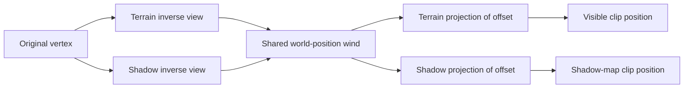

# Milestone 18: Gentle foliage wind with matching shadows

Date: 2026-11-13. Branch: `codex/milestone-18-foliage-wind`.
Base: M17 commit `b26755b1c3e611dd18a4836db305d6188dafd052`.
[中文学习版](MILESTONE_18.zh-CN.md).

M18 gives selected vanilla leaves and grass small, world-anchored movements. It
displaces the visible mesh and its shadow with the same function, while keeping
grass roots fixed. This adds a restrained sense of life to Aurora's fantasy palette.
Minecraft/Iris appearance, resource-pack behavior and performance remain unobserved.

## 1. Scope and controls

The new **Leaves and Grass** settings page contains:

| Option | Default | Values and behavior |
|---|---|---|
| `FOLIAGE_WIND` | 1 | Off / On |
| `FOLIAGE_WIND_STRENGTH` | 0.5 | 0, 0.25, 0.5, 1; zero preserves original geometry |
| `FOLIAGE_WIND_SPEED` | 1 | 0: static zero-phase pattern; 1: normal; 2: double |

Static keeps bent geometry; it does not freeze the current frame. Off, strength zero,
legacy scene mode and every debug view preserve the original clip position exactly.
There is no weather, dimension or camera-distance gate: this is a simple shared
motion field, not a simulation of local wind or storms.

`block.properties` explicitly assigns these non-fluid blocks:

| ID | Geometry |
|---|---|
| 10002 | Acacia, azalea, birch, cherry, dark oak, flowering azalea, jungle, mangrove, oak, pale oak and spruce leaves |
| 10003 | Short grass |
| 10004 | Lower half of tall grass |
| 10005 | Upper half of tall grass |

Water keeps ID 10001. Unclassified blocks, fluids, flowers, crops and vines do not
enter this feature. The visible hook is only in `gbuffers_terrain`; held items,
entities and block-entity programs do not gain foliage motion.

A read-only inspection of the local `1.21.11.jar`, whose internal version ID is
1.21.11, confirmed the eleven leaf names, grass states and vanilla cross-model
height range 0–16. This checks asset assumptions, not an actual game launch.
Arbitrary resource-pack models may use different ground/root conventions.

## 2. One displacement, two projections



Each pass first converts its view-space vertex back to the same player-relative
world orientation. The camera integer/fraction anchor then supplies a stable world
phase. Terrain uses `gbufferModelViewInverse`; the caster uses
`shadowModelViewInverse`. These transforms follow the
[Iris matrix contracts](https://shaders.properties/current/reference/uniforms/matrices/).

The helper preserves the original `ftransform()` result and adds only a projected
direction:

```text
playerH = passInverse * viewVertex
playerPosition = playerH.xyz / playerH.w
delta = foliageDisplacement(playerPosition, material, at_midBlock)
clip = originalClip + projection * passModelView * vec4(delta, 0)
```

The zero homogeneous component prevents matrix translation from moving the offset.
A zero displacement returns the original value directly, avoiding changed rounding
on bypasses. The same motion must affect both passes; otherwise a bent blade would
cast the shadow of its old geometry. No extra pass, texture or buffer is introduced.

## 3. Rooted grass and continuous wind

Iris supplies the vertex-to-block-center offset in `at_midBlock.xyz`, scaled by 64.
Its pinned implementation quantizes those offsets into bytes.
[Attribute contract](https://shaders.properties/current/reference/attributes/at_midblock/),
[packing implementation](https://github.com/IrisShaders/Iris/blob/99d855970316329f2e0e42ac2b79ef763cb77cc3/common/src/main/java/net/irisshaders/iris/vertices/ExtendedDataHelper.java#L11-L21).

```text
h = 0.5 - at_midBlock.y / 64 + (tallUpper ? 1 : 0)
H = shortGrass ? 1 : 2
bend = clamp((h - 1/64) / (H - 1/64), 0, 1)^2
```

The 1/64-block dead zone protects ground vertices from metadata quantization.
Squaring makes the lower stem move less than the tip. Both tall-grass halves use
one 0–2 height, so their shared edge receives the same bend weight. Leaves use
weight 1 and do not depend on `at_midBlock`.

The world field uses a 128-block periodic tile:

```text
anchor = uvec2(cameraPositionInt.xz) & uvec2(127)
tile = fract((anchor + cameraPositionFract.xz + playerPosition.xz) / 128)
cycle = fract(max(time, 0) * speed / 200)
p0 = TAU * fract(dot((1, 2), tile) + 37 * cycle)
p1 = TAU * fract(dot((3, -1), tile) - 53 * cycle)
field = 0.6*sin(p0)*(0.8, 0.6) + 0.4*sin(p1)*(-0.6, 0.8)
delta.xz = field * (leaves ? 0.08 : 0.20) * strength * bend
delta.y = 0
```

For leaves, substitute 1 for `bend`. Integer spatial frequencies make the tile edge
continuous; integer temporal frequencies join the 200-second cycle and Iris's
3600-second clock reset. Double speed has a 100-second common cycle. Individual
oscillations are faster than that common repeat period.
[Iris clock](https://shaders.properties/current/reference/uniforms/system/#frametimecounter).

The small integer anchor avoids forming a large floating-point world position.
Unsigned masking also wraps negative coordinates without signed negative remainder.
[M14 anchor explanation](MILESTONE_14.md) records the coordinate/specification basis.

The two field directions are orthonormal, giving the conservative bound
`length(field) <= sqrt(0.6^2 + 0.4^2) = sqrt(0.52)`.

| Maximum horizontal displacement bound | Default strength 0.5 | Strength 1 |
|---|---|---|
| Leaves | 0.02885 blocks | 0.05769 blocks |
| Grass tip | 0.07212 blocks | 0.14423 blocks |

These rounded-up bounds describe the formula, not measured animation maxima.
Invalid required positions/anchors or projection results retain the original
position; an invalid clock uses the static zero phase.

## 4. Integration and limits

`lib/foliage_settings.glsl` owns the three controls; `lib/foliage.glsl` owns
`foliageDisplacement` and `foliageWindClip`. The terrain entry enables the shared
lit-vertex hook. `shadow.vsh` calls the same helper using the light's matrices.
Block classification, settings layout and both language files complete the feature.

Requesting `at_midBlock` can affect Iris's vertex format and attribute traffic.
Wind Off skips the wind math; it does not establish zero added overhead. There is
no new sampler or rendering pass, and no measured performance claim.

Original normals, texture coordinates, vertex colors, lightmap values and alpha
tests are unchanged. Normals therefore approximate the gently bent surface rather
than its exact deformed orientation. Collision, selection and game simulation keep
the original blocks. Tree trunks do not bend with their leaves.

The engine's original culling bounds are not enlarged. Boundary clipping, leaf/trunk
seams, model-specific roots and tall-grass joins need in-game observation. A shared
continuous field helps adjacent eligible vertices agree, but does not promise
compatibility with every resource pack or third-party rendering path.

There are now 54 controls and 171 keys per language. Balanced and Soft Shadows
enable foliage wind; Light disables it. Profiles now control seven values and
retain the other 47, including wind strength/speed. Existing saved configurations
are not reset. Manual edits to a controlled value may match another profile or
Custom; edits outside the seven do not force Custom. The
[M17 matching explanation](MILESTONE_17.md) still applies to this expanded set.
No FPS improvement or measured hardware tier is claimed.

## 5. Runtime observation worksheet

No result is implied by the blank cells.

| Controlled observation | Actual result |
|---|---|
| Off and strength zero match M17 geometry; debug/legacy modes remain still | |
| Static is bent but still; Normal and Double change speed | |
| Short-grass roots stay fixed; both tall halves join without a gap | |
| Eleven leaf types move gently; trunks and unrelated plants remain still | |
| Geometry and shadows agree while camera and sun direction change | |
| Negative/large coordinates and tile/time wrap show no visible jump | |
| Chunk/frustum edges, leaf/trunk seams and resource-pack roots | |
| Profile changes, English/Chinese tooltips and saved options | |

## 6. Learning questions

1. **Why move vertices?** Actual silhouettes and shadow casters must sway together.
2. **Why not move UVs?** Sliding the texture cannot bend the mesh or its silhouette.
3. **Why shared world coordinates?** Camera or light motion must not move the wind field.
4. **Why use block metadata?** It supplies root height independently of texture-atlas layout.
5. **Why square the bend?** It keeps the base stiff while allowing greater tip motion.
6. **Why use integer harmonics?** They keep the chosen spatial/time repeat boundaries continuous.
7. **Why project a direction?** Offset vectors must ignore matrix translations.
8. **Why keep original normals?** This bounds the change, with an explicit shading approximation.
9. **Why can culling still fail?** The engine does not know about shader-displaced mesh bounds.
10. **Does GPU testing prove Iris behavior?** No; attribute binding, patched programs and real scenes remain a separate evidence layer.

## 7. Executed checks

The [M18 native foliage report](validation/M18_GPU_foliage.json) records a successful
run on Intel Iris Xe, OpenGL 3.3 compatibility, driver 31.0.101.3962. Its shader-tree
digest remained unchanged through the run.

- **35 displacement fixtures / 840 samples:** classification, roots, tall-half joins,
  signed/large anchors, clock modes and invalid inputs; 570 zero results required
  exact equality. Maximum absolute component error was approximately
  `7.015e-7` blocks, within the `1e-5`-block comparison tolerance.
- **11 clip fixtures / 264 samples:** terrain/light transforms, homogeneous division,
  feature bypasses and invalid matrices; 220 baseline returns required exact equality.
  Maximum absolute error was approximately `1.167e-7` in clip-coordinate components,
  within the `2e-5` comparison tolerance.

These fixtures call the real GLSL helpers through synthetic fragment wrappers and
compare them with a CPU mathematical reference. They do not test Iris attribute
binding, actual foliage vertex execution, chunk geometry, shadow rasterization,
visual quality or frame times. The Minecraft worksheet remains blank.

The [full native compilation report](validation/M18_GPU_compile.json) also passed:
**1,504 program/option configurations across 24 program pairs** compiled and linked
on the same driver. Its shader-tree digest matches the foliage report exactly.
These expanded pack programs do not include Iris's runtime transformations.
The unmodified full historical/CPU validator passed through M18, and all **1,504
offline compile/link configurations** passed. Syntax and whitespace checks passed.
M18 checks verify **95 prior files**, accounting only for the intended M18 changes,
and cover **240 field cases, 5,184 displacement cases, 78 fixed-world anchor cases
and 1,536 independent point/direction transform cases**. These are structural and
mathematical checks, separate from the native GPU fixtures above.
To repeat only this native helper suite, run from the D: checkout:

```powershell
python -B tools/validate_gpu.py --cxx C:/msys64/ucrt64/bin/g++.exe --suite foliage --report docs/validation/NEW_FOLIAGE_RUN.json
```

Use a new report filename; existing reports are never overwritten. The next
water-transparency design still requires explicit depth/sorting/composition research.
[Roadmap](AURORA_ROADMAP.md).
