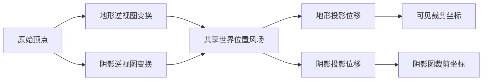

# Milestone 18：轻柔植被风动与同步阴影

日期：2026-11-13。分支：`codex/milestone-18-foliage-wind`。
基线：M17 提交 `b26755b1c3e611dd18a4836db305d6188dafd052`。
[English learning notes](MILESTONE_18.md)。

M18 让选定的原版树叶与草产生幅度较小、固定于世界坐标的运动。可见网格与投影
使用同一位移函数，草根保持固定，让 Aurora 的奇幻配色多一点自然生气。
Minecraft／Iris 实际画面、资源包兼容性与性能仍待观察。

## 1. 范围与设置

新增的**树叶与草**设置页包含：

| 选项 | 默认值 | 取值与行为 |
|---|---|---|
| `FOLIAGE_WIND` | 1 | 关闭／开启 |
| `FOLIAGE_WIND_STRENGTH` | 0.5 | 0、0.25、0.5、1；零精确保留原几何体 |
| `FOLIAGE_WIND_SPEED` | 1 | 0：零相位静态形态；1：正常；2：双倍 |

静态保留弯曲形态，并不是冻结当前帧。关闭、强度为零、旧场景模式及所有调试视图
都会精确保留原始裁剪坐标。这里没有天气、维度或相机距离开关：
它是简单的共享运动场，不模拟局部风力或暴风雨。

`block.properties` 明确指定以下非流体方块：

| ID | 几何体 |
|---|---|
| 10002 | 金合欢、杜鹃、白桦、樱花、深色橡木、盛开的杜鹃、丛林、红树、橡木、苍白橡木、云杉树叶 |
| 10003 | 矮草 |
| 10004 | 高草下半部 |
| 10005 | 高草上半部 |

水继续使用 10001。未分类方块、流体、花、农作物和藤蔓不进入这个功能。
可见几何体的入口仅在 `gbuffers_terrain`；手持物、实体与方块实体程序不新增植被风动。

本阶段只读检查了本地 `1.21.11.jar`，其内部版本 ID 也是 1.21.11，
确认十一种树叶名称、草的状态，以及原版交叉面模型 0–16 的高度范围。
这验证的是资源假设，不代表实际启动游戏。任意资源包可能使用不同的地面／根部约定。

## 2. 同一位移，两种投影



每个阶段先把自己的视图空间顶点还原为相同世界朝向的玩家相对位置，
再用相机整数／小数锚点获得稳定世界相位。地形使用
`gbufferModelViewInverse`，投影者使用 `shadowModelViewInverse`。
这些变换遵循 [Iris 矩阵约定](https://shaders.properties/current/reference/uniforms/matrices/)。

辅助函数保留原始 `ftransform()` 结果，只加上投影后的方向向量：

```text
playerH = passInverse * viewVertex
playerPosition = playerH.xyz / playerH.w
delta = foliageDisplacement(playerPosition, material, at_midBlock)
clip = originalClip + projection * passModelView * vec4(delta, 0)
```

齐次分量为零，让矩阵平移不会改变位移向量。位移为零时直接返回原值，
避免回退路径出现不同舍入。两个阶段必须一致，否则弯曲的草叶仍会投出原形阴影。
没有新增绘制阶段、纹理或缓冲附件。

## 3. 固定草根与连续风场

Iris 在 `at_midBlock.xyz` 中提供顶点到方块中心的偏移，放大 64 倍存储。
固定版本的实现会把偏移量化成字节。
[属性约定](https://shaders.properties/current/reference/attributes/at_midblock/)、
[打包实现](https://github.com/IrisShaders/Iris/blob/99d855970316329f2e0e42ac2b79ef763cb77cc3/common/src/main/java/net/irisshaders/iris/vertices/ExtendedDataHelper.java#L11-L21)。

```text
h = 0.5 - at_midBlock.y / 64 + (tallUpper ? 1 : 0)
H = shortGrass ? 1 : 2
bend = clamp((h - 1/64) / (H - 1/64), 0, 1)^2
```

1/64 方块的死区保护地面顶点，避免元数据量化让根部微动。
平方权重让底部比尖端更稳。高草两半共用 0–2 的高度，
因此接缝处得到相同弯曲权重。树叶权重为 1，不依赖 `at_midBlock`。

世界风场使用 128 方块的周期区域：

```text
anchor = uvec2(cameraPositionInt.xz) & uvec2(127)
tile = fract((anchor + cameraPositionFract.xz + playerPosition.xz) / 128)
cycle = fract(max(time, 0) * speed / 200)
p0 = TAU * fract(dot((1, 2), tile) + 37 * cycle)
p1 = TAU * fract(dot((3, -1), tile) - 53 * cycle)
field = 0.6*sin(p0)*(0.8, 0.6) + 0.4*sin(p1)*(-0.6, 0.8)
delta.xz = field * (leaves ? 0.08 : 0.20) * strength * bend
delta.y = 0
```

树叶的 `bend` 换成 1。整数空间频率让区域边界连续；
整数时间频率让 200 秒周期及 Iris 的 3600 秒时钟重置衔接。
双倍速度的共同周期为 100 秒，单个摆动的周期比整体重复周期短。
[Iris 时钟](https://shaders.properties/current/reference/uniforms/system/#frametimecounter)。

小整数锚点避免构造很大的浮点世界坐标。无符号掩码也能让负坐标正确循环，
无需对负有符号数取余。[M14 锚点说明](MILESTONE_14.zh-CN.md)记录了坐标与规范依据。

两个方向互相垂直且长度为 1，因此有保守上界：
`length(field) <= sqrt(0.6^2 + 0.4^2) = sqrt(0.52)`。

| 最大水平位移上界 | 默认强度 0.5 | 强度 1 |
|---|---|---|
| 树叶 | 0.02885 方块 | 0.05769 方块 |
| 草尖 | 0.07212 方块 | 0.14423 方块 |

表中数值向上舍入，描述公式上界，并非动画最大值的实测结果。
所需位置／锚点或投影结果无效时保留原位置；时钟无效时使用静态零相位。

## 4. 接入位置与限制

`lib/foliage_settings.glsl` 定义三个设置；`lib/foliage.glsl` 包含
`foliageDisplacement` 和 `foliageWindClip`。地形入口开启共享 lit 顶点挂钩，
`shadow.vsh` 用光源矩阵调用同一辅助函数。
方块分类、设置布局与两种语言标签补齐这个功能。

请求 `at_midBlock` 可能影响 Iris 的顶点格式与属性传输成本。
关闭风动会跳过风场计算，但不代表新增开销一定为零。
没有新增采样器或绘制阶段，也没有实测性能结论。

原始法线、纹理坐标、顶点颜色、光照贴图值和 alpha 测试保持不变。
因此法线近似表示轻微弯曲后的表面，没有精确追踪形变朝向。
碰撞、选择框与游戏模拟仍使用原方块；树干也不会跟着树叶弯曲。

引擎原有剔除边界没有扩大。边界裁切、树叶／树干接缝、不同模型的根部、
高草接缝仍需游戏内观察。连续共享场能让相邻的适用顶点一致，
但不保证兼容所有资源包或第三方绘制路径。

现在共有 54 个控制项，每种语言 171 个键。均衡与柔和阴影开启风动，
轻量关闭。预设扩大为七个受控值，保留另外 47 项，包括风动强度／速度。
已有保存设置不会重置。手动修改受控项可能匹配另一预设，也可能变成自定义；
修改七项之外的设置不会强制自定义。
[M17 匹配说明](MILESTONE_17.zh-CN.md)同样适用于这个扩展后的集合。
没有声称 FPS 提升或已经实测的硬件分档。

## 5. 游戏内观察记录

空白格不代表测试通过。

| 控制变量观察 | 实际结果 |
|---|---|
| 关闭／强度零匹配 M17 几何体；调试／旧模式保持静止 | |
| 静态弯曲但不运动；正常／双倍改变速度 | |
| 矮草根部固定；高草两半没有裂缝 | |
| 十一种树叶轻柔运动；树干与无关植物保持静止 | |
| 相机与太阳方向变化时，几何体与阴影仍一致 | |
| 负／远坐标、空间边界与时间循环没有可见跳变 | |
| 区块／视锥边缘、树叶树干接缝、资源包根部 | |
| 预设变化、中英文提示与已保存设置 | |

## 6. 学习问答

1. **为什么移动顶点？** 实际轮廓和阴影投影者需要一起摆动。
2. **为什么不移动 UV？** 滑动纹理不能弯曲网格或轮廓。
3. **为什么共享世界坐标？** 相机与光源移动不应带动风场。
4. **为什么用方块元数据？** 根部高度不必依赖纹理图集布局。
5. **为什么把弯曲权重平方？** 保持底部稳定，让尖端位移更明显。
6. **为什么选整数谐波？** 保证指定空间／时间重复边界连续。
7. **为什么投影方向向量？** 位移不应受到矩阵平移影响。
8. **为什么保留原法线？** 控制本次改动范围，并明确接受轻微着色近似。
9. **为什么仍可能出现剔除问题？** 引擎不知道着色器改变后的网格边界。
10. **GPU 测试能证明 Iris 行为吗？** 不能，属性绑定、补丁程序与真实场景仍是另一层证据。

## 7. 已执行检查

[M18 本机植被报告](validation/M18_GPU_foliage.json)记录了 Intel Iris Xe、
OpenGL 3.3 compatibility、驱动 31.0.101.3962 上的成功运行。
整个检查期间，着色器目录摘要保持一致。

- **35 组位移输入／840 个样本：** 覆盖分类、草根、高草接缝、负／远坐标锚点、
  时钟模式与无效输入；570 个零结果要求精确相等。
  位移分量最大绝对误差约 `7.015e-7` 方块，低于 `1e-5` 方块的比较容差。
- **11 组裁剪输入／264 个样本：** 覆盖地形／光源变换、齐次除法、
  功能回退与无效矩阵；220 个原坐标回退要求精确相等。
  裁剪坐标分量最大绝对误差约 `1.167e-7`，低于 `2e-5` 的比较容差。

这些测试通过合成片元包装程序调用真实 GLSL 辅助函数，并与 CPU 数学参考比较。
它们没有测试 Iris 属性绑定、真实植被顶点执行、区块网格、阴影栅格化、
画面质量或帧耗时。Minecraft 观察表继续留空。

[完整本机编译报告](validation/M18_GPU_compile.json)也已通过：同一驱动成功编译、
链接 **24 对程序中的 1,504 个程序／选项组合**。
其着色器目录摘要与植被报告完全一致。这些展开后的程序未经过 Iris 运行时变换。
未经修改的完整历史／CPU 验证器已通过至 M18，全部 **1,504 组离线编译／链接**
也已通过。语法与空白检查通过。M18 仅排除本阶段预期改动，核对 **95 个历史
文件**的保留情况，并覆盖 **240 组风场、5,184 组位移、78 组固定世界锚点、
1,536 组独立点／方向变换**。这些是结构与数学检查，与上述本机 GPU 输入分别记录。
只重复本机辅助函数测试时，在 D 盘工作目录运行：

```powershell
python -B tools/validate_gpu.py --cxx C:/msys64/ucrt64/bin/g++.exe --suite foliage --report docs/validation/NEW_FOLIAGE_RUN.json
```

报告使用新文件名，工具不会覆盖已有报告。下一项水体透明合成设计仍需先明确
深度、排序与合成约定。[路线图](AURORA_ROADMAP.zh-CN.md)。
