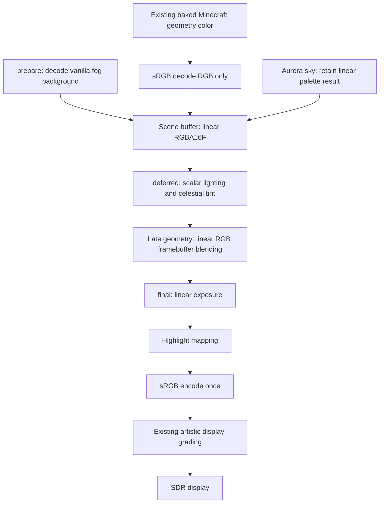

# Milestone 8: Linear scene composition and HDR storage

Date: 2026-11-13. Branch: `codex/milestone-8-hdr-color`.
Base: M7 commit `0b46bcb663363df21e0b45a89c26b427afe04eeb`.
[中文学习版](MILESTONE_8.zh-CN.md).

Minecraft/Iris runtime success remains **unconfirmed**. This document describes
implemented contracts and proposed observations; the recorded check results are
added only after execution. Pending observations do not block independent work
under the continuous-development goal.

## 1. What changes, and why

Aurora's vivid sky, future fog and future bloom need a consistent place to combine
light contributions. M8 establishes **linear scene storage, framebuffer composition
and subsequent lighting**, with an HDR-capable `colortex0`. Bright values can remain
above 1 until the final display mapping instead of being clipped after each pass.
The display output remains ordinary SDR sRGB; HDR scene data does not require or
implement an HDR-monitor output mode.

This is a bounded migration. The existing Minecraft texture, vertex tint, AO,
entity overlay and lightmap operations still produce a baked, display-like color.
That complete RGB result is decoded once before scene storage. Input texture
filtering and those original multiplications are not all rewritten in linear light.
This is therefore not a full physical material/PBR renderer or an independent
replacement for Minecraft lighting.

## 2. Pipeline contract



The diagram describes `SCENE_COLOR_MODE=1`. Mode 0 retains the M7 display-space
path and RGBA8 storage. Debug 1-6 bypass the final exposure, tone mapping, display
encoding and artistic grading path; their data visualization is not scene radiance.

| Stored quantity | M8 treatment |
|---|---|
| `colortex0.rgb` | Mode 1: linear RGB in RGBA16F; mode 0: M7 display RGB in RGBA8 |
| `colortex0.a` | Coverage/alpha semantics retained; never sRGB-decoded |
| `colortex1` | Existing encoded view normal and validity, RGBA16 normalized |
| `colortex2` | Existing block/sky light levels, RG16 normalized |
| Depth and shadow maps | Existing numerical data; no color conversion |

RGBA16F uses eight bytes per RGBA pixel, versus four for RGBA8, before accounting
for the other buffers and Iris's ping-pong attachments. This is a storage cost,
not a measured performance claim.

## 3. Cover every scene producer

Four shared geometry fragment files handle the existing basic, textured, lit and
entity paths. Each computes the old color first, then calls
`sceneFromDisplay(color.rgb)` without touching alpha, alpha testing or surface data.
This also covers late water/glass, clouds, weather, hands, particles, beacon beams,
armor glint and emissive eyes through their existing program/include routing.

The sky palette is already calculated in linear space. `sceneFromLinear` returns
that linear result directly in HDR mode; mode 0 retains the M7 encode/clamp path.
Native star color is decoded for HDR storage. The void branch blends the decoded
baseline and native RGB in mode 1 while keeping alpha interpolation separate.
Solar phase, sky orientation and M7 palette constants are unchanged.

The scalar `lightScene` formula is unchanged, but it now operates on linear scene
values in mode 1. Its appearance can therefore differ from a scalar multiplication
of display-encoded RGB. The celestial palette also multiplies the already-linear
scene directly; it must not perform the M7 decode/tint/encode round trip again.
The existing cave, block-light and disabled-lighting protection conditions remain.

### Why a prepare pass is necessary

Iris normally clears `colortex0` with `fogColor`. Leaving that display-like clear
value in a linear buffer would make uncovered background pixels inconsistent,
particularly where sky rendering is absent. M8 declares a black clear in HDR mode
and adds `prepare` to fill the complete buffer with `sceneFromDisplay(fogColor)`
and alpha 1 before geometry. Mode 0 writes the display fog color.

Buffer format declarations stay inside multiline comments, one directive per line:
RGBA8 in mode 0 and RGBA16F in mode 1. Their identifiers are not active GLSL variables.
[Iris buffer formats](https://shaders.properties/current/reference/constants/buffer_format/),
[default clear colors](https://shaders.properties/current/reference/constants/buffer_clear_color/),
[prepare pass ordering](https://shaders.properties/current/reference/programs/prepare/).

## 4. Linear blending and its practical limits

For ordinary source-alpha blending, RGB now combines as
`result = sourceLinear * alpha + destinationLinear * (1 - alpha)`.
Alpha is a coverage/transparency weight, not an sRGB color channel.

A useful reference is 50% white over black: its linear result is 0.5, which encodes
to about 0.735 sRGB. Directly mixing display codes gives 0.5, a different light level.
This example is a mathematical check, not a Minecraft screenshot result.

M8 preserves the existing Iris/Minecraft blend factors. It does not force every
program to ordinary alpha blending. Armor glint's color-dependent blend and
additive emissive effects consequently operate on different RGB values in the
linear mode; their brightness and overlap need specific runtime observation.
Transparent water, glass, particles and clouds also need scrutiny. There is no
new water material, reflection, bloom or fog implementation in this milestone.
[Iris blend settings](https://shaders.properties/current/reference/shadersproperties/rendering/#blend).

## 5. Exposure and the highlight shoulder

In normal rendering with HDR enabled, `final` performs:

```text
rgb = max(scene.rgb, 0) * 2^EXPOSURE
mappedLinear = toneMapScene(rgb)
displayRGB = sRGBEncode(mappedLinear)
outputRGB = gradeColor(displayRGB)
```

The old exposure block inside `gradeColor` is enabled only for mode 0. In mode 1,
exposure occurs exactly once, before tone mapping. Positive one stop doubles linear
intensity; it does not promise to double the final display code after compression.
Saturation, contrast, temperature, tint and optional grayscale remain artistic
post-mapping display operations.

`TONE_MAPPING=0` clamps linear RGB to [0,1]. The default mode 1 uses an original,
peak-based exponential shoulder. Let `p = max(r,g,b)` after nonnegative clamping,
`k = clamp(TONEMAP_KNEE, 0, 0.95)` and `s = 1-k`:

```text
if p <= k:
    result = rgb
else:
    q = k + s * (1 - exp(-(p-k)/s))
    result = rgb * (q/p)
```

Below the knee, values remain unchanged. Above it, the peak approaches 1 smoothly.
The function and its first derivative join continuously at the knee. The division
only occurs when `p > k >= 0`, avoiding division by zero. Each RGB channel receives
the same multiplier, so linear RGB ratios are preserved before encoding/grading.
That is not a guarantee of unchanged perceptual hue. This curve is not ACES, a
film simulation or a physically calibrated camera response.

The default knee is 0.6. A linear neutral value 1 maps to approximately 0.853,
while 0.18 stays 0.18 before display encoding. Extreme later saturation or channel
balance can still clip colors in `gradeColor`; the shoulder cannot recover detail
already lost in source textures, legacy products or earlier quantization.

### Default-knee numerical reference

These values use knee 0.6 and zero exposure. They are linear values **before**
sRGB encoding and artistic grading, not measured display pixels.

| Input scalar / RGB peak | Clip output | Soft Shoulder output |
|---:|---:|---:|
| 0.18 | 0.18 | 0.18 |
| 0.6 | 0.6 | 0.6 |
| 1 | 1 | 0.852848 |
| 2 | 1 | 0.987921 |
| 4 | 1 | 0.999919 |

## 6. Options and source map

Open **Scene Color and Highlights** (`COLOR_PIPELINE`).

| Option | Default | Choices | Purpose |
|---|---:|---|---|
| `SCENE_COLOR_MODE` | 1 | 0, 1 | M7 display/LDR or linear/HDR composition |
| `TONE_MAPPING` | 1 | 0, 1 | Linear clip or soft shoulder; HDR mode only |
| `TONEMAP_KNEE` | 0.6 | 0.4, 0.6, 0.8 | Shoulder start in linear intensity |
| Existing `EXPOSURE` | 0 | Existing -2 to +2 stop choices | Applied before the HDR shoulder; old behavior in mode 0 |

Set `SCENE_COLOR_MODE=0` to compare against M7, keeping the old sky, light and
shadow settings identical. This restores the old color logic and RGBA8 selection;
the added prepare pass means universal bit-identical runtime output is not asserted.
Switching only `TONE_MAPPING` does not switch the storage or composition mode.

| File | Role |
|---|---|
| `shaders/lib/pipeline_settings.glsl` | Three new pipeline settings |
| `shaders/lib/scene_color.glsl` | Explicit display-to-scene and linear-to-scene boundaries |
| `shaders/lib/tone_mapping.glsl` | Clip/soft-shoulder mapping in linear RGB |
| `shaders/prepare.vsh`, `prepare.fsh` | Full background initialization and format selection |
| Four `shaders/lib/geometry/*_fragment.glsl` includes plus sky | Scene producer conversion |
| `shaders/lib/celestial_lighting.glsl` | Avoid double conversion in HDR mode |
| `shaders/final.fsh`, `shaders/lib/color.glsl` | Single exposure/map/encode sequence and shared grading |

There are now 20 vertex/fragment program pairs, including prepare. Shadow source,
caster scope, PCF patterns, bias calculations and the surface-data contracts remain
separate from this color migration.

## 7. Checks and runtime observation sheet

Run the current validation tools from the D: checkout:

```text
python -B tools/validate.py
python -B tools/compile_glsl.py
```

The compiler tool needs an installed `glslangValidator`. Neither command executes
Minecraft or proves Iris directive parsing, GPU-driver rendering, appearance,
transparency correctness or performance. Record executed results separately;
do not fill the following rows with expected behavior presented as observation.

Fix world, viewpoint, FOV, resolution, render distance, resource pack, weather/time
and non-color options for each pair. Keep ordinary grading neutral first. Use a
scene with white/colored blocks, cave/torch boundaries, glass over bright sky,
water, leaves, particles, an enchanted item, glowing eyes and a beacon.

| Comparison | Observation needed | Actual result |
|---|---|---|
| Mode 0 versus M7 | Legacy color logic, sky, fallback dimensions and debug | |
| Mode 1, Clip versus Soft Shoulder | Bright-detail roll-off, midtone preservation, color shifts | |
| Exposure -2/0/+2; all knee choices | One exposure response, no unexplained double brightening | |
| Day, dusk, night and rain | M7 palette identity survives the new display mapping | |
| Glass/water/clouds/particles over dark and bright backgrounds | Linear blending, edges, overlap, alpha coverage | |
| Armor glint, emissive eyes and beacon | Special blend behavior and brightness | |
| Cutout leaves and entity overlays | Discard/alpha intact, no data-color conversion artifacts | |
| Sky-disabled, Nether, End, fluid camera and void | Background initialization and fallback encoding | |
| Caves, torches, both bias modes, four PCF filters | Protected lighting and unchanged shadow algorithms | |
| Debug 1-6 in either mode | No exposure, tone mapping or display grading on numerical data | |

Open runtime observations are not approval gates for subsequent development.
The next planned system is distance/height fog with explicit opaque/translucent
composition rules on top of the scene-color contract.

## Recorded offline checks — 2026-11-13

- `python -B tools/validate.py` completed successfully (exit 0), retaining the
  M1–M7 regression checks and checking all 20 program pairs under the two
  scene-color contracts.
- M8 numerical checks covered 2,112 tone-mapping cases, along with storage,
  composition, exposure ordering and protected data/alpha contracts.
- `python -B tools/compile_glsl.py` completed successfully (exit 0): **350**
  standalone vertex/fragment program-pair compile/link configurations passed.
- Full shader review found no blocking defect; whitespace checks passed.

These checks did not execute Minecraft, Iris patching/directive parsing, GPU
rendering or a performance benchmark. The runtime observation table remains
unfilled. Development continues toward geometry fog while these observations
remain explicitly pending.

## 8. Interview-sized explanations

1. **Why use RGBA16F?** It stores fractional linear values and values above 1,
   allowing later effects to combine bright contributions before display mapping.
2. **Does a floating-point buffer make a renderer HDR by itself?** No. Producers,
   composition, lighting and final mapping must agree on the stored meaning.
3. **Why decode the complete old geometry result?** The current vertex/lightmap
   path already bundles tint, AO and lighting. This bounded bridge retains that
   input appearance while migrating subsequent composition, without pretending
   those input operations have become a physical material model.
4. **Why never gamma-correct alpha or normals?** They represent coverage or
   numerical geometry data rather than display-encoded RGB light values.
5. **Why add prepare?** Background clears are scene inputs too. Decoding geometry
   alone leaves fog-color clears in the wrong representation.
6. **Why expose before tone mapping?** Exposure scales scene light. Tone mapping
   then compresses the selected intensity range into display output.
7. **What goes wrong with double exposure/encoding?** The image becomes wrongly
   scaled or washed out; the scene-to-display boundary must occur once.
8. **What does the peak shoulder preserve?** Relative linear RGB channel ratios
   through a common scalar, not guaranteed perceptual hue or post-grading ratios.
9. **How does linear alpha blending differ?** It averages light contributions,
   so 50% white over black encodes near 0.735 rather than 0.5 sRGB.
10. **Why is SDR output compatible with an HDR scene?** HDR describes the scene's
    stored range; tone mapping and encoding deliberately produce bounded SDR output.

## Primary references

- [Iris buffer format directives](https://shaders.properties/current/reference/constants/buffer_format/)
- [Iris buffer clear colors](https://shaders.properties/current/reference/constants/buffer_clear_color/)
- [Iris prepare pass](https://shaders.properties/current/reference/programs/prepare/)
- [Iris vertex color and baked AO](https://shaders.properties/current/reference/attributes/gl_color/)
- [Iris blending](https://shaders.properties/current/reference/shadersproperties/rendering/#blend)
- [W3C sRGB conversion code](https://www.w3.org/TR/css-color-4/#color-conversion-code)
- [Next priorities](AURORA_ROADMAP.md)
