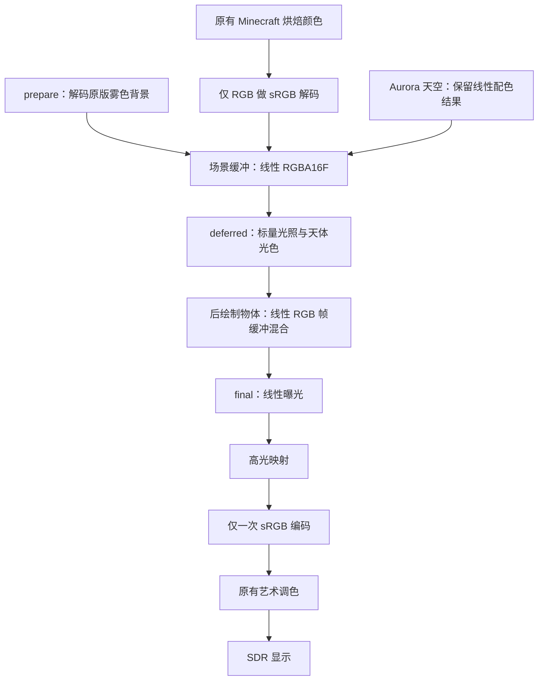

# Milestone 8：线性场景合成与 HDR 存储基础

日期：2026-11-13。分支：`codex/milestone-8-hdr-color`。
基于 M7 提交 `0b46bcb663363df21e0b45a89c26b427afe04eeb`。
[English](MILESTONE_8.md)。

**尚未确认 Minecraft／Iris 运行成功。** 本文记录实现约定和待观察项目，实际检查
结果只在执行后补充。持续开发目标允许在保留这些未确认事项的同时推进独立工作。

## 1. 这一步解决什么问题

Aurora 的鲜明天空，以及之后的雾和 bloom，需要在同一种颜色表示下组合光的贡献。
M8 建立的是**线性场景存储、帧缓冲合成和后续光照**，并让 `colortex0` 具备 HDR
存储能力。超过 1 的亮度可以保留到最终显示映射，而不必每经过一个阶段就被截断。
最终输出仍是普通 SDR sRGB；场景内部使用 HDR，不等于已经实现 HDR 显示器输出。

这次迁移有明确边界：原来的 Minecraft 纹理、顶点 tint、AO、实体叠色和 lightmap
运算，仍先生成一份已烘焙、接近显示编码的颜色。代码对这个**完整 RGB 结果解码一次**，
然后写入线性场景缓冲。输入纹理的过滤和原来的乘法没有全部改写成线性光运算。
因此，这不是完整的物理材质／PBR 渲染器，也没有独立替换 Minecraft 的光照输入。

## 2. 先约定每个阶段里的颜色含义



图中对应 `SCENE_COLOR_MODE=1`。模式 0 保留 M7 的显示空间通路和 RGBA8 存储。
Debug 1–6 不经过最终曝光、tone mapping、显示编码或艺术调色：这些画面展示的是
数据，不是需要按正常场景光照处理的颜色。

| 数据 | M8 中的含义与处理 |
|---|---|
| `colortex0.rgb` | 模式 1：RGBA16F 中的线性 RGB；模式 0：RGBA8 中的 M7 显示 RGB |
| `colortex0.a` | 继续表示覆盖／透明度，不做 sRGB 解码 |
| `colortex1` | 原有观察空间法线编码和有效标记，RGBA16 normalized |
| `colortex2` | 原有方块光／天空光数据，RG16 normalized |
| 深度与阴影图 | 数值数据，不做颜色转换 |

RGBA16F 每个 RGBA 像素占八字节，RGBA8 为四字节；这还没有计入其他缓冲和 Iris
使用的乒乓附件。这里说明的是存储成本，没有据此声称测得了性能变化。

## 3. 每一个写颜色的入口都要处理

basic、textured、lit、entity 四个共享 fragment 文件负责原来的几何体通路。
它们先完成旧颜色计算，再调用 `sceneFromDisplay(color.rgb)`，alpha、alpha test
和表面数据保持各自原来的含义。这也通过既有的程序／include 关系覆盖了之后绘制的
水、玻璃、云、天气、手持物、粒子、信标、附魔光效和发光眼睛。

天空配色原本已在线性空间计算。HDR 模式的 `sceneFromLinear` 直接返回线性结果，
模式 0 则保留 M7 的编码和截断方式。原版星星颜色会在写入 HDR 场景前解码。
虚空天空在模式 1 下混合已解码的基线和原生 RGB，alpha 仍单独按原权重插值。
太阳阶段、天空朝向和 M7 的配色常量没有变化。

`lightScene` 的标量公式没有改写，但模式 1 的输入已经是线性颜色；它与直接乘在
显示编码 RGB 上可能呈现不同的亮度，这是表示方式变化的结果。
天体光色直接乘到线性场景上，不能再次执行 M7 的“解码—染色—编码”往返。
洞穴、方块光和关闭光照的保护条件仍然保留。

### 为什么还需要 prepare

Iris 默认用 `fogColor` 清空 `colortex0`。如果只转换几何体输出，未被天空覆盖的背景
就仍可能保留显示编码的雾色，在线性缓冲中含义错误。M8 在 HDR 模式声明黑色 clear，
再用 `prepare` 在几何体之前填满 `sceneFromDisplay(fogColor)`，alpha 为 1。
模式 0 则写入显示空间的原版雾色。

缓冲格式指令继续放在多行注释中，每条单独一行：模式 0 为 RGBA8，模式 1 为 RGBA16F。
格式名称不会作为普通 GLSL 变量参与编译。
[Iris 格式指令](https://shaders.properties/current/reference/constants/buffer_format/)、
[默认清屏颜色](https://shaders.properties/current/reference/constants/buffer_clear_color/)、
[prepare 执行顺序](https://shaders.properties/current/reference/programs/prepare/)。

## 4. 线性混合，以及需要留意的特殊效果

普通 source-alpha 混合的 RGB 现在按以下含义组合：
`结果 = 源线性颜色 × alpha + 目标线性颜色 × (1-alpha)`。
alpha 是覆盖／透明度权重，不是需要进行 sRGB 转换的颜色分量。

一个便于记忆的例子是：50% 的白色覆盖黑色，线性结果为 0.5，编码后约为 0.735 sRGB。
如果直接平均显示编码，得到的则是 0.5，两者对应的光强不同。
这是数学参考值，不是 Minecraft 截图实测结果。

M8 保留 Iris／Minecraft 原来的 blend factors，没有把所有程序都强制设成普通
alpha blending。附魔光效涉及颜色因子的混合，加法发光效果也有自己的行为；
它们现在操作的 RGB 数值改变了，实际亮度和重叠效果需要单独观察。
透明水、玻璃、粒子、云同样需要检查。本阶段没有新增水材质、反射、bloom 或雾。
[Iris 混合设置](https://shaders.properties/current/reference/shadersproperties/rendering/#blend)。

## 5. 曝光为什么只能做一次

普通渲染且启用 HDR 时，`final` 按以下顺序处理：

```text
rgb = max(scene.rgb, 0) × 2^EXPOSURE
mappedLinear = toneMapScene(rgb)
displayRGB = sRGBEncode(mappedLinear)
outputRGB = gradeColor(displayRGB)
```

`gradeColor` 中旧的曝光代码只在模式 0 启用。模式 1 的曝光仅在线性场景上执行一次，
并且位于 tone mapping 之前。加一档曝光表示线性光强翻倍，不表示压缩后的显示数值
也必须翻倍。饱和度、对比度、色温、tint 和可选灰度仍属于映射后的艺术调色。

`TONE_MAPPING=0` 直接把线性 RGB 截断到 [0,1]。默认模式 1 使用一个自定义的
peak-based exponential shoulder（按最大分量控制的指数高光肩部）。
将 RGB 限制为非负后，令 `p=max(r,g,b)`、`k=clamp(TONEMAP_KNEE,0,0.95)`、`s=1-k`：

```text
若 p <= k：
    result = rgb
否则：
    q = k + s × (1 - exp(-(p-k)/s))
    result = rgb × (q/p)
```

低于 knee 时保持原值，高于 knee 后最大分量平滑趋近 1。函数值和一阶导数在连接处
连续。只有 `p > k >= 0` 才进行除法，因此不会在黑色处除以零。
三个分量乘同一个比例，能在编码和后续调色之前保持线性 RGB 比例；这不等于保证
感知色相完全不变。该曲线不是 ACES、胶片模拟或物理校准相机模型。

默认 knee 为 0.6。线性中性值 1 会映射到约 0.853；0.18 在显示编码前仍保持 0.18。
后面的强饱和度或通道平衡仍可能在 `gradeColor` 中造成截断。高光肩部也不能找回
已经在原始纹理、旧颜色乘积或更早的量化过程中丢失的细节。

### 默认 knee 的数值参考

下表使用 knee 0.6、零曝光。数值位于 sRGB 编码和艺术调色**之前**，
表示线性强度，不是实测屏幕像素。

| 输入标量／RGB 最大分量 | Clip 输出 | Soft Shoulder 输出 |
|---:|---:|---:|
| 0.18 | 0.18 | 0.18 |
| 0.6 | 0.6 | 0.6 |
| 1 | 1 | 0.852848 |
| 2 | 1 | 0.987921 |
| 4 | 1 | 0.999919 |

## 6. 设置与文件职责

设置页为 **Scene Color and Highlights**，内部名称 `COLOR_PIPELINE`。

| 设置 | 默认值 | 可选值 | 含义 |
|---|---:|---|---|
| `SCENE_COLOR_MODE` | 1 | 0、1 | M7 显示／LDR 或线性／HDR 合成 |
| `TONE_MAPPING` | 1 | 0、1 | 线性截断或柔和肩部，仅 HDR 模式使用 |
| `TONEMAP_KNEE` | 0.6 | 0.4、0.6、0.8 | 高光开始压缩的线性强度 |
| 原有 `EXPOSURE` | 0 | 原有 -2 到 +2 档选项 | HDR 模式在高光映射之前应用；模式 0 保留旧行为 |

与 M7 对照时设置 `SCENE_COLOR_MODE=0`，同时保持天空、光照和阴影选项相同。
这会恢复旧颜色逻辑与 RGBA8 选择；由于增加了 prepare 通路，不声称所有运行环境下
都已证明逐像素、逐位一致。单独切换 `TONE_MAPPING` 不会切换存储或合成方式。

| 文件 | 职责 |
|---|---|
| `shaders/lib/pipeline_settings.glsl` | 三项新管线设置 |
| `shaders/lib/scene_color.glsl` | 明确显示颜色／线性颜色进入场景的边界 |
| `shaders/lib/tone_mapping.glsl` | 在线性 RGB 上执行截断或高光肩部映射 |
| `shaders/prepare.vsh`、`prepare.fsh` | 完整背景初始化与缓冲格式选择 |
| 四个共享 geometry fragment 加 sky | 统一场景颜色写入 |
| `shaders/lib/celestial_lighting.glsl` | HDR 模式避免重复解码与编码 |
| `shaders/final.fsh`、`shaders/lib/color.glsl` | 单次曝光／映射／编码，以及共享艺术调色 |

加入 prepare 后共有 20 对 vertex／fragment 程序。阴影源、投射范围、PCF 采样、bias
计算和表面数据约定都与本次颜色迁移分开维护。

## 7. 自动检查与运行观察表

在 D: 项目根目录执行：

```text
python -B tools/validate.py
python -B tools/compile_glsl.py
```

第二项需要已安装的 `glslangValidator`。这两项不会执行 Minecraft，也不能证明
Iris 指令解析、GPU 驱动渲染、实际画面、透明度正确性或性能。执行过的结果另行记录，
不要把下表中的预期当成已观察到的事实。

每一组对照固定世界、机位、FOV、分辨率、渲染距离、资源包、天气／时间和非色彩设置，
先把普通调色保持中性。场景包含白色／彩色方块、洞穴与火把边界、明亮天空前的玻璃、
水、树叶、粒子、附魔物品、发光眼睛和信标。

| 对照项目 | 需要观察的现象 | 实际结果 |
|---|---|---|
| 模式 0 与 M7 | 旧颜色逻辑、天空、回退维度和调试画面 | |
| 模式 1 的 Clip／Soft Shoulder | 高光细节、低于 knee 的中间调、颜色变化 | |
| 曝光 -2／0／+2 与所有 knee | 曝光只生效一次，没有意外重复增亮 | |
| 白天、晨昏、夜晚和雨天 | 新显示映射下仍能辨认 M7 配色 | |
| 深／浅背景前的玻璃、水、云和粒子 | 线性混合、轮廓、叠加和 alpha 覆盖 | |
| 附魔光效、发光眼睛、信标 | 特殊混合方式与亮度 | |
| 镂空树叶和实体叠色 | discard／alpha 正常，数据没有被误当颜色转换 | |
| 关闭天空、下界、末地、流体镜头和虚空 | 背景初始化与回退编码正确 | |
| 洞穴、火把、两种 bias、四种 PCF | 光照保护条件和阴影算法保持 | |
| 两种模式下 Debug 1–6 | 数值视图不经过曝光、高光映射或艺术调色 | |

未完成的运行观察不会变成后续开发的批准门槛。下一项优先处理距离／高度雾，
在已经明确的场景颜色约定上安排不透明和透明物体的合成顺序。

## 已执行的离线检查 — 2026-11-13

- `python -B tools/validate.py` 成功结束，退出码 0；保留 M1–M7 的回归检查，
  并检查 20 对程序在两种场景颜色约定下的行为。
- M8 数值检查包含 **2,112** 组 tone mapping 案例，以及存储、合成、曝光顺序
  和数据／alpha 保护约定。
- `python -B tools/compile_glsl.py` 成功结束，退出码 0；**350** 组独立的
  vertex／fragment 程序对编译与链接配置全部通过。
- 完整 shader 审查没有发现阻断问题，空白检查通过。

这些检查没有执行 Minecraft、Iris patching／指令解析、GPU 渲染或性能测量。
运行观察表仍保留空白。后续继续开发几何体雾，同时明确保留这些未确认事项。

## 8. 面试时如何说明

1. **为什么使用 RGBA16F？** 它能保存线性小数和超过 1 的值，让后续阶段先组合
   明亮贡献，再决定如何显示，而不必提早把它们全部截为白色。
2. **换浮点缓冲就等于 HDR 渲染器了吗？** 不等于。写入、合成、光照和最终显示
   必须对缓冲中数据的含义达成一致。
3. **为什么解码完整的旧几何体结果？** 当前 tint、AO 和 lightmap 已经混合在输入中。
   这次先保留它们的校准结果，迁移后续合成，不把它冒充为物理材质重构。
4. **为什么不能 gamma-correct alpha 或法线？** 它们是覆盖或几何数值，不是显示编码 RGB。
5. **为什么加 prepare？** 背景清屏也是颜色来源；只转换几何体会漏掉雾色背景。
6. **为什么曝光在 tone mapping 前？** 曝光改变场景光强，tone mapping 再把选中的
   强度范围压缩到显示输出。
7. **重复曝光／编码有什么问题？** 亮度会被错误缩放，或出现发灰、发白等结果。
   必须明确场景到显示的边界只经过一次。
8. **最大分量肩部保持了什么？** 通过统一比例保持线性 RGB 分量比，不保证感知色相
   或后续艺术调色后的比例。
9. **线性 alpha 混合有什么区别？** 它组合光的贡献；半透明白色叠黑色，编码后接近
   0.735，而不是直接平均显示数值所得的 0.5。
10. **内部 HDR 为什么还能输出 SDR？** HDR 指内部可保存的范围，tone mapping 和编码
    则主动将它变成有界的 SDR 显示结果。

## 原始资料

- [Iris 缓冲格式](https://shaders.properties/current/reference/constants/buffer_format/)
- [Iris 缓冲清屏颜色](https://shaders.properties/current/reference/constants/buffer_clear_color/)
- [Iris prepare](https://shaders.properties/current/reference/programs/prepare/)
- [Iris 顶点颜色与烘焙 AO](https://shaders.properties/current/reference/attributes/gl_color/)
- [Iris 混合设置](https://shaders.properties/current/reference/shadersproperties/rendering/#blend)
- [W3C sRGB 转换代码](https://www.w3.org/TR/css-color-4/#color-conversion-code)
- [下一步路线](AURORA_ROADMAP.zh-CN.md)
