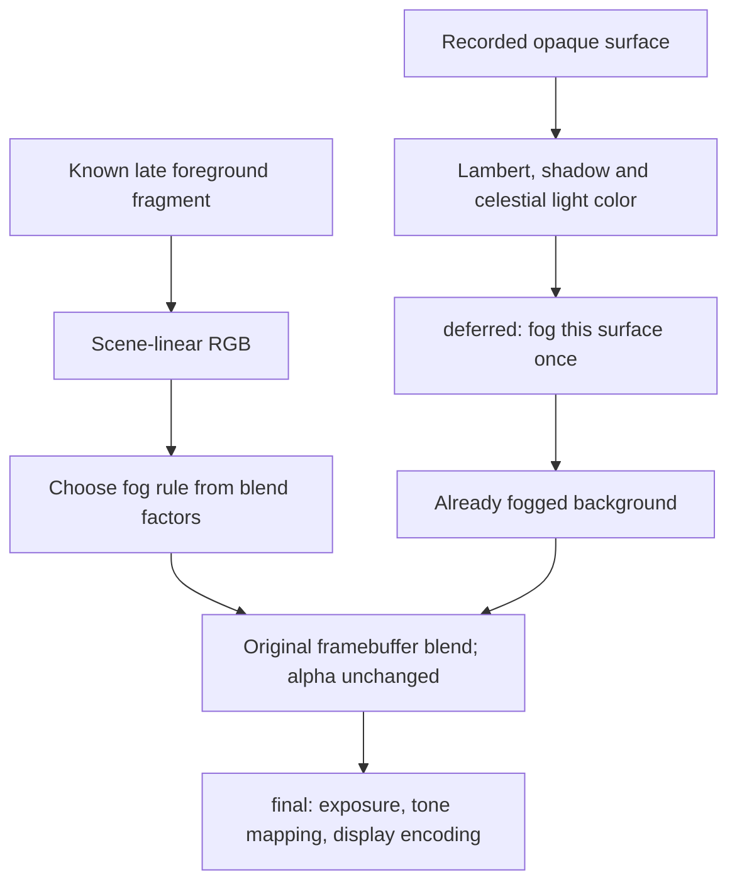

# Milestone 9: Distance, height and weather fog

Date: 2026-11-13. Branch: `codex/milestone-9-atmospheric-fog`.
Base: M8 commit `7ac62da5bada1ab0fd0eb6c66cb27222d6ed3586`.
[中文学习版](MILESTONE_9.zh-CN.md).

Minecraft/Iris runtime success remains **unconfirmed**. Executed check results
belong in a separate record; the observations below are not fabricated results.
The continuing development goal does not require manual acceptance at every stage.

## 1. Visual purpose and scope

M9 introduces air between the camera and selected geometry: distant surfaces
approach the shared Aurora day/night/weather palette, while high-altitude paths
encounter less dense fog. Rain can increase extinction. The nearby scene remains
clear by default so building and exploration retain readable detail.

This is a bounded analytic fog model with an approximate height-density integral.
It is not a ray-marched volume, shadowed volumetric lighting, multiple scattering
or a physical atmospheric simulation. It adds no cloud system or water material.

The new fog is active only in the M8 linear scene mode. Its implementation covers:

- Valid recorded opaque/cutout surfaces in `deferred`, after their lighting.
- Known late terrain/water/glass, weather and textured routes, before blending,
  with explicit handling of recognized blend factors. Textured routes can include
  particles and the world border when Iris routes them here with a supported blend.

Clouds, hands, sky, sun/moon, stars, armor glint and emissive-eye programs are not
opted into the new foreground fog path. Non-recorded opaque geometry, late entity
paths and unknown blend modes are not claimed to have complete coverage. The
result is a first coherent fog scope, not universal transparent-material support.

## 2. Put fog after lighting, but before the right blend



Adding fog before deferred lighting would let the surface's shadow or Lambert
factor darken the added fog color. Adding fullscreen fog after transparent layers
would apply one depth to a mixture of different surfaces and can refog a background.
M9 instead uses two controlled insertion points; there is no fog call in `final`.

The opaque call requires valid surface metadata and `depthtex1 < 1`. It reconstructs
a view position at the pixel center. The late call reconstructs the current source
fragment from `gl_FragCoord.xy` and `gl_FragCoord.z`, using the existing inverse
projection. It does not sample the composed background color. Hands are excluded
because their projection/depth convention differs from ordinary scene geometry.

`particles.ordering = after` explicitly keeps particle calls on the late side of
deferred. Entity ordering is more complicated; this milestone does not assume that
`separateEntityDraws` is a reliable universal fix. Iris currently documents a
warning for that feature. [Iris ordering](https://shaders.properties/current/reference/shadersproperties/ordering/),
[projection matrices](https://shaders.properties/current/reference/uniforms/matrices/).

## 3. From distance to transmission

Let `L = length(viewPosition)` and `S = max(FOG_START, 0)`. If `L <= S`, density is
zero, or the environment guard is zero, the helper returns transmission `T = 1`.
Only the segment beyond the clear near distance participates in the model.
Non-finite reconstructed view positions, ray lengths or endpoint/origin heights
also return T = 1, so invalid geometry reconstruction does not introduce fog.

The density profile is bounded:

```text
rho(y) = exp(-max(y - FOG_BASE_HEIGHT, 0) / max(FOG_HEIGHT_FALLOFF, 1))
```

At/below the reference height its value is 1. Above that plane it decays with
height. The scale is an exponential decay length, not a hard top boundary.
Capping the profile below the reference prevents unbounded density deep underground.

Use the ray's world heights at the beginning, midpoint and end of the fogged
segment to estimate its average density:

```text
rhoAverage = (rho(startY) + 4*rho(midY) + rho(endY)) / 6
weather = 1 + max(FOG_RAIN_BOOST, 0) * clamp(rainStrength, 0, 1)
tau = max(FOG_DENSITY, 0) * (L-S) * rhoAverage * weather * environment
T = exp(-clamp(tau, 0, 80))
```

This is a three-point Simpson approximation, not an exact integration of the
piecewise height profile. The optical-depth cap keeps the exponent bounded.
For a fixed height weighting/environment, more distance, density or rain boost
means less transmission. Different paths can have different height weightings,
so distance alone does not determine the fog amount.

## 4. Coordinate spaces and cave protection

View-space position determines distance. Height needs a world-aligned reference;
its Y value cannot be taken directly from a camera-rotating view-space vector.
The implementation uses:

```text
anchorY = float(cameraPositionInt.y) + cameraPositionFract.y
originY = anchorY + gbufferModelViewInverse[3].y
endY = anchorY + viewToPlayerPosition(viewPosition).y
startY = mix(originY, endY, S/L)
midY = (startY + endY) / 2
```

The inverse-view translation participates in the ray origin as well as its end.
This accounts for the view/player-relative offset rather than silently treating
the player-relative result as absolute world height. Integer/fractional camera
coordinates avoid relying on the wrapped `cameraPosition` anchor.
[Iris coordinate spaces](https://shaders.properties/current/how-to/coordinate_spaces/).

The environment multiplier is:

```text
skyAccess = smoothstep(0, 0.5, clamp(eyeBrightnessSmooth.y / 240, 0, 1))
environment = celestialEnvironmentWeight() * skyAccess
```

`celestialEnvironmentWeight` retains the M7 guards: an open skylit dimension,
no water/lava/powdered-snow camera, and a fade during blindness/darkness.
The smoothed sky-light signal reduces the new fog when the camera enters a cave.
This is an artistic camera-local safeguard, not an analysis of air visibility
along every ray. A cave entrance can therefore change the global fog strength;
that transition belongs in runtime observations. These guards do not implement
underwater fog or the complete vanilla status-effect renderer.

## 5. Fog color and transparent composition

The atmosphere color reuses `applyAuroraSky` along the current view direction,
with vanilla `fogColor` as its baseline. Thus sky style/blend and the shared solar
and rain palette also affect the fog color. The enabled branch is scene-linear.
For an opaque surface:

```text
fogged = T * sceneRGB + (1-T) * atmosphereRGB
```

The atmosphere contribution is added after shadowed surface lighting. It is not
multiplied by the surface's shadow visibility. This does not make it volumetrically
shadowed; there are no light shafts or shadow samples along the fog ray.

Known late programs inspect `blendFunc.xy` without changing alpha or blend state:

| Source / destination RGB factors | Source RGB sent to blending | Reason |
|---|---|---|
| `SRC_ALPHA / ONE_MINUS_SRC_ALPHA` (770/771) | `T*C + (1-T)*F` | Fog the foreground coverage only |
| `ONE / ZERO` (1/0) | `T*C + (1-T)*F` | Fully replace the destination with the fogged source |
| `ONE / ONE` or `SRC_ALPHA / ONE` (1/1 or 770/1) | `T*C` | Attenuate additive light; do not add another fog-color layer |
| `SRC_COLOR / ONE` (768/1) | `sqrt(T)*C` | The source factor squares RGB, producing total attenuation T |
| Other modes | Original source | Unsupported composition is explicitly left unchanged |

For ordinary straight-alpha blending, the result is
`alpha * foregroundFogged + (1-alpha) * backgroundAlreadyFogged`.
Alpha zero leaves the background alone; alpha one uses only the fogged foreground.
For additive particles, adding `(1-T)*F` to every layer would brighten the fog once
per particle. Transmission-only handling avoids that failure. The square-root rule
is an algebraic adjustment for the particular source-color blend, not a new glint
implementation. Glint and emissive-eye programs remain outside the new call scope.
[Iris blend-factor uniform](https://shaders.properties/current/reference/uniforms/rendering/#blendfunc),
[framebuffer blending controls](https://shaders.properties/current/reference/shadersproperties/rendering/#blend).

## 6. Controls and implementation map

Open **Distance and Height Fog** (`FOG`).

| Option | Default | Choices | Meaning |
|---|---:|---|---|
| `FOG_ENABLED` | 1 | 0, 1 | New fog off/on; requires linear scene mode |
| `FOG_DENSITY` | .006 | 0, .002, .004, .006, .01, .02 | Extinction per block at maximum height-profile weight |
| `FOG_START` | 24 | 0, 16, 24, 32, 64 | Clear near distance in blocks |
| `FOG_BASE_HEIGHT` | 64 | 32, 64, 96, 128 | World height where density stops increasing downward |
| `FOG_HEIGHT_FALLOFF` | 64 | 16, 32, 64, 128 | Exponential height scale in blocks |
| `FOG_RAIN_BOOST` | 1 | 0, .5, 1, 2 | Additional density multiplier at full rain |

`FOG_ENABLED=0`, `FOG_DENSITY=0` or `SCENE_COLOR_MODE=0` supplies an unfogged
comparison path. Keep other M8 controls fixed for an A/B comparison; there is no
claim of measured bit-identical runtime output across different engine versions.

`lib/fog.glsl` owns the shared transmission and composition rules;
`lib/fog_settings.glsl` owns the six settings. `deferred.fsh` handles valid recorded
surfaces. The late flag appears only in `gbuffers_water`, `gbuffers_weather`,
`gbuffers_textured` and `gbuffers_textured_lit`, which share `lit_fragment.glsl`.
Include guards let fog reuse existing sky, scene-color and position helpers.
No new render pass or attachment is introduced; the pack still has 20 program pairs.

## 7. Checks and open observations

Use `python -B tools/validate.py`, the optional installed-compiler check
`python -B tools/compile_glsl.py`, and whitespace review. Structural/numerical
checks and standalone compilation do not execute the Iris patcher or a Minecraft
frame. They cannot establish draw-order coverage, GPU output, appearance or speed.
Record actual execution results separately.

Keep a fixed viewpoint and ordinary grading while comparing fog off/on. Use a
low valley, hill, cave entrance, water/glass layers, foliage and particle effects.
Record Minecraft/Iris/Sodium/driver versions and all non-fog settings.

| Comparison | Observation needed | Actual result |
|---|---|---|
| Fog off / density zero / legacy scene mode | Original M8 path remains available | |
| Near distance and its boundary | Clear foreground and smooth onset, no abrupt ring | |
| Valley, horizontal vista, elevated camera and tall structures | Height reference and gradual density decay | |
| Rotate, translate, third person and view bobbing | Fog remains tied to geometry/world height | |
| Clear, rain and thunder transitions | Controlled increase without sudden palette changes | |
| Day, sunset and night | Shared sky colors and usable terrain silhouettes | |
| Cave entrance and torch-lit interior | Camera-local cave safeguard and smooth transitions | |
| Water/glass/weather, ordinary particles and world-border routing over fogged terrain | Correct foreground coverage where blend/routing is supported; no refogged background | |
| Overlapping additive particles | Attenuation without accumulating fog-color brightness | |
| Unknown blends, late entities, clouds, glint and emissive eyes | Document scope gaps and actual engine routing | |
| Fluid camera, blindness/darkness, Nether/End and modded dimensions | Existing environment fallback remains usable | |
| Hands, sky, Debug 1-6 and shadow modes | No new fog call in excluded paths or numerical views | |

Unobserved rows stay blank and are not approval gates. Future work must tighten
remaining draw-scope coverage while adding clouds and controlled glow in separate
steps, preserving explicit composition rules.

## 8. Interview-sized explanations

1. **What is fog transmission?** The surviving fraction of a surface's light after
   the modeled path; Beer-Lambert attenuation is exponential in optical depth.
2. **Why separate density from distance?** Their product describes accumulated
   extinction; height and weather can change the density sampled along the path.
3. **Why integrate height instead of reading only the surface height?** A ray can
   pass through dense low air even when its endpoint is above the fog layer.
4. **Is the Simpson calculation exact?** No. Three samples approximate the profile,
   especially where the ray crosses the capped-density boundary.
5. **Why fog after surface lighting?** Otherwise the object's Lambert/shadow term
   incorrectly scales fog color that was added before lighting.
6. **Why not apply final fullscreen fog after transparency?** One depth cannot
   describe a foreground/background mixture; it risks processing the background again.
7. **Why preserve alpha?** Alpha controls foreground coverage; fog changes RGB
   transmission/scattering, not the geometry's material coverage in this model.
8. **Why treat additive particles differently?** Their contribution is extra light.
   Adding fog color for each layer would count the same atmosphere repeatedly.
9. **Why use sqrt(T) with SRC_COLOR?** The blend multiplies the source by itself;
   squaring a sqrt(T) scale gives the intended total transmission T.
10. **Is this volumetric lighting?** It is a simple height-fog approximation without
    ray-marched lighting or shadowed scattering; those require additional systems.

## Primary references

- [Iris coordinate spaces](https://shaders.properties/current/how-to/coordinate_spaces/)
- [Iris camera/player uniforms](https://shaders.properties/current/reference/uniforms/camera/)
- [Iris program ordering](https://shaders.properties/current/reference/shadersproperties/ordering/)
- [Iris rendering uniforms and blend factors](https://shaders.properties/current/reference/uniforms/rendering/)
- [Iris blend settings](https://shaders.properties/current/reference/shadersproperties/rendering/#blend)
- [M8 scene-color foundation](MILESTONE_8.md)
- [Continuing roadmap](AURORA_ROADMAP.md)

## Recorded offline verification (2026-11-13)

- Full `tools/validate.py`: passed, retaining M1-M8 regressions, pinning 68 M8 shader/property files and checking 87,480 M9 transmission cases.
- `tools/compile_glsl.py`: all 590 standalone GLSL compile/link configurations passed.
- Full source/tool diff review and `git diff --check`: passed.
- Minecraft/Iris runtime appearance and GPU timing have not been measured for M9.
