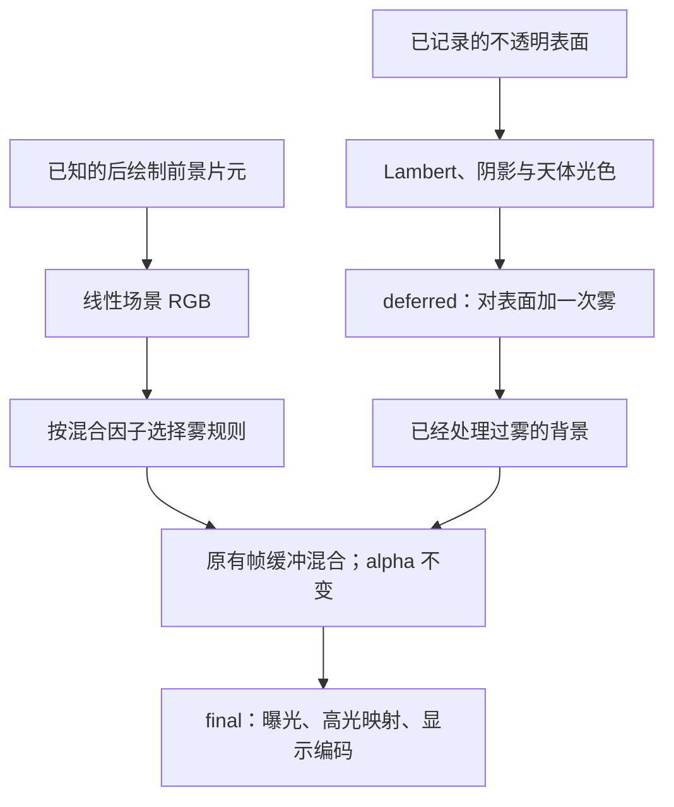

# Milestone 9：距离、高度与天气雾

日期：2026-11-13。分支：`codex/milestone-9-atmospheric-fog`。
基于 M8 提交 `7ac62da5bada1ab0fd0eb6c66cb27222d6ed3586`。
[English](MILESTONE_9.md)。

**尚未确认 Minecraft／Iris 运行成功。** 真正执行的检查应单独记录；下方观察表
不能用预期代替实测。持续开发目标不要求每一步都先取得人工验收。

## 1. 画面目标与覆盖范围

M9 开始在相机与部分几何体之间加入空气感：远处表面逐渐融入 Aurora 的昼夜／天气
配色，高空路径遇到的雾更稀薄，降雨可以增加消光。默认保留清晰的近景，便于建造和探索。

这是一个有界的解析雾模型，使用近似的高度密度积分。它没有沿视线步进计算体积光，
没有雾中的阴影、多次散射，也不是完整物理大气模拟。本阶段不新增云或水材质。

新雾只在线性场景模式中生效，当前覆盖：

- `deferred` 中有有效表面记录的不透明／镂空物体，在光照完成后处理。
- 已明确走后绘制路径的水／玻璃地形、天气和纹理程序，在混合前处理其前景颜色，
  并按已识别的 blend factors 选择规则。纹理程序也可能绘制世界边界；只有 Iris
  实际把对象送到这些路径且使用受支持混合时，才属于这里的处理范围。

云、手持物、天空、太阳／月亮、星星、附魔光效和发光眼睛没有加入新的前景雾调用。
没有表面记录的不透明物体、较晚绘制的实体以及未知混合类型，也不能宣称已完整覆盖。
这一阶段建立的是范围明确的雾合成方式，不是“所有透明材质已经完全正确”。

## 2. 雾放在哪一步，和公式同样重要



如果先加雾再做 deferred 光照，表面的阴影或 Lambert 系数会把雾色也一起压暗。
如果等透明层已经混合后，再在 final 按一个深度全屏加雾，又无法区分前景与背景，
可能重复处理已加雾的背景。因此 M9 使用两个受控的接入位置，`final` 不调用雾函数。

不透明路径要求表面标记有效且 `depthtex1 < 1`，按像素中心重建观察空间位置。
后绘制路径使用当前源片元自己的 `gl_FragCoord.xy` 与 `gl_FragCoord.z`，通过现有
逆投影重建位置，不去读取已经合成的背景颜色。手持物的投影／深度约定不同，故不加入。

`particles.ordering = after` 明确要求粒子位于 deferred 之后。实体绘制顺序更复杂；
本阶段没有把 `separateEntityDraws` 当作通用修复，Iris 文档目前也对它给出了失效警告。
[Iris 绘制顺序](https://shaders.properties/current/reference/shadersproperties/ordering/)、
[投影矩阵说明](https://shaders.properties/current/reference/uniforms/matrices/)。

## 3. 从距离算到透射率

令 `L=length(viewPosition)`，`S=max(FOG_START,0)`。当 `L<=S`、密度为零或环境权重
为零时，函数返回 `T=1`，保留原结果。参与积分的是清晰近景之外的那段视线。
重建位置、视线长度或起终点高度出现 NaN／Inf 时也返回 T=1，避免无效的几何重建产生雾。

高度密度曲线为：

```text
rho(y) = exp(-max(y - FOG_BASE_HEIGHT, 0) / max(FOG_HEIGHT_FALLOFF, 1))
```

参考高度及以下的密度权重为 1；向上按指数衰减。高度尺度表示衰减长度，不是雾层的
硬顶面。下方封顶可以避免越往地下密度越无界增长。

对参与加雾的线段，在起点、中点、终点各采一次高度密度，估计平均值：

```text
rhoAverage = (rho(startY) + 4*rho(midY) + rho(endY)) / 6
weather = 1 + max(FOG_RAIN_BOOST, 0) * clamp(rainStrength, 0, 1)
tau = max(FOG_DENSITY, 0) * (L-S) * rhoAverage * weather * environment
T = exp(-clamp(tau, 0, 80))
```

这里使用三点 Simpson 近似，不是对分段高度函数的精确积分。把光学厚度 `tau`
限制到 80，是为了让指数的输入有界。在高度权重和环境相同的条件下，路径更长、
密度更高或雨量增强，透射率会降低。不同路径的高度权重不同，不能只靠距离判断雾量。

## 4. 高度坐标与洞穴保护

观察空间位置可以给出距离，但其 Y 轴随相机转动，不能直接当世界高度。
代码采用以下约定：

```text
anchorY = float(cameraPositionInt.y) + cameraPositionFract.y
originY = anchorY + gbufferModelViewInverse[3].y
endY = anchorY + viewToPlayerPosition(viewPosition).y
startY = mix(originY, endY, S/L)
midY = (startY + endY) / 2
```

逆观察矩阵中的平移既用于视线起点，也用于终点，明确处理观察空间与玩家相对空间
之间的偏移，而不是把玩家相对坐标误当成绝对世界坐标。整数／小数相机坐标也避免依赖
会包装重置的 `cameraPosition` 锚点。
[Iris 坐标空间](https://shaders.properties/current/how-to/coordinate_spaces/)。

环境权重为：

```text
skyAccess = smoothstep(0, 0.5, clamp(eyeBrightnessSmooth.y / 240, 0, 1))
environment = celestialEnvironmentWeight() * skyAccess
```

`celestialEnvironmentWeight` 延续 M7 的保护条件：开放且有天空光的维度、相机不在
水／岩浆／细雪中，并在失明／黑暗效果期间淡出。平滑后的相机天空光还会在进入洞穴时
减弱新雾。这是艺术化的相机局部保护，不是逐条视线分析空气是否与室外连通。
因此走过洞口可能改变整幅画面的雾强度，需要单独观察过渡。它也没有实现完整的水下雾
或原版状态效果渲染。

## 5. 雾色与透明混合

雾色沿当前视线复用 `applyAuroraSky`，以原版 `fogColor` 为基线。因此天空样式、
天空混合比例、太阳阶段和雨天配色也会影响雾色。实际启用分支处理的是线性场景颜色。
不透明表面的合成为：

```text
fogged = T * sceneRGB + (1-T) * atmosphereRGB
```

空气颜色在表面光照之后加入，不乘表面的阴影可见性。但这不代表已经有体积阴影；
模型没有沿雾线段采样阴影，也不会产生被遮挡的光柱。

后绘制程序检查 `blendFunc.xy`，不改变 alpha 或原有混合状态：

| 源／目标 RGB 因子 | 送去混合的源 RGB | 原因 |
|---|---|---|
| `SRC_ALPHA / ONE_MINUS_SRC_ALPHA`（770/771） | `T*C + (1-T)*F` | 只处理前景所覆盖的部分 |
| `ONE / ZERO`（1/0） | `T*C + (1-T)*F` | 用处理后的源颜色完全替换目标 |
| `ONE / ONE` 或 `SRC_ALPHA / ONE`（1/1 或 770/1） | `T*C` | 加法光只衰减，不重复加入雾色 |
| `SRC_COLOR / ONE`（768/1） | `sqrt(T)*C` | 源颜色还会乘自己，最终总衰减为 T |
| 其他模式 | 原源颜色 | 未建立合成约定时明确回退 |

普通 straight-alpha 混合的结果是：
`alpha * foregroundFogged + (1-alpha) * backgroundAlreadyFogged`。
alpha 为零时背景不变，为一时只采用处理后的前景。

如果每个加法粒子都加一次 `(1-T)*F`，雾就会随粒子层数越来越亮。只衰减光贡献可以
避免重复计入同一片空气。平方根规则只是针对特定 source-color 混合的代数处理，
并不等于新写了附魔光效；glint 与发光眼睛程序仍不调用新雾。
[Iris 混合因子 uniform](https://shaders.properties/current/reference/uniforms/rendering/#blendfunc)、
[帧缓冲混合设置](https://shaders.properties/current/reference/shadersproperties/rendering/#blend)。

## 6. 参数与文件职责

设置页为 **Distance and Height Fog**，内部名称 `FOG`。

| 选项 | 默认值 | 可选值 | 含义 |
|---|---:|---|---|
| `FOG_ENABLED` | 1 | 0、1 | 关闭／开启新雾，要求线性场景模式 |
| `FOG_DENSITY` | .006 | 0、.002、.004、.006、.01、.02 | 高度权重最大时，每方块的消光系数 |
| `FOG_START` | 24 | 0、16、24、32、64 | 相机周围保持清晰的距离 |
| `FOG_BASE_HEIGHT` | 64 | 32、64、96、128 | 低于此世界高度时，密度不再继续增长 |
| `FOG_HEIGHT_FALLOFF` | 64 | 16、32、64、128 | 高度指数衰减的尺度，单位方块 |
| `FOG_RAIN_BOOST` | 1 | 0、.5、1、2 | 满雨量时额外增加的密度倍数 |

`FOG_ENABLED=0`、`FOG_DENSITY=0` 或 `SCENE_COLOR_MODE=0` 提供无新雾的对照通路。
对照时保持其他 M8 设置相同；不声称已证明不同引擎版本下逐位一致的运行输出。

`lib/fog.glsl` 集中处理透射率与合成，`lib/fog_settings.glsl` 定义六个设置。
`deferred.fsh` 处理有效记录表面。后绘制标记只加在 `gbuffers_water`、
`gbuffers_weather`、`gbuffers_textured`、`gbuffers_textured_lit`，通过共享的
`lit_fragment.glsl` 接入。include guards 让雾复用已有天空、颜色与位置辅助函数，
避免重复声明。没有增加新渲染阶段或附件，程序对总数仍为 20。

## 7. 检查与待观察项目

使用 `python -B tools/validate.py`、可选的已安装编译器检查
`python -B tools/compile_glsl.py`，以及空白检查。
结构／数值检查和独立编译不会执行 Iris patcher 或 Minecraft 帧，不能证明实际绘制
顺序覆盖、GPU 输出、画面质量或速度。真正执行的结果单独记录。

开关雾时固定机位与普通调色，场景包含低谷、高处、洞口、水／玻璃叠层、树叶和粒子。
记录 Minecraft／Iris／Sodium／显卡驱动版本，以及非雾设置。

| 对照项目 | 需要观察的内容 | 实际结果 |
|---|---|---|
| 关闭雾／密度零／旧场景模式 | M8 对照通路仍可用 | |
| 近景距离与边界 | 前景清晰，雾平滑出现，没有突兀的圈 | |
| 低谷、平视远景、高处相机与高建筑 | 世界高度参考正确，密度渐变 | |
| 转动、移动、第三人称和视角摇晃 | 雾跟随几何体与世界高度 | |
| 晴天、雨天、雷雨及过渡 | 密度受控增加，配色不突跳 | |
| 白天、日落、夜晚 | 天空配色协调，地形仍可辨 | |
| 洞口和火把照亮的内部 | 相机洞穴保护及过渡 | |
| 雾化地形前的水／玻璃／天气／普通粒子，以及世界边界路径 | 受支持混合与绘制路径中的前景正确，背景没有重复加雾 | |
| 多层加法粒子 | 光被衰减，不随层数叠加雾色亮度 | |
| 未知混合、晚绘制实体、云、glint、发光眼睛 | 记录范围缺口和引擎实际绘制路径 | |
| 流体镜头、失明／黑暗、下界／末地及模组维度 | 现有环境回退可用 | |
| 手持物、天空、Debug 1–6 与阴影模式 | 排除路径和数值视图没有新增雾调用 | |

没有观察过的结果保留空白，也不作为后续工作的批准门槛。后续应继续补齐绘制范围，
再以独立步骤加入云和受控辉光，保持明确的合成规则。

## 8. 面试时如何解释

1. **透射率是什么？** 在模型中，表面光穿过这段路径后剩下的比例；Beer–Lambert
   形式让它随光学厚度指数衰减。
2. **为什么区分密度和距离？** 两者共同决定累积消光；高度与天气还会改变路径上的密度。
3. **为什么不能只看物体高度？** 终点在高处的视线，也可能先穿过低处的浓雾。
4. **三点 Simpson 是精确积分吗？** 不是，尤其跨越密度封顶边界时，它只是少量采样近似。
5. **为什么在表面光照之后加雾？** 否则物体的 Lambert／阴影系数会错误地缩放雾色。
6. **为什么不在透明合成后的 final 里统一加雾？** 一个深度无法描述多个层，容易重复处理背景。
7. **为什么 alpha 不变？** 本模型修改 RGB 的透射与雾色贡献，几何体原来的覆盖率不随之改变。
8. **为什么加法粒子单独处理？** 它们添加的是额外光；每层都加入雾色会反复计算同一片空气。
9. **SRC_COLOR 为什么用 sqrt(T)？** 混合还要再乘一次源颜色，平方根缩放被平方后才得到总衰减 T。
10. **这是不是体积光？** 它是简单高度雾近似，没有沿光路步进求光照或雾中阴影；那些需要额外系统。

## 原始资料

- [Iris 坐标空间](https://shaders.properties/current/how-to/coordinate_spaces/)
- [Iris 相机与玩家输入](https://shaders.properties/current/reference/uniforms/camera/)
- [Iris 绘制顺序](https://shaders.properties/current/reference/shadersproperties/ordering/)
- [Iris 渲染输入与混合因子](https://shaders.properties/current/reference/uniforms/rendering/)
- [Iris 混合设置](https://shaders.properties/current/reference/shadersproperties/rendering/#blend)
- [M8 场景颜色基础](MILESTONE_8.zh-CN.md)
- [持续开发路线](AURORA_ROADMAP.zh-CN.md)

## 已执行的离线验证（2026-11-13）

- 完整 `tools/validate.py` 通过：保留 M1–M8 回归检查，固定比对 68 个 M8 着色器／配置文件，检查 87,480 组 M9 透射率输入。
- `tools/compile_glsl.py` 的 590 组独立 GLSL 编译／链接配置全部通过。
- 完整代码与验证工具差异复核、`git diff --check` 通过。
- M9 尚未测量 Minecraft／Iris 实际画面和 GPU 耗时。
