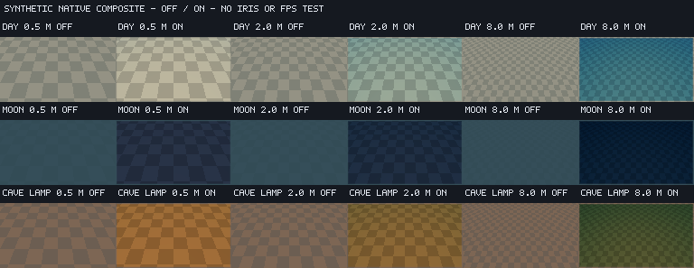

# Water M1 — bounded optical transport

[中文](WATER_M1_OPTICS.zh-CN.md) · [Architecture](WATER_ARCHITECTURE.md) · [Water roadmap](WATER_ROADMAP.md)

AuroraShader now has an opt-in water composition stage before bloom. It replaces the native transparent result only where one supported water surface and a matched solid background can be identified. The default remains `WATER_OPTICS=0`. Enabling it requires HDR scene color, water styling, debug view 0 and Iris independent per-buffer blending. `WATER_CLARITY` offers 0.5 / 1.0 / 2.0; increasing it increases the attenuation length.

This is the first owned transmission model: depth-dependent absorption, bounded in-scattering, a separated incoming directional-light leg, Fresnel reflection and atmosphere evaluated along the appropriate paths. It does not bend the transmitted ray, simulate waves geometrically, solve multiple scattering, or implement underwater/waterline transport.

## Why the two lengths matter

A bottom pixel's light has an incoming path from the sun/moon to the bed and an outgoing path from the bed to the water surface. Only the newly recorded custom directional component receives incoming attenuation. Ambient and block-light contributions receive outgoing attenuation; they are not incorrectly treated as sunlight.

For linear bottom radiance `L`, its custom directional fraction `q`, and per-channel extinction `sigma=(absorption+scattering)/clarity`:

```text
T(d) = exp(-clamp(sigma*d, 0, 80))
incident = L * ((1-q) + q*T(incomingLength))
transmitted = incident*T(outgoingLength)
scatterSource = min(L+sky, L*mix(0.25,0.60,blockLight) + sky*0.25*skyLight)
scatter = (1-T(outgoingLength)) * scattering/(absorption+scattering) * scatterSource
```

The exponential is the homogeneous-medium transmittance relation. The bounded scatter source is Aurora's practical approximation, not a solved phase function or measured freshwater model. [PBRT: transmittance](https://pbr-book.org/4ed/Volume_Scattering/Transmittance)

Live defaults in `water_params.glsl` are one block per meter, refractive index 1.333, absorption `(0.18,0.055,0.025)` per meter and scattering `(0.012,0.020,0.025)` per meter. The warm channel attenuates fastest. A black, unlit cave has no scatter source and remains black; a lamp contributes its local color and energy.

The outgoing length is reconstructed between the water and background at the **same screen pixel**. The incoming length uses the vertical drop divided by the refracted sun/moon cosine. This assumes a locally horizontal top interface above a solid bed. It is not a refracted scene lookup, true water-volume thickness, or a way to infer hidden geometry.

The stored fraction is `q=directional/(residual+directional)` for the existing custom Lambert modulation. R16F stores it with hardware conversion. An independent probe on this Intel driver showed truncation can occur; tests first check the R32F ratio independently, then allow one binary16 ULP for storage conversion rather than assuming round-to-nearest. Minecraft's baked lightmap sunlight cannot be separated by this fraction; that remains an explicit lighting approximation.

## Pass and buffer ownership

```text
early opaque ownership → deferred lit RGB / matched depth / directional fraction
→ native late geometry + water metadata / overlay counter
→ composite water resolve → composite1–4 existing bloom → final display
```

| Buffer | Format / clear | Producer and meaning | Consumer |
|---|---|---|---|
| 0 | Existing scene format | Native color remains a complete fallback | Optical resolve copies alpha exactly |
| 5 / 6 | RGBA16F / R32F, existing W1 | Pre-atmosphere lit RGB + validity / matching depth | Same-pixel transmission and bounded W3 reflections |
| 7 | RGBA32F / zero | Water filtered unit view normal XYZ + raw window depth | Surface ownership, orientation and reflection |
| 8 | RGBA8 / zero | Early ownership; reset in deferred; late count R, block light G, sky light B, A=0 | Exactly one water count, byte 1, is eligible |
| 9 | R16F / −1 | Deferred custom directional fraction, 0–1; −1 invalid | Incoming attenuation and reflected-hit validity |

All new targets use full resolution and ordinary main/alternate flipping. Deferred writes six outputs `0,5,6,7,8,9`, explicitly resetting 7 and 8 for the late phase. Existing supported opaque writers overwrite ownership; later transparent categories add blockers. Water writes its normal/depth without blending, adds `1/255` to the ownership counter, and keeps native color blending independent. A blocker contributes byte 255; multiple waters and saturation cannot wrap back to byte 1. These are logical colortex indices, not a requirement for ten simultaneous draw buffers. [Iris buffer behavior](https://shaders.properties/current/reference/buffers/colortex/), [per-buffer blending](https://shaders.properties/current/reference/shadersproperties/rendering/)

Nominal double-buffer storage for 7/8/9 is `(16+4+2)*2=44` bytes per display pixel, about **87.01 MiB at 1920×1080**. Existing W1 5/6 is separate. M0 already uses 7 for debug views, which are mutually exclusive with M1. This is a format-based allocation estimate, not measured additional Iris allocation or a performance result.

## Resolve and fallback contract

The actual composite validates sizes, finite values, unit normals, count, direct fraction, matching scene depth and surface/final depth agreement within one nominal D24 step. It requires a top-facing interface, the eye above it, positive vertical bed separation and an outgoing length below 64 m. Four neighboring background samples detect depth breaks. Border, orientation and range confidence fade between complete native and optical solutions; confidence is not Fresnel.

Unsupported or ambiguous pixels keep native rendering: missing bed, glass/ice and other overlays, multiple water layers, side faces/waterfalls, underwater camera, invalid snapshots, incompatible dimensions/blending, and debug or legacy color modes. Early translucent contamination invalidates fraction 9 instead of pretending the scene snapshot contains clean opaque lighting.

Reflection uses W3's screen-space trace where available. It is independent of local skylight for a valid scene hit; analytic sky fallback remains skylight weighted. A scene hit additionally needs a valid fraction at the hit pixel so unresolved early overlays cannot become reflected opaque radiance. Missing reflected sources release the unavailable reflection weight back to transmission. The analytic fallback still does not reproduce the actual aurora, clouds or sun/moon discs.

For a scene hit, reflected air-segment fog is evaluated from the hit to the water surface, without reusing the camera's `FOG_START` exemption. The complete optical result then receives one water-surface-to-camera atmosphere evaluation. A confidence blend happens afterward; the existing fallback already owns its atmosphere. Reflected-segment density is a bounded Simpson approximation, not volumetric multiple scattering.

## Files and verification

| File | Responsibility |
|---|---|
| `shaders/lib/water_params.glsl` | Live optical coefficients; old three-field path remains when disabled |
| `water_optics_settings.glsl` / `water_optics_capture.glsl` | Capability gates, valid surface records, blockers and directional fraction |
| `water_transport.glsl` | Shared exponential attenuation and bounded scatter |
| `water_resolve.glsl` / `shaders/composite.fsh` | Validated reconstruction, transport, reflection and atmosphere composition |
| `shaders/composite1–4.*` | Previous bloom stages, shifted after the new resolve |
| [Native transport tests](../tools/validate_gpu_water_transport.py) | Independent analytical oracle, real composite, invalid cases and comparison plate |
| [Native capture tests](../tools/validate_gpu_water_capture.py) | Actual producer outputs and deferred MRT reset/fraction |
| [Native harness](../tools/gpu_harness.cpp) | Separate indexed-blend protocol proof |

Retained validation passed on 2026-11-21. Native render and complete native compile reports use the same shader digest:

```text
f6d1d82ad3d643d34efbcf7c48bc02ecf88ecdc67c988165cfeffacfd03e63de
```

Results on Intel Iris Xe OpenGL 3.3, driver 31.0.101.3962:

| Check | Retained / completed result |
|---|---|
| Fixed-function indexed blending | 6 sequences × 3 attachments × 4 pixels; maximum absolute error 1.19209e−7; 2 deliberately incorrect outputs rejected |
| Shared optical helper | 108 samples over three clarity settings passed an independent double-precision reference |
| Actual composite transport | 8 scenes, 936 pixels, 539 changed pixels; maximum RGB error 1.41056e−5 |
| Disabled / unsupported resolve | 5 disabled configurations and 17 invalid input cases returned native RGBA exactly |
| Actual composite scene reflections | 993 changed pixels; invalid hit shares −1 / nonfinite / >1 each matched the SSR-off fallback exactly |
| Reflected atmospheric segment | 130 samples; enabled maximum error 4.0005e−8, disabled path exact; camera FOG_START exemption did not leak into the reflected leg |
| Actual water / geometry producers | 13 water cases and 26 geometry cases; native RGBA16F exact, RGBA32F wave diagnostic within one FP32 ULP, alpha exact |
| Actual deferred | 4 configurations / 72 samples, 47 valid fractions; outputs 0/5/6 exact, 7/8 reset to zero; R32F ratio maximum error 2.31e−8 |
| CPU history / compatibility | 1,200 live legacy-stage comparisons, 4 exact bloom pairs, 64 gate/ownership/settings combinations; full historical M0 suite at 648c5fc and nine-view lab checks passed |
| Full offline / native compilation | Each passed 2,237 program configurations across 25 program pairs |
| Installed Iris parsers, offline | 72 actual fragment configurations and 64 property combinations selected expected targets/formats/blends |
| Harness controls | Existing copy, sampler, matrix and intentional invalid-input controls passed |
| Comparison plate | 18 panels visually inspected with readable labels; actual composite and final run on synthetic inputs |

The unlit-cave fixture uses black bottom radiance **and black native fallback**. A previous fixture retained an authored blue fallback; the confidence blend correctly kept part of that input near boundaries. Correcting the input, rather than changing the shader, made the intended no-self-emission test precise.

The retained [native render report](validation/WATER_M1_GPU.json) and [full native compile report](validation/WATER_M1_driver.json) both contain `ok=true`. Maximum R16F fraction storage error was 9.30060e−5, within one binary16 ULP plus 3e−7 arithmetic slack; the R32F formula result was checked separately. Actual Iris frame ordering, Minecraft appearance and performance remain unobserved.



The plate shows a warm bed in shallow water, a shift toward blue-green as the longer path absorbs more red, a darker moon response and warm cave-lamp influence without sky fill. These are observations of the synthetic experiment, not acceptance of final in-game image quality.

The synthetic plate uses authored checker-bed radiance, analytical horizontal geometry, 0.5 / 2 / 8 m vertical depths and day/moon/cave-lamp inputs. The actual composite and final shaders draw the comparisons; no Minecraft assets, screenshots or FPS measurements are involved. Its native fallback is an explicitly authored alpha blend, and its light source is not a Minecraft lighting simulation.

For later game observations use the [isolated water lab](../tests/water_lab/README.md): compare enabled/disabled at shallow/deep pools, lamp-lit cave, glass/ice, waterfall, waterline and all nine fixed views. Actual Iris flips, transparent ordering, resource-pack behavior, visual stability and GPU cost still require runtime observation.

The installed Iris 1.10.5 preprocessors for Minecraft 1.21.11 selected the expected formats, draw targets and indexed blends across 72 actual fragment configurations and 64 setting combinations. The four subsequent bloom programs remain independently scheduled when the new water pass is disabled. The offline GLSL compiler and Intel Iris Xe driver each compiled and linked 2,237 program configurations. World bindings, frame ordering and in-game performance require separate observations. [Iris feature flags](https://shaders.properties/current/reference/shadersproperties/flags/) · [Iris composite scheduling](https://github.com/IrisShaders/Iris/blob/1.21.11/common/src/main/java/net/irisshaders/iris/pipeline/CompositeRenderer.java) · [Native driver report](validation/WATER_M1_driver.json).
