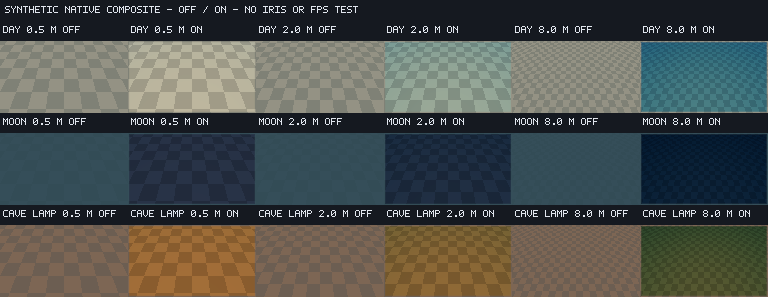

# 水体 M1：有边界的光学传输

[English](WATER_M1_OPTICS.md) · [水体架构](WATER_ARCHITECTURE.zh-CN.md) · [水体路线图](WATER_ROADMAP.zh-CN.md)

AuroraShader 增加了位于 Bloom 之前、可选开启的水体合成阶段。只有能确认一层有效水面及其后方实心水底的像素，才替换原版透明混合结果。默认仍为 `WATER_OPTICS=0`；开启需要 HDR 场景、水体风格、调试视图 0，以及 Iris 的逐缓冲区独立混合能力。`WATER_CLARITY` 提供 0.5 / 1.0 / 2.0，数值越大，光能穿过的距离越长。

这一步建立真正由水体阶段负责的透光合成：按深度吸收、受光源约束的散射、单独计算入水的直射光路、Fresnel 反射与各段空气雾。当前没有弯折透射采样射线、移动水面几何、求解多次散射，也没有实现水下和跨水线传输。

## 为什么要区分两段距离

水底像素的光先从太阳／月亮到达水底，再从水底走到水面。只有新记录的自定义直射分量受到第一段入水路径的衰减；环境与方块灯光只计算向水面传播的第二段，避免把洞穴火把错误地当成日光处理。

令 `L` 为线性水底亮度、`q` 为自定义直射比例、`sigma=(吸收+散射)/清澈度`，各颜色通道分别计算：

```text
T(d) = exp(-clamp(sigma*d, 0, 80))
入射亮度 = L * ((1-q) + q*T(入水光程))
透射亮度 = 入射亮度*T(出水光程)
散射光源 = min(L+天空, L*mix(0.25,0.60,方块光) + 天空*0.25*天光)
散射贡献 = (1-T(出水光程)) * 散射/(吸收+散射) * 散射光源
```

指数项来自均匀介质的透射关系；这里有上限的散射光源是 Aurora 的实用近似，并非完整相函数求解或实测淡水参数。[PBRT：介质透射](https://pbr-book.org/4ed/Volume_Scattering/Transmittance)

`water_params.glsl` 当前实际使用：1 方块 = 1 米、折射率 1.333、每米吸收 `(0.18,0.055,0.025)`、每米散射 `(0.012,0.020,0.025)`。暖色通道衰减更快。没有光的黑色洞穴没有散射能量来源，因此仍为黑色；火把等局部光源保留自身的色彩和能量作用。

出水距离从**同一屏幕像素**的水面与背景深度重建；入水距离由垂直水深除以折射后的太阳／月亮方向余弦得到。这假定局部水平顶面下方有实心水底，不是折射后的场景查询、真实体积厚度，也不能推断屏幕外或遮挡后的几何。

记录的 `q=直射/(剩余光+直射)` 只分离已有自定义 Lambert 调制，按实际硬件转换存为 R16F。该 Intel 驱动的独立探针显示转换可能截断；测试先独立验证 R32F 比例，再允许最多一个 binary16 ULP 的存储误差，不假设舍入到最近值。Minecraft 光照贴图中已经混入的日光无法由这个比例拆开，这是当前明确保留的近似。

## 渲染顺序与缓冲区归属

```text
早期不透明归属 → deferred 光照颜色／配对深度／直射比例
→ 原生后期几何 + 水面信息／遮挡计数
→ composite 水体合成 → composite1–4 原有 Bloom → final 显示
```

| 缓冲区 | 格式／清除值 | 写入内容 | 用途 |
|---|---|---|---|
| 0 | 既有场景格式 | 完整保留原生颜色回退 | 水体合成始终原样复制 alpha |
| 5／6 | RGBA16F／R32F，既有 W1 | 未加入相机空气雾的光照 RGB 与有效标记／配对深度 | 同像素透射与 W3 有界反射 |
| 7 | RGBA32F／零 | 水面过滤后的单位观察空间法线 XYZ 与原始窗口深度 | 归属、朝向、反射 |
| 8 | RGBA8／零 | 早期归属；deferred 重置后，R 为层数计数、G 为方块光、B 为天光，A=0 | 只有 R 等于字节 1 的单层水可用 |
| 9 | R16F／−1 | deferred 自定义直射比例 0–1；−1 为无效 | 入水衰减与反射命中有效性 |

新目标均为全分辨率，使用正常主／备用纹理翻转。deferred 同时写六个输出 `0,5,6,7,8,9`，并把 7、8 清零，供后续透明阶段使用。支持的不透明类别覆盖写入归属；后期透明类别累加阻挡标记。水面法线／深度不混合，计数累加 `1/255`，场景颜色仍独立执行原有混合。阻挡物贡献字节 255，多层累加与饱和都不会回绕成字节 1。这些是逻辑 colortex 编号，不代表同时需要十个绘制附件。[Iris 缓冲区规则](https://shaders.properties/current/reference/buffers/colortex/)、[逐缓冲区混合](https://shaders.properties/current/reference/shadersproperties/rendering/)

7／8／9 双缓冲的名义存储量为每显示像素 `(16+4+2)*2=44` 字节，**1920×1080 约 87.01 MiB**。既有 W1 的 5／6 另算；M0 调试已使用 7，调试模式与 M1 互斥。这是按格式计算的容量，不是实测 Iris 新增分配量或性能结果。

## 合成条件与回退

实际 composite 检查尺寸、有限数值、单位法线、计数、直射比例、场景深度配对，以及水面深度与最终深度在一个名义 D24 单位内一致。要求顶面朝上、观察者位于其上方、水底有正垂直间距、出水路径小于 64 米，并用四个邻近背景样本识别深度突变。屏幕边缘、朝向与距离置信度只负责混合完整的原生和光学结果；它不是 Fresnel。

缺失水底、玻璃／冰及其他覆盖物、多层水、水侧面／瀑布、水下相机、无效快照、不兼容维度或混合方式，以及调试／旧颜色模式，都保留原生渲染。早期透明污染会让 9 无效，而不是把受污染的场景当成干净的不透明光照。

反射沿用 W3 的屏幕空间追踪。有效场景命中不依赖局部天光；解析天空回退仍受天光限制。命中像素还必须有有效直射比例，防止早期透明覆盖物被当作不透明反射。找不到可用反射光源时，对应权重释放给透射。解析天空仍没有复现真实极光、云或太阳／月亮圆盘。

场景反射先计算“命中物体 → 水面”自己的空气雾，不套用相机的 `FOG_START` 豁免距离；光学结果随后只计算一次“水面 → 相机”的空气雾，最后再与已含雾的原生结果按置信度混合。反射段密度使用有界 Simpson 近似，不是多次体积散射。

## 文件与验证

| 文件 | 作用 |
|---|---|
| `shaders/lib/water_params.glsl` | 实际光学系数；关闭时保留原来的三个参数路径 |
| `water_optics_settings.glsl`／`water_optics_capture.glsl` | 能力开关、有效水面记录、阻挡标记与直射比例 |
| `water_transport.glsl` | 共用指数衰减和受约束散射 |
| `water_resolve.glsl`／`shaders/composite.fsh` | 有效性检查、重建、透光、反射及空气雾合成 |
| `shaders/composite1–4.*` | 移到水体合成之后的原有 Bloom |
| [原生透光测试](../tools/validate_gpu_water_transport.py) | 独立解析参照、真实 composite、异常输入及对照图 |
| [原生写入测试](../tools/validate_gpu_water_capture.py) | 实际几何写入、deferred 多目标重置和比例 |
| [原生显卡测试程序](../tools/gpu_harness.cpp) | 独立的逐附件混合协议验证 |

2026-11-21 的归档验证通过。原生渲染报告与完整原生编译报告使用同一着色器摘要：

```text
f6d1d82ad3d643d34efbcf7c48bc02ecf88ecdc67c988165cfeffacfd03e63de
```

Intel Iris Xe OpenGL 3.3（驱动 31.0.101.3962）的结果：

| 检查 | 已归档／已完成结果 |
|---|---|
| 显卡逐附件混合 | 6 种序列 × 3 个附件 × 4 个像素，最大绝对误差 1.19209e−7；2 个故意错误的输出被拒绝 |
| 共用光学函数 | 3 档清澈度，共 108 个样本通过独立双精度参照 |
| 实际 composite 透光 | 8 个场景、936 个像素，其中 539 个发生变化；最大 RGB 误差 1.41056e−5 |
| 关闭／不支持的合成路径 | 5 种关闭配置、17 种无效输入，原生 RGBA 完全不变 |
| 实际 composite 场景反射 | 993 个像素变化；命中比例为 −1／非有限值／大于 1 时，分别精确回退到 SSR 关闭结果 |
| 反射空气段 | 130 个样本；开启时最大误差 4.0005e−8，关闭路径完全一致；相机 FOG_START 未错误套入反射段 |
| 实际水面／几何写入 | 13 个水面用例、26 个几何用例；原生 RGBA16F 场景完全一致，RGBA32F 波浪诊断最多 1 个单精度 ULP，alpha 完全一致 |
| 实际 deferred | 4 种配置、72 个样本，47 个有效比例；0／5／6 完全一致，7／8 重置为零；R32F 比例最大误差 2.31e−8 |
| CPU 历史与兼容检查 | 1,200 个现行旧路径阶段比较、4 对 Bloom 完全保留、64 种开关／归属／设置组合；648c5fc 的完整 M0 历史验证与九视角实验场检查通过 |
| 完整离线／原生编译 | 两者分别通过 2,237 种程序配置，共 25 对程序 |
| 已安装 Iris 解析器离线检查 | 72 个实际片元配置与 64 种属性组合的目标／格式／混合解析通过 |
| 原生测试程序控制 | 原有拷贝、采样器、矩阵及故意错误输入检查通过 |
| 对照图 | 18 个面板已检查，文字完整；真实 composite 与 final 运行在合成输入上 |

无光洞穴用例同时使用**黑色水底与黑色原生回退**。早先测试输入保留了人为设定的蓝色回退，置信度混合会正确地在边界保留一部分该输入；修正输入后，才准确检验了水体不会自行发光。这里没有为测试修改着色器。

归档的[原生渲染报告](validation/WATER_M1_GPU.json)与[完整原生编译报告](validation/WATER_M1_driver.json)均为 `ok=true`。R16F 比例最大存储误差为 9.30060e−5，位于一个 binary16 ULP 加 3e−7 运算余量以内；对应 R32F 公式结果单独通过检查。实际 Iris 帧顺序、游戏表现和性能尚未观察，不能由这些结果推断。



图中浅水保留暖色水底，水越深，红色衰减越快，水底逐渐偏青；月光随深度变暗，洞穴灯光保持自身暖色影响且没有天光填充。这是合成实验的观察，不是游戏最终画面质量验收。

合成对照图使用自行设定的棋盘格水底亮度、解析水平几何、0.5／2／8 米垂直水深，以及日光／月光／洞穴灯光输入，由实际 composite 和 final 着色器绘制。没有使用 Minecraft 素材、游戏截图或 FPS 测量；原生回退是明确构造的 alpha 混合，光照输入不模拟 Minecraft 完整照明。

后续游戏观察使用[独立水体实验场](../tests/water_lab/README.zh-CN.md)，对比浅／深水池、火把洞穴、玻璃／冰、瀑布、水线和九个固定视角。Iris 的实际翻转、透明绘制顺序、资源包表现、运动稳定性及显卡耗时仍需运行时观察。

本机已安装的 Iris 1.10.5（Minecraft 1.21.11）离线解析了 72 组实际片元文件和 64 组设置。其预处理器选中了预期的渲染目标、格式与独立混合，且跳过水体合成时仍保留后面的四道 Bloom。独立 GLSL 编译器与 Intel Iris Xe 驱动分别通过 2,237 组实际程序编译和链接。游戏世界的绑定、顺序和帧耗时仍需运行时证据。[Iris 特性开关](https://shaders.properties/current/reference/shadersproperties/flags/) · [Iris 合成阶段源码](https://github.com/IrisShaders/Iris/blob/1.21.11/common/src/main/java/net/irisshaders/iris/pipeline/CompositeRenderer.java) · [本机驱动报告](validation/WATER_M1_driver.json)。
