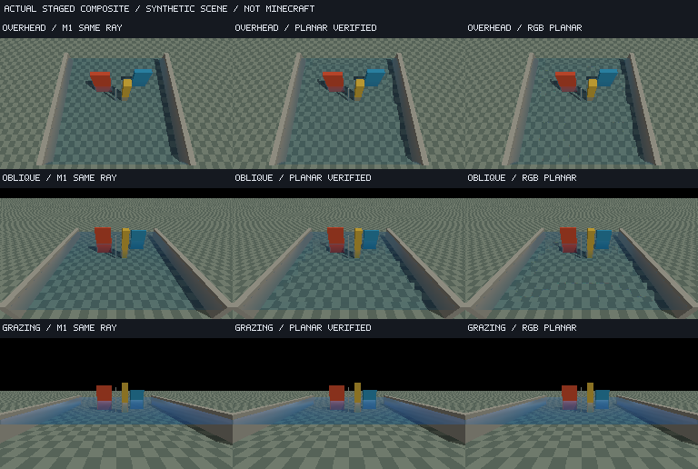

# Validated planar refraction and production pass migration

The ordinary refraction setting now solves Snell's law against a locally proven horizontal pool bed. If that proof fails it keeps the existing same-ray optical result. The option remains **Off by default**. This is screen-space transport, with explicit missing-data fallbacks; it adds neither hidden geometry nor hardware ray tracing.

## Pipeline and preservation

| Program | Work | Output / lifetime |
|---|---|---|
| `composite` | Post-water planar/ownership proof | `colortex11 RGBA32F`, width/height × 1/8, rewritten each frame |
| `composite1` | Existing water transport, celestial glints and local/persistent foam | Existing `0` or `0,13,14` layout |
| `composite2..5` | Existing four bloom programs | Unchanged formats, math and behavior |
| `final` | Existing display transform/debug | Unchanged |

The migration baseline is `9b188fa96401c5108dc9c0a33830d69fb87eb968`. The complete resolver, all four bloom pairs, water flow, interactions and foam history are retained. Buffer11 avoids requiring logical target16; it is not eleven simultaneous render targets. The producer uses eight samplers; the resolve adds one. Actual combined device limits must still be checked for additional features.

Each8×8 source tile plus a one-pixel halo checks100 pixels: one supported water layer, no overlay, matching final-water depth, valid pre-fog opaque RGB/depth/direct share, and an upward horizontal **opaque bed** normal. Reconstructed water and bed heights may each span at most4mm. The output stores their four min/max bounds. An inverted interval is invalid; incomplete borders fall back. This proves finite raster samples, not unseen subpixel geometry or a closed water volume.

Default Iris ping-pong allocation is nominally0.44MiB at1280×720 and0.99MiB at1920×1080 for both RGBA32F sides. No history is sampled and every scheduled target pixel is written. Actual Iris allocation/flip behavior has not been observed.

## Refraction modes

- **0 Off:** previous same-ray transport.
- **1 Validated Planar:** analytic Snell/plane intersection after at most32 proved tile intervals; failure returns same-ray.
- **2 Planar + Strict128:** the same fast route, then the fully checked cached128-step experimental search on failure. This can be extremely expensive.
- **3 RGB Planar:** three representative IAPWS wavelength indices; only the planar route, with coherent missing-channel fallback.

Every accepted analytic endpoint receives the full3×3 depth/ownership inspection and local bed-plane correction. It must stay within the already proven pixel and0.25pixel correction. The selected receiver position, normal, radiance and **target** direct-light share enter two-leg transport. Confidence is separate from Fresnel. The rejected provisional-plane search optimization is absent.

Sloping beds, stairs, rocks, shore overlaps, waterfalls, glass and incomplete screen coverage usually invalidate the planar proof. Grazing coverage is deliberately limited; tile-boundary/motion behavior still needs game observation. No submerged waterline path is introduced.

## Verification

Current source/CPU checks passed:1,200 historical stage comparisons;127 baseline files exact after program rename;1,296 complete refraction-off stage comparisons including foam, glints, flow and contacts;96 foam routing combinations;128 planar dispatch combinations; the full original M0/history suite; nine unchanged lab camera definitions. Offline compile/link passed all2,562 configurations. Installed Iris1.10.5 preprocessing parsed304 fragment configurations and512 setting selections. These are not Minecraft runtime results.

Native verification passed on Intel Iris Xe / OpenGL3.3 (driver31.0.101.3962). Frozen shader SHA256: `6387b86b651c2dd230ee2fc946cb587a1ed3e3cb8cd8357edf875e8ba9b7c234`.

| Retained evidence | Observed result |
|---|---|
| [Full driver compile](validation/M3_PLANAR_PRODUCTION_compile.json) | All2,562 configurations pass |
| [Actual producer and resolve](validation/M3_PLANAR_PRODUCTION_GPU.json) | 96 independent height intervals, max9.3923e−5m;11 rejection controls; odd41×29 size; actual RGBA16_UNORM normal input |
| Same optical report | 53 independent Snell/transport samples, maxRGB6.5723e−6;82 target-share distinctions;7 target-only vetoes;9,216 exact Off pixels; exact0.5mm/2mm shallow fallbacks |
| [Foam/history](validation/M3_PLANAR_foam_regression.json) | Actual mixed MRT,11 resets, translation/yaw reprojection and readback-fed frame chain pass |
| [Glints](validation/M3_PLANAR_glints_regression.json), [renamed bloom](validation/M3_PLANAR_bloom_regression.json) | Existing native regressions pass |
| [Planar/RGB with foam](validation/M3_PLANAR_foam_combined.json) | Refraction changes3,678/3,680 pixels; foam independently changes1,680 in each; alpha exact |

Twelve angle/depth scenes cover18,432 pixels with exact alpha and four native-invalid whole-image controls. The actual capture/proof/resolve/final comparison below was visually inspected: ordinary refraction changes9,537/14,709 overhead water pixels,6,918/13,408 oblique and48/5,309 grazing. The checker bed visibly shifts overhead/oblique; grazing mostly falls back. This is an authored synthetic scene, not Minecraft or evidence of motion stability.




The earlier isolated prototype's cost is retained as [raw timings](validation/M3_PLANAR_PROTOTYPE_timing.json), under its **different shader digest**. On Intel Iris Xe at720p, separate median producer/resolve draws were14.545544/12.183756ms, versus2.274792ms same-ray baseline. Their sum minus baseline is24.454508ms. This remains expensive. These are separately measured draw medians, not an end-to-end frame time, Minecraft FPS, or a timing result for this cumulative source. Each distribution retains25 samples after six warmups.

## Reproduce

```text
python -B tools/validate.py --historical
python -B tools/compile_glsl.py --compiler <installed-glslangValidator>
python -B tools/validate_iris_water.py --iris-jar <installed-Iris.jar> --slf4j-jar <installed-slf4j.jar>
python -B tools/validate_gpu.py --suite water-refraction --cxx <installed-g++.exe> --report docs/validation/NEW.json --debug-plate docs/validation/NEW.png
python -B tools/benchmark_water_refraction.py --cxx <installed-g++.exe> --report docs/validation/NEW_TIMING.json
```

The production timing entry increases320×180→640×360→1280×720, checkpoints completed distributions, and owns/cancels each native child with a90-second timeout. Run timing without other GPU validation tasks. Reports refuse overwriting existing evidence. All generated temporary data remains on the project drive.

References: [Iris program order](https://shaders.properties/current/reference/programs/overview/), [Iris buffer sizing and flips](https://shaders.properties/current/reference/shadersproperties/rendering/), [PBRT Snell/Fresnel](https://pbr-book.org/4ed/Reflection_Models/Specular_Reflection_and_Transmission), [IAPWS refractive index](https://iapws.org/documents/release/Rindex.download).

In the cumulative release with the underwater and caustic programs present, the same 1280 × 720 full-screen pool measured **11.411 ms** for the tile producer, **13.010 ms** for the ordinary resolve, and **2.094 ms** for same-ray transport. The sum of the two separately measured medians is **24.421 ms**, an increment of **22.327 ms**. This is why Coastal leaves the ray feature off. The two solvers differed by 0.00000242 linear RGB on the selected receiver when a source normal deliberately invalidated the planar proof. Source direct-light changes were exact within a fixed solver. [GPU timing](validation/WATER_FAST_REFRACTION_TIMING.json) · [Captured views](validation/WATER_FAST_REFRACTION_views.png).
