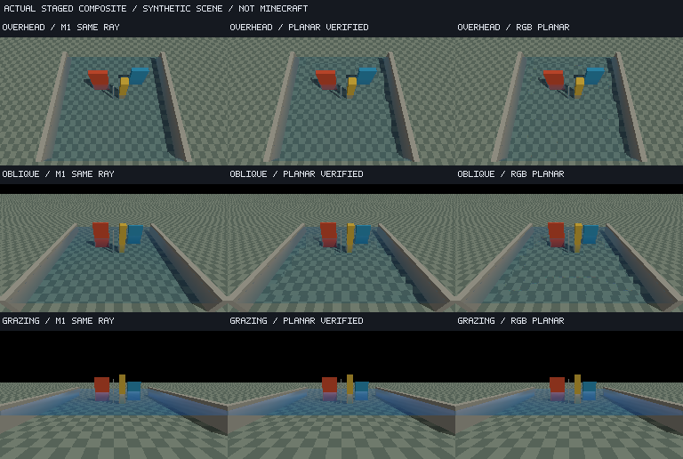

# 可信水平水池折射与正式流程迁移

普通折射档现在先证明局部水平水池，再用Snell定律解析求床面交点。无法证明时保留原来的同射线透光。选项仍然**默认关闭**。这是有明确缺失数据回退的屏幕空间光学，没有添加隐藏几何或硬件光追。

## 流程与既有效果

| 程序 | 工作 | 输出与寿命 |
|---|---|---|
| `composite` | 水面之后检查水平床面与单层归属 | `colortex11 RGBA32F`，宽高各1/8，每帧重写 |
| `composite1` | 原水体透光、日月高光、局部／历史泡沫 | 原有`0`或`0,13,14`布局 |
| `composite2..5` | 原四个泛光程序 | 格式、公式和行为不变 |
| `final` | 原显示变换与调试 | 不变 |

迁移基线为`9b188fa96401c5108dc9c0a33830d69fb87eb968`。完整合成程序、四组泛光、水流、互动和泡沫历史都保留。11号避免要求逻辑16号支持，也不是同时写11个目标。生产阶段使用8个采样器，合成阶段多读1个；其他功能累加后仍需检查设备限制。

每个8×8块连同一像素边界检查100个像素：必须是单层有效水，没有覆盖物；最终深度属于水，雾前不透明颜色／深度／直射比例有效配对，且真正的**不透明水底**法线水平向上。重建水面／水底的高度跨度各不超过4毫米。输出保存两者的最小／最大高度；区间倒置表示无效，边界不完整则回退。这只能证明有限屏幕采样，不是不可见亚像素几何或封闭水体体积。

按Iris默认双侧缓冲计算，RGBA32F在1280×720约0.44MiB、1920×1080约0.99MiB。不读历史，每次执行都会写完整输出。实际Iris显存分配和翻转尚未观察。

## 档位与交点

- **0关：**原同射线透光。
- **1可信水平水池：**最多检查32个有效区块，再用Snell方向解析求交；失败直接保留同射线。
- **2水平池＋严格128：**先尝试同一路径，失败才用完整检查、带缓存的实验128步搜索。此档可能非常昂贵。
- **3 RGB水平水池：**采用三种IAPWS代表波长，仅走水平池路径，缺失颜色射线保留一致回退。

所有接受的交点仍需完整3×3深度／归属检查，并通过局部床面修正；修正必须留在已证明的终点像素内，且不超过0.25像素。真正目标的位置、法线、亮度与**目标端直射比例**进入双段透光。置信度不等于Fresnel。此前未通过全画面对照的临时平面优化没有合入。

斜坡、台阶、石块、岸边叠层、瀑布、玻璃与屏幕覆盖不全通常会使证明失败。掠视覆盖刻意保守；块边界和移动时的表现还需游戏观察。此迁移没有新增水下水线。

## 验证与成本

已通过当前源码／CPU检查：1,200个历史stage对照；改名后127个基线文件精确一致；1,296个完整折射关闭stage对照覆盖泡沫、高光、水流与互动；96组泡沫路由；128组水平池调度；完整原M0历史套件；原九个测试场景镜头。全部2,562组离线编译／链接通过。已安装Iris1.10.5的真实预处理器通过304个片元与512个设置组合。这些不代表Minecraft实机结果。

Intel Iris Xe／OpenGL3.3（驱动31.0.101.3962）原生验证通过。冻结着色器SHA256：`6387b86b651c2dd230ee2fc946cb587a1ed3e3cb8cd8357edf875e8ba9b7c234`。

| 保留证据 | 实际结果 |
|---|---|
| [全部驱动编译](validation/M3_PLANAR_PRODUCTION_compile.json) | 2,562组通过 |
| [真实生产与合成](validation/M3_PLANAR_PRODUCTION_GPU.json) | 96个独立高度区间，最大9.3923e−5米；11项拒绝控制；41×29非整除尺寸；真实RGBA16_UNORM法线输入 |
| 同一光学报告 | 53个独立Snell／透光样本，最大RGB误差6.5723e−6；82次目标比例区分；7项仅目标拒绝；9,216个精确关闭像素；0.5毫米／2毫米精确浅水回退 |
| [泡沫／历史](validation/M3_PLANAR_foam_regression.json) | 真实混合MRT、11项重置、平移／转动重投影与回读续帧通过 |
| [高光](validation/M3_PLANAR_glints_regression.json)、[改名泛光](validation/M3_PLANAR_bloom_regression.json) | 原生回归通过 |
| [普通／RGB加泡沫](validation/M3_PLANAR_foam_combined.json) | 折射改变3,678／3,680像素，泡沫各独立改变1,680，alpha精确保留 |

12个角度／深度场景覆盖18,432像素，alpha精确保留，四组全图无效输入保持原生。已目视检查真实捕获／小块证明／合成／最终显示对照图：普通折射在俯视14,709个水像素中改变9,537，斜看13,408中改变6,918，掠视5,309中改变48。俯视和斜看能看到棋盘床面位移，掠视大多回退。这是人工场景，不是Minecraft截图，也不证明移动稳定。




[旧隔离原型原始计时](validation/M3_PLANAR_PROTOTYPE_timing.json)保留其**不同的着色器摘要**。Intel Iris Xe在720p分别测得生产／合成中位数14.545544／12.183756毫秒，同射线基线2.274792毫秒；前两者相加减基线为24.454508毫秒额外成本，仍然昂贵。这是分别测量的绘制中位数，不是完整帧耗时、Minecraft帧率或当前累计源码的实测成本。每组保留预热6次后的25个样本。

## 复现

```text
python -B tools/validate.py --historical
python -B tools/compile_glsl.py --compiler <已安装的glslangValidator>
python -B tools/validate_iris_water.py --iris-jar <已安装Iris.jar> --slf4j-jar <已安装slf4j.jar>
python -B tools/validate_gpu.py --suite water-refraction --cxx <已安装g++.exe> --report docs/validation/NEW.json --debug-plate docs/validation/NEW.png
python -B tools/benchmark_water_refraction.py --cxx <已安装g++.exe> --report docs/validation/NEW_TIMING.json
```

生产计时从320×180→640×360→1280×720递增，随时保存已完成的分布，每个自有原生子进程90秒超时并可明确取消。计时时不要并行其他GPU验证。报告不会覆盖旧证据；所有临时数据仍在项目所在盘。

原始资料：[Iris执行顺序](https://shaders.properties/current/reference/programs/overview/)、[Iris缓冲尺寸与翻转](https://shaders.properties/current/reference/shadersproperties/rendering/)、[PBRT Snell／Fresnel](https://pbr-book.org/4ed/Reflection_Models/Specular_Reflection_and_Transmission)、[IAPWS折射率](https://iapws.org/documents/release/Rindex.download)。

在包含水下视窗和焦散程序的累计版本上，1280 × 720 满屏水池的分块检查耗时 **11.411 毫秒**，普通折射合成 **13.010 毫秒**，不开折射的同射线合成 **2.094 毫秒**。两次独立测量的中位数相加约 **24.421 毫秒**，相对同射线路径多 **22.327 毫秒**。因此海岸档保持折射关闭。把一处已知水平床面的原始法线改为侧向，会使对应分块失效，严格法与平面法在选定像素上相差约 0.00000242 线性 RGB；固定求解方式单独改变源像素的直接光，两次结果完全相同。 [GPU timing](validation/WATER_FAST_REFRACTION_TIMING.json) · [Captured views](validation/WATER_FAST_REFRACTION_views.png).

焦散取样跟随折射光线在水底的实际终点。场景里只把该终点的直接光份额设为零，打开和关闭焦散的 HDR 存储值逐位相同；全精度诊断相差一个浮点末位。[交叉验证](validation/WATER_PLANAR_CAUSTICS_GPU.json)
