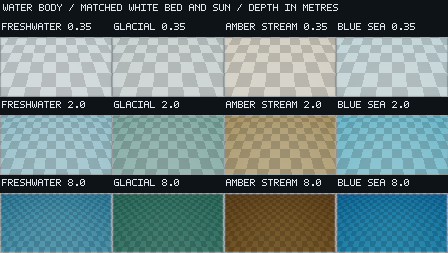

# 选水的颜色与画质

**想直接看 AuroraShader 的水，先在光影设置首页选择「水面 / 海岸（中）」。** 这个档位开启水体吸收、浅岸泡沫、流动、雨纹、接触涟漪与日月高光。水面菜单里的「水体色调」决定水如何吃掉和散射不同颜色的光。切换画质会保留这个选择。

图中每行保持同一个视角、同样的白色水底和阳光强度。三行水深分别为 0.35、2 和 8 米。从左到右依次是清澈淡水、冰川青、琥珀林溪、深蓝海水。浅水主要保留水底颜色。随着光在水中走的距离增加，林溪的蓝光衰减更快，海水的红光衰减更快，颜色差异才明显。

四种水体采用以米为单位的吸收和散射系数。它们是供美术调节的材质；目前的选择作用于整个世界。清澈度用来缩放衰减距离。颜色来自线性光照运算，画面最后才做显示映射。

| 画质 | 用来观察 |
|---|---|
| 轻量 | 简化波纹和天空倒影 |
| 海岸（中） | 雨滴、水流、船边或玩家触水后的涟漪、浪尖和浅岸泡沫 |
| 倒影（高） | 树木、岸壁等已在画面中出现的物体映入水面 |
| 焦散（极致） | 太阳照到的水底光斑和逐渐消散的泡沫；高档位对显卡要求更高 |

这组图使用实际合成和显示着色器，由 Intel Iris Xe 在固定输入上绘制。每个像素都与独立的双程吸收与散射计算对照，总计 80,640 个像素。[颜色与深度数据](validation/WATER_MATERIALS_GPU.json) · [七个预设的显卡编译记录](validation/WATER_PROFILES_GPU.json)

## 读懂画质和耗时

以下为 Intel Iris Xe 的固定输入测量，计时区间只包含列出的 GPU 绘制。水覆盖了大部分或全部测试画面。实际存档的分辨率、水面占屏比例、模组和其他绘制都会影响一帧的总耗时。

| 已测配置 | 分辨率 | GPU 中位耗时 |
|---|---|---|
| 基础双程吸收与散射 | 1280 × 720 | 2.50 ms |
| 64 步屏幕反射，无空区跳过 | 1280 × 720 | 32.78 ms |
| 同场景，启用空区跳过 | 1280 × 720 | 粗深度 1.47 ms，合成 16.27 ms |
| 阴影空间焦散，2048² 阴影图 | 512 × 288 | 合成由 0.42 升至 3.28 ms |

60 帧每秒给整帧留下约 16.7 ms，所以海岸档保留水面运动和真实的受光变化，把场景反射留给高档。恒定的颜色参数由着色器编译器选择，四种水体共用同一套纹理和渲染阶段。上表中的基础吸收测量早于泡沫和日月高光，海岸档完整帧耗时仍需要在游戏中测量。

[基础水体计时](validation/WATER_M1_timing_720p.json) · [反射空区跳过计时](validation/WATER_M2_BOUNDS_720p.json) · [焦散计时](validation/WATER_CAUSTICS_TIMING.json)
