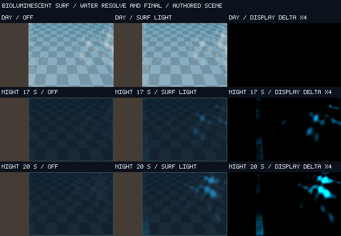

# 夜光浪花

在「水面 → 水上和水底光照」开启「夜光浪花」，并选择本地或跨帧泡沫。日落后，海浪在浅岸卷起或浪峰受到挤压时，会出现蓝绿色亮纹。日间仍使用普通泡沫。这个选项让 AuroraShader 的夜海有自己的色彩，四种水体都能独立开启。

## 哪一部分会亮

泡沫系统先确定哪些像素属于可见水面，并计算被浪花覆盖的比例。夜光在这些像素内根据波面材质点的实际速度、随波移动的纹理和太阳高度渐变；天空光很低的地方会淡出。在这里，泡沫是水体受到扰动的可见线索。岩壁、平静的水底和整片天空不会被当作发光源。

亮度在线性 HDR 中加入，然后经过原有的水面到相机的雾、当帧泛光与色调映射。它是表面发光。周围方块受到的照明仍由 Minecraft 的场景光照计算。设计灵感来自夜间受波浪扰动时发蓝光的浮游生物。[斯克里普斯海洋研究所的夜光浪花说明](https://scripps.ucsd.edu/news/red-tides-and-bioluminescence)

图的三列依次是关闭、开启、显示差异放大四倍。图像使用实际水面合成和最终显示程序，岸边与水底是固定几何测试输入。关闭泡沫、冻结波形和完全失去天空光的场景也分别检查了开关结果。[显卡逐像素记录](validation/WATER_SURF_GLOW_GPU.json)
