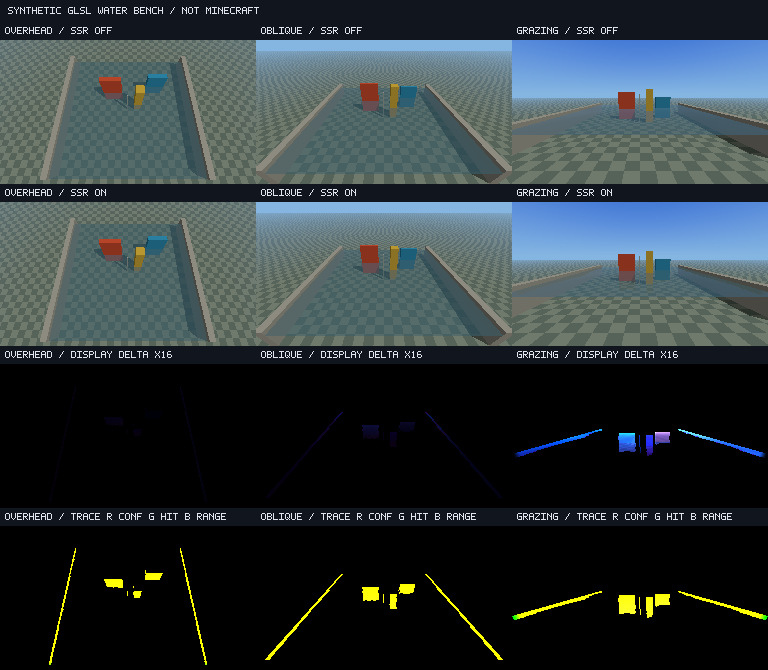

# W3 synthetic water visual bench

This is authored analytic geometry rendered with actual Aurora GLSL helpers.
It is **not Minecraft or Iris imagery**, a physical-water reference or a performance measurement.

- Columns: overhead 70, oblique 35, grazing 10 degrees downward pitch (20/55/80 from water normal).
- Rows: SSR off; SSR on; absolute display-space difference magnified 16x; trace diagnostics.
- Diagnostic channels: red = confidence, green = valid hit, blue = hit distance / 64.
- Each panel is 256x144, daylight, default controls, 64 steps, constant source alpha 0.55.
- Vertical FOV is 70 degrees, near/far planes 0.05/128, fixed wave time 17 seconds, world water level 64.
- Every surviving water fragment must match the independent CPU mask; off-water display pixels must remain exactly unchanged.
- An independent CPU scene supplies colored AABBs, a checker floor, paired FP16 color and R32F depth. No Minecraft textures or imported imagery are used.
- Water has true perspective raster depth and real derivatives before the analytic coverage mask.
- Native GLSL runs actual water style, late fog, tone mapping, display encoding and grading.
- Source-alpha RGB arithmetic is explicit over the background; actual OpenGL blending, Minecraft transparent sorting and Iris buffer flipping are not tested.
- Analytic sky fallback does not include actual aurora, glow, discs or clouds. Reflected-segment fog and physical water composition remain absent.
- The JSON report records exact shader/script digests, GPU identity and pixel counts; no frame-time/FPS number is reported.

Source: [render_water_bench.py](../../../tools/render_water_bench.py).
To reproduce from the repository, run Python with -B tools/render_water_bench.py,
--expect-shader-sha256 set to report.json's shader_sha256, and --output pointing
to a new docs/validation/W3_visual-prefixed directory. Existing output is never overwritten.
The source, native build and temporary files remain on D:.
